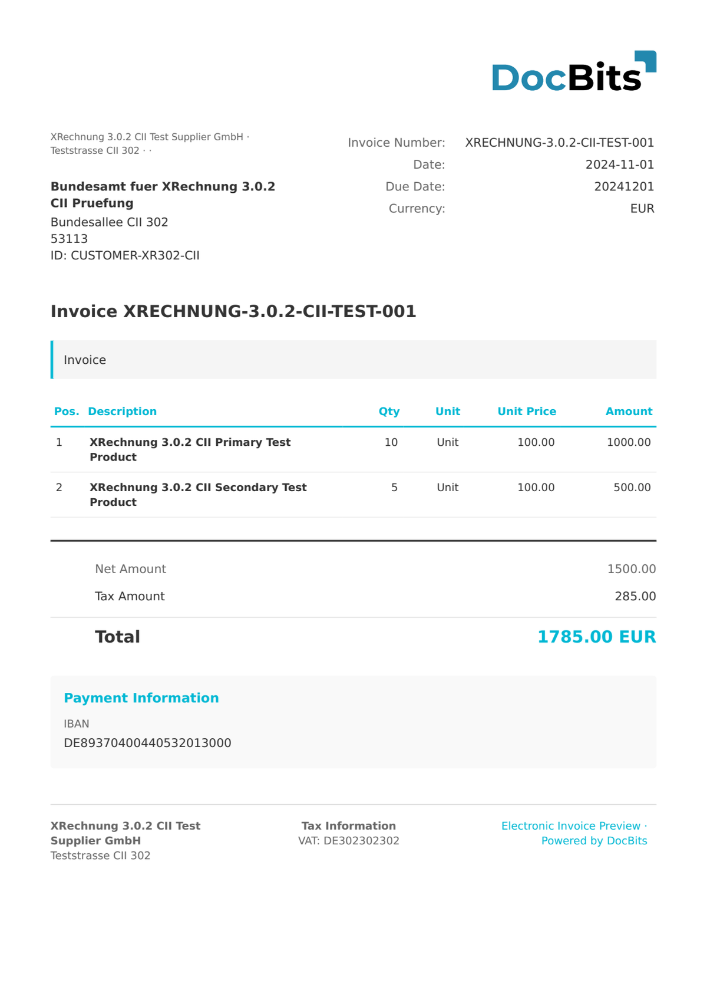

# 🇩🇪 XRECHNUNG 2.1 CII

| Eigenschaft       | Wert                                        |
| ----------------- | ------------------------------------------- |
| **Land / Region** | Deutschland                                 |
| **Dokumenttypen** | Rechnung, Gutschrift                        |
| **Format**        | CII                                         |
| **Standard**      | XRechnung 2.1                               |
| **Basiert auf**   | EN 16931 (UN/CEFACT Cross Industry Invoice) |

XRechnung 2.1 setzt den EN 16931 Core Invoice Standard mit den deutschen CIUS-Erweiterungen (Core Invoice Usage Specification) um. Diese Version brachte eine verbesserte Validierung mit erweiterten Schematron-Regeln und strengeren Konformitätsprüfungen.

## Unterstützungsstatus

| Komponente     | Status        |
| -------------- | ------------- |
| Vorschau       | ✅ Unterstützt |
| Feldextraktion | ✅ Unterstützt |
| Transformation | ✅ Unterstützt |

## Standard-Vorschau

<figure><figcaption>
Standard-Vorschau von DocBits für eine deutsche XRechnung 2.1 CII-Rechnung
</figcaption></figure>

## Verwandte Themen

* [XRechnung-Konfiguration](../xrechnung/)
* [XRechnung-Feldzuordnung](../xrechnung/mapping-xrechnung-in-docbits/)
* [Unterstützte elektronische Dokumente](./)
