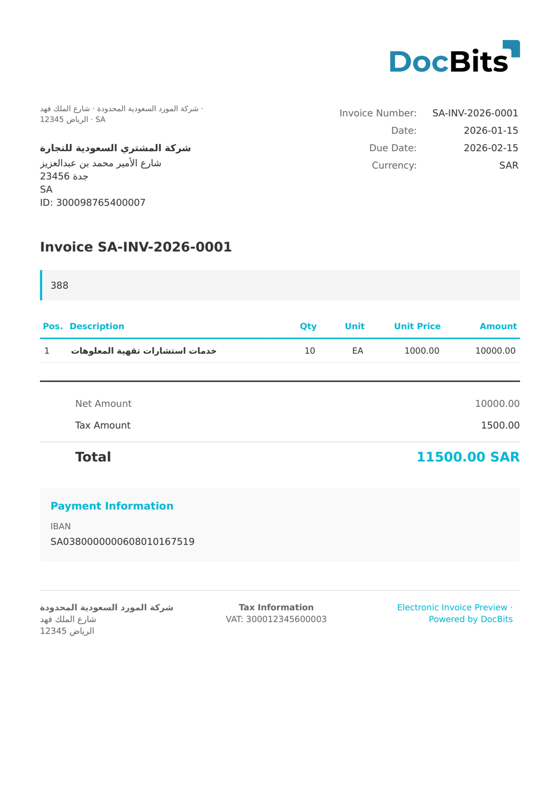

# 🇸🇦 ZATCA FATOORAH

<!-- edocs-country-scope -->


Die Länderanleitung enthält Versionsgrenzen, die tatsächlich verwendete Konfiguration und das Erklärvideo zum Land. [Saudi-Arabien](countries/saudi-arabia.md). Diese Bezeichnungen beschreiben unterschiedliche Prozesse und Rechnungsvarianten. Das Einlesen belegt keine Signierung, Freigabe oder Meldung über ZATCA.


| Eigenschaft       | Wert                                                      |
| ----------------- | --------------------------------------------------------- |
| **Land / Region** | Saudi-Arabien                                             |
| **Dokumenttypen** | Rechnung (Fatoorah)                                       |
| **Format**        | UBL 2.1 XML                                               |
| **Standard**      | ZATCA FATOORAH (ZATCA - Zakat, Tax and Customs Authority) |

ZATCA Fatoorah ist der saudi-arabische Standard für die elektronische Rechnungsstellung, betrieben von der Zakat, Tax and Customs Authority. Phase 1 (Generierung) wurde im Dezember 2022 verpflichtend, Phase 2 (Integration) erfordert die Echtzeit-Meldung an die ZATCA-Plattform. Fatoorah ist das Standardformat für Steuerrechnungen im B2B-Geschäft bei Beträgen über 1.000 SAR.

## Unterstützungsstatus

| Komponente     | Status        |
| -------------- | ------------- |
| Vorschau       | ✅ Unterstützt |
| Feldextraktion | ✅ Unterstützt |
| Transformation | ✅ Unterstützt |

## Standard-Vorschau

<figure><figcaption>
Standard-Vorschau von DocBits für eine ZATCA-Fatoorah-Rechnung
</figcaption></figure>

## Verwandte Themen

* [Unterstützte elektronische Dokumente](./)
* [ZATCA REPORTING](zatca-reporting.md)
* [ZATCA SIMPLIFIED](zatca-simplified.md)
* [ZATCA TAX INVOICE](zatca-tax-invoice.md)
