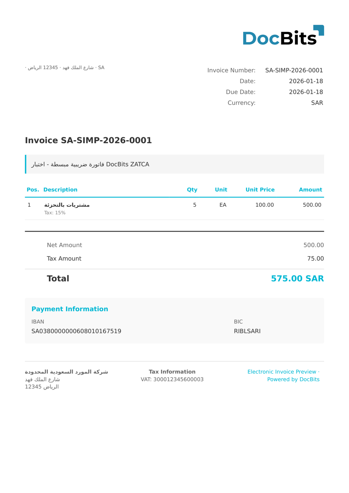

# 🇸🇦 ZATCA SIMPLIFIED

| Eigenschaft       | Wert                         |
| ----------------- | ---------------------------- |
| **Land / Region** | Saudi-Arabien                |
| **Dokumenttypen** | Vereinfachte Steuerrechnung  |
| **Format**        | UBL 2.1 XML                  |
| **Standard**      | ZATCA Simplified Tax Invoice |

Die ZATCA Simplified Tax Invoice (vereinfachte Steuerrechnung) wird für B2C-Transaktionen in Saudi-Arabien verwendet, bei denen der Gesamtbetrag (einschließlich MwSt.) 1.000 SAR nicht übersteigt. Im Gegensatz zu Standard-Steuerrechnungen ist keine Identifizierung des Käufers erforderlich, es muss jedoch ein QR-Code mit den TLV-kodierten Verkäuferdaten, dem MwSt.-Betrag und dem Zeitstempel enthalten sein.

## Unterstützungsstatus

| Komponente     | Status        |
| -------------- | ------------- |
| Vorschau       | ✅ Unterstützt |
| Feldextraktion | ✅ Unterstützt |
| Transformation | ✅ Unterstützt |

## Standard-Vorschau

<figure><figcaption>
Standard-Vorschau von DocBits für eine saudi-arabische ZATCA-Simplified-Rechnung
</figcaption></figure>

## Verwandte Themen

* [Unterstützte elektronische Dokumente](./)
