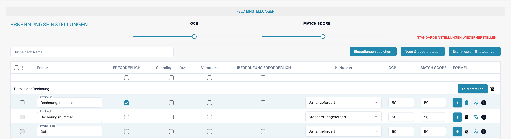

# Felder

Felder bestimmen, welche Daten ein Dokumenttyp erfasst und wie diese geprüft werden. Öffnen Sie den Dokumenttyp in den Einstellungen und anschließend seine Felder.

<figure><figcaption>
Deutsche Feldübersicht für den Dokumenttyp Rechnung.
</figcaption></figure>

## Eigenschaften und Erkennung

* **Pflichtfeld** verlangt einen Wert für die Validierung.
* **Schreibgeschützt** verhindert die Bearbeitung; **Ausgeblendet** entfernt das Feld aus der üblichen Ansicht.
* **Validierung erzwingen** verlangt eine ausdrückliche Prüfung des Feldes. Diese Option erstellt keine Vergleichsregel und keinen regulären Ausdruck; benutzerdefinierte Validierungsregeln werden gesondert eingerichtet.
* **OCR** legt einen numerischen Schwellenwert für die Erkennungssicherheit fest. Dies ist kein Schalter zum Aktivieren von OCR.
* **Abgleichswert** legt einen numerischen Schwellenwert für die Übereinstimmung fest. Dies ist weder ein Referenztext noch eine Werteliste.
* Die Option für **KI** steuert die angeforderte Extraktion des Feldes.

Suchen Sie das Feld nach seinem Namen und prüfen Sie die entsprechende Zeile vor einer Änderung. Sie können Gruppen ordnen, Felder hinzufügen und Optionen für Formeln oder Stammdaten öffnen. Verfügbare Aktionen hängen vom Feld und Ihren Rechten ab; das Löschen von Standardfeldern kann eingeschränkt sein.

Speichern Sie nur beabsichtigte Änderungen und prüfen Sie die Validierung mit repräsentativen Dokumenten. Die Bilder belegen keine gespeicherten Änderungen.

Siehe [Feldeigenschaften](configuring-field-properties-1.md), [Validierung und Match Score](setting-validation-and-match-score.md) und [Felder mit Zusatzkosten](new-fields-with-charges.md).
