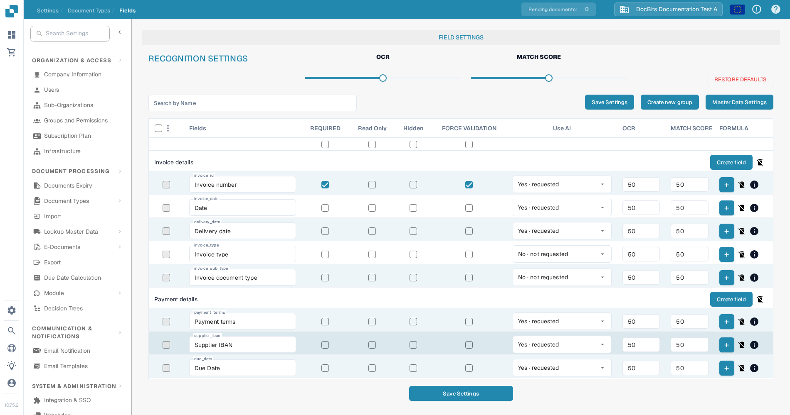
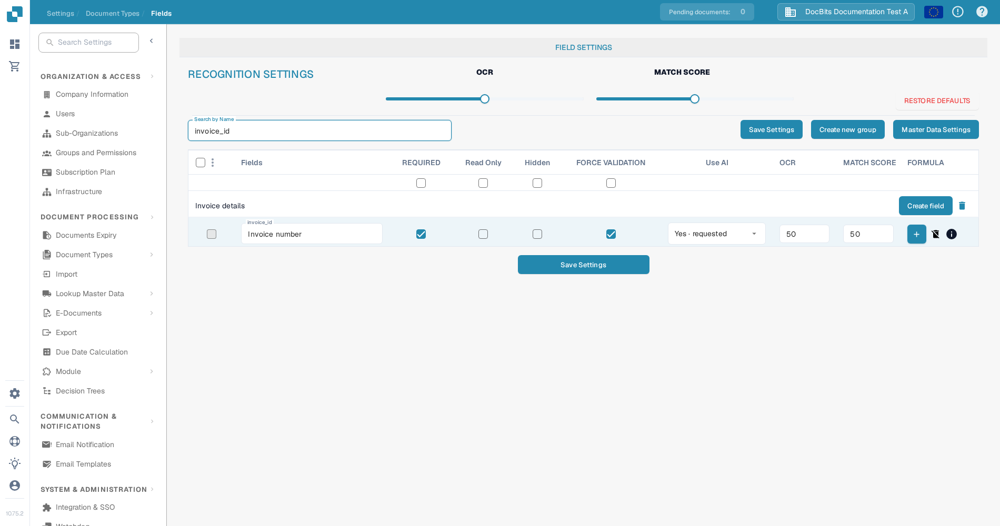

# Feldeigenschaften konfigurieren

Verwenden Sie **Settings → Document Types → Fields**, um zu steuern, wie sich Felder für einen Dokumenttyp verhalten. Wählen Sie zuerst den Dokumenttyp aus; das folgende Beispiel zeigt **Invoice** in der englischen Oberfläche.

<figure><figcaption>Invoice-Feldeinstellungen in einer DocBits-Sandbox-Organisation.</figcaption></figure>

## Ein Feld finden und seine Eigenschaften ändern

1. Geben Sie unter **Search by Name** den Feldnamen oder die Bezeichnung ein. Dadurch wird die Liste gefiltert; das Feld selbst wird nicht verändert.
2. Suchen Sie die Zeile des Feldes. **Invoice number** hat zum Beispiel den technischen Namen `invoice_id`.
3. Passen Sie die Steuerelemente in dieser Zeile an und wählen Sie dann **Save Settings**. Dieselbe Speichern-Schaltfläche steht oberhalb und unterhalb der Tabelle zur Verfügung.

<figure><figcaption>Die Zeile Invoice number nach der Suche nach `invoice_id`.</figcaption></figure>

| Steuerelement | Wofür es verwendet wird |
| --- | --- |
| **Required** | Markieren Sie Informationen, die für die Validierung vorhanden sein müssen. Prüfen Sie nach dieser Änderung das Validierungsergebnis des Dokuments. |
| **Read Only** | Zeigt ein Feld an, ohne dass Benutzer seinen Wert bearbeiten können. |
| **Hidden** | Blendet das Feld in der normalen Dokumentansicht aus. |
| **Force Validation** | Verlangt, dass das Feld die Validierung bestehen muss. Detaillierte Regeln konfigurieren Sie separat; dieses Kontrollkästchen ist kein Regel-Editor. |
| **Use AI** | Fordert die KI-Extraktion für dieses Feld an oder beendet sie. Die Zeile zeigt an, ob die Extraktion angefordert ist. |
| **OCR** | Geben Sie den OCR-Konfidenzschwellenwert des Feldes ein. Das ist eine Zahl, kein Ein/Aus-Schalter und keine Spracheinstellung. |
| **Match Score** | Geben Sie den Abgleichsschwellenwert des Feldes ein. Das ist eine Zahl, kein Ein/Aus-Schalter. |

Die Schieberegler **OCR** und **Match Score** unter **Recognition Settings** wenden Werte auf die gesamte Feldliste an. Die Kontrollkästchen direkt unter den Spaltentiteln wenden **Required**, **Read Only**, **Hidden** oder **Force Validation** auf die gesamte Liste an. Prüfen Sie die betroffenen Zeilen, bevor Sie **Save Settings** wählen. **Restore Defaults** setzt die Feldkonfiguration zurück; verwenden Sie die Funktion nur, wenn Sie Ihre Änderungen ersetzen möchten.

## Weitere Steuerelemente in dieser Ansicht

- **Create new group** und **Create field** fügen eine Gruppe oder ein Feld hinzu. Siehe [Felder hinzufügen und bearbeiten](adding-and-editing-fields.md).
- **Master Data Settings** öffnet die [Stammdaten-Konfiguration](master-data-settings.md).
- Die Kontrollkästchen ganz links wählen Felder aus. Das danebenliegende Menü bietet für die ausgewählten Felder **Reassign Field Group** an.
- Die Plus-Schaltfläche **Formula** öffnet den Formel-Editor für das jeweilige Feld. Das **info**-Symbol zeigt Feldinformationen an. Das Löschen-Symbol ist für Standardfelder nicht verfügbar.

Weitere Informationen zu Validierung und Abgleich finden Sie unter [Validierung und Match Score festlegen](setting-validation-and-match-score.md).
