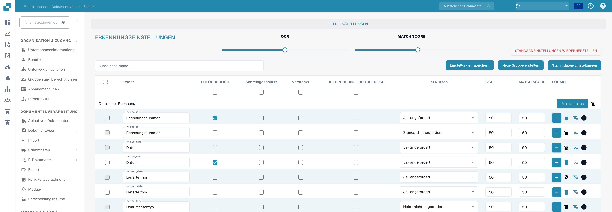
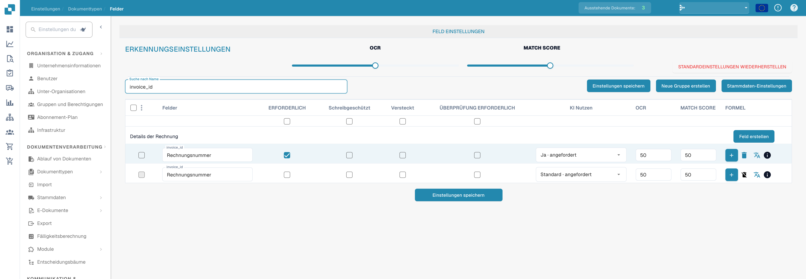

# Feldeigenschaften konfigurieren

Öffnen Sie **Einstellungen → Dokumenttypen → Felder** und wählen Sie den Dokumenttyp. Die Bilder zeigen Rechnungsfelder in der deutschen Oberfläche; technische Bezeichner wie `invoice_id` bleiben unverändert.

<figure><figcaption>
Deutsche Feldeinstellungen mit Pflichtfeld, Schreibschutz, Sichtbarkeit und Überprüfung.
</figcaption></figure>

## Ein Feld finden und seine Eigenschaften ändern

1. Geben Sie unter **Suche nach Name** den Feldnamen oder die Bezeichnung ein. Dadurch wird die Liste gefiltert; das Feld selbst wird nicht verändert.
2. Suchen Sie die Zeile des Feldes. **Rechnungsnummer** hat zum Beispiel den technischen Namen `invoice_id`.
3. Passen Sie die Steuerelemente in dieser Zeile an und wählen Sie dann **Einstellungen speichern**. Dieselbe Speichern-Schaltfläche steht oberhalb und unterhalb der Tabelle zur Verfügung.

<figure><figcaption>
Feldeinstellungen nach invoice_id gefiltert; OCR und Match Score bleiben sichtbar.
</figcaption></figure>

| Steuerelement | Wofür es verwendet wird |
| --- | --- |
| **Erforderlich** | Markieren Sie Informationen, die für die Validierung vorhanden sein müssen. Prüfen Sie nach dieser Änderung das Validierungsergebnis des Dokuments. |
| **Schreibgeschützt** | Zeigt ein Feld an, ohne dass Benutzer seinen Wert bearbeiten können. |
| **Versteckt** | Blendet das Feld in der normalen Dokumentansicht aus. |
| **Validierung erzwingen** | Verlangt eine ausdrückliche Prüfung des Feldes. Diese Option erstellt keine Vergleichsregel und keinen regulären Ausdruck; benutzerdefinierte Validierungsregeln werden gesondert eingerichtet. |
| **KI nutzen** | Fordert die KI-Extraktion für dieses Feld an oder beendet sie. Die Zeile zeigt an, ob die Extraktion angefordert ist. |
| **OCR** | Geben Sie den OCR-Konfidenzschwellenwert des Feldes ein. Das ist eine Zahl, kein Ein/Aus-Schalter und keine Spracheinstellung. |
| **Abgleichswert** | Geben Sie den Abgleichsschwellenwert des Feldes ein. Das ist eine Zahl, kein Ein/Aus-Schalter. |

Die Schieberegler **OCR** und **Abgleichswert** unter **Erkennungseinstellungen** wenden Werte auf die gesamte Feldliste an. Die Kontrollkästchen direkt unter den Spaltentiteln wenden **Erforderlich**, **Schreibgeschützt**, **Versteckt** oder **Validierung erzwingen** auf die gesamte Liste an. Prüfen Sie die betroffenen Zeilen, bevor Sie **Einstellungen speichern** wählen. **Standardwerte wiederherstellen** setzt die Feldkonfiguration zurück; verwenden Sie die Funktion nur, wenn Sie Ihre Änderungen ersetzen möchten.

## Weitere Steuerelemente in dieser Ansicht

- **Neue Gruppe erstellen** und **Feld erstellen** fügen eine Gruppe oder ein Feld hinzu. Siehe [Felder hinzufügen und bearbeiten](adding-and-editing-fields.md).
- **Stammdaten-Einstellungen** öffnet die [Stammdaten-Konfiguration](master-data-settings.md).
- Die Kontrollkästchen ganz links wählen Felder aus. Das danebenliegende Menü bietet für die ausgewählten Felder **Feldgruppe neu zuordnen** an.
- Die Plus-Schaltfläche **FORMEL** öffnet den Formel-Editor für das jeweilige Feld. Das **info**-Symbol zeigt Feldinformationen an. Das Löschen-Symbol ist für Standardfelder nicht verfügbar.

Weitere Informationen zu Validierung und Abgleich finden Sie unter [Validierung und Match Score festlegen](setting-validation-and-match-score.md).
