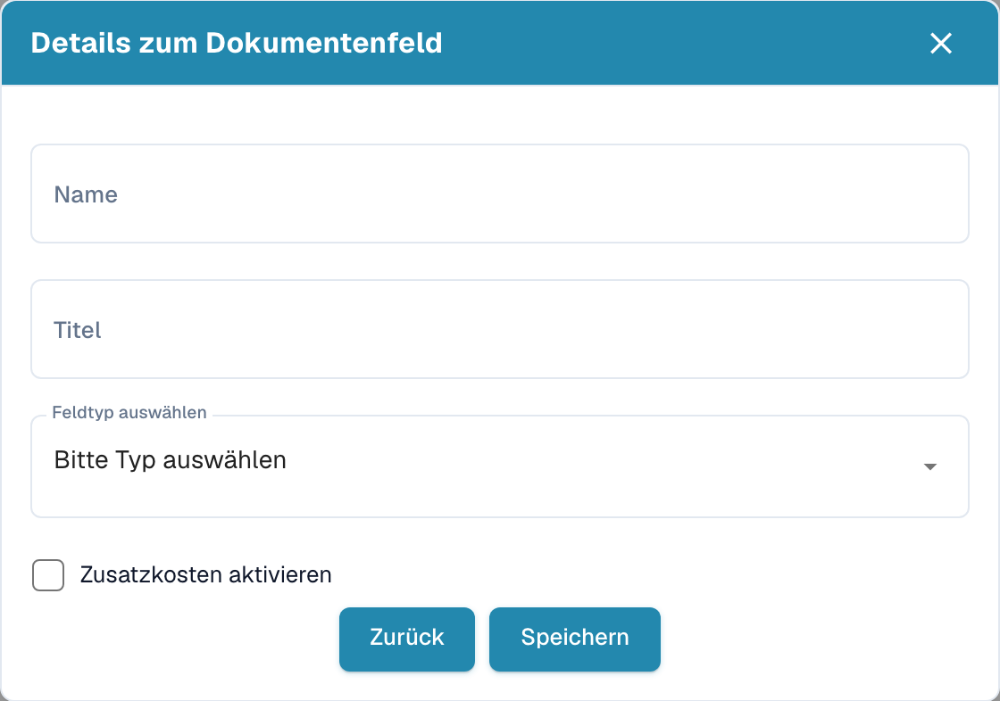
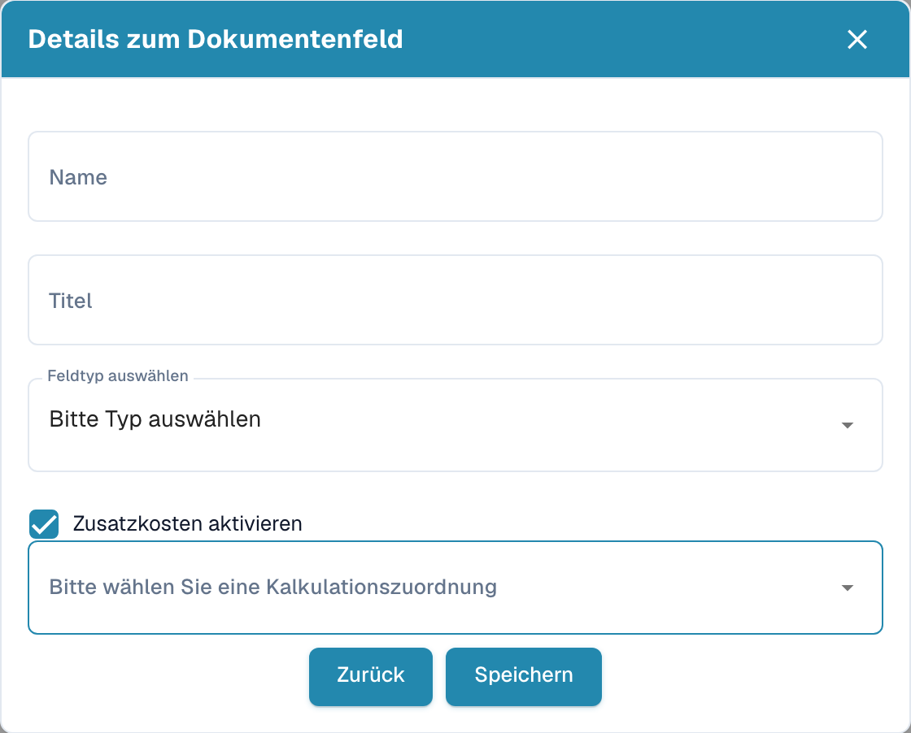

# Neue Felder mit Zusatzkosten

## Feldeinstellungen öffnen

Öffnen Sie **Einstellungen → Dokumenttypen**, wählen Sie den gewünschten Dokumenttyp und öffnen Sie **Felder**. Klicken Sie in der passenden Feldgruppe auf **Feld erstellen**.

<figure><figcaption>
Deutscher Dialog Details zum Dokumentenfeld vor dem Anlegen eines Feldes.
</figcaption></figure>

## Zusatzkosten zuordnen

1. Geben Sie im Dialog **Details zum Dokumentenfeld** einen technischen **Namen** und einen verständlichen **Titel** ein.
2. Wählen Sie unter **Feldtyp auswählen** den passenden Datentyp.
3. Aktivieren Sie **Zusatzkosten aktivieren**. Daraufhin erscheint die Auswahl **Bitte wählen Sie eine Kalkulationszuordnung**.
4. Wählen Sie die zu Ihren Zusatzkosten passende Zuordnung. Die verfügbaren Einträge hängen von Ihrer Konfiguration ab.

<figure><figcaption>
Ungespeicherter Feldentwurf mit aktivierter Option Zusatzkosten aktivieren.
</figcaption></figure>

Das Beispiel zeigt einen noch nicht gespeicherten Entwurf. Mit **Speichern** legen Sie das Feld an; **Zurück** führt aus dem Dialog zurück. Prüfen Sie anschließend in der Feldübersicht die Eigenschaften des neuen Feldes, beispielsweise **Erforderlich**, **OCR** und **Match Score**, und übernehmen Sie beabsichtigte Änderungen mit **Einstellungen speichern**.
