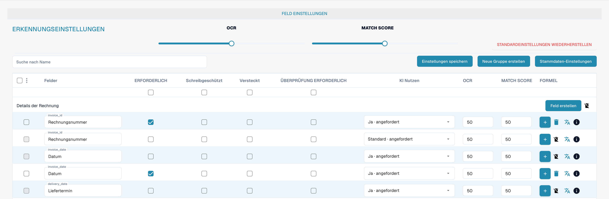
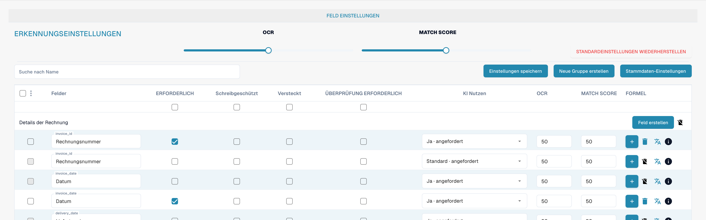
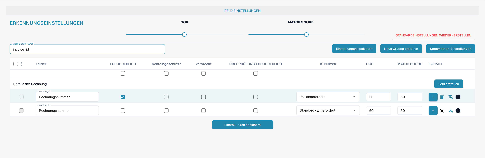

# Validierung und Match Score einstellen

Öffnen Sie **Einstellungen → Dokumenttypen → Felder** für den gewünschten Dokumenttyp. In der Feldübersicht stehen die Einstellungen **Überprüfung erforderlich**, **OCR** und **Abgleichswert** nebeneinander. Sie betreffen unterschiedliche Eigenschaften eines Feldes.

<figure><figcaption>
Feldeinstellungen mit den getrennten Spalten Überprüfung erforderlich, OCR und Match Score.
</figcaption></figure>

## Überprüfung erforderlich

Aktivieren Sie das Kontrollkästchen **Überprüfung erforderlich** für ein Feld, das bewusst manuell geprüft werden soll. Dies ist eine eigene Einstellung neben **Erforderlich**, **Schreibgeschützt** und **Versteckt**. Ein Pflichtfeld und eine erforderliche Überprüfung sind daher getrennt zu konfigurieren.

<figure><figcaption>
Übersicht der feldbezogenen Validierungs- und Erkennungseinstellungen.
</figcaption></figure>

## OCR und Match Score

Die Spalten **OCR** und **Abgleichswert** enthalten die feldbezogenen Schwellenwerte. Über die Suche können Sie beispielsweise `invoice_id` eingrenzen und die Werte für die Rechnungsnummer prüfen. **Abgleichswert** ist ein numerischer Schwellenwert; hier wird kein fester Referenztext und keine Option „Match Value“ eingetragen.

<figure><figcaption>
Gefilterte Rechnungsnummer mit den Einstellungen zur Überprüfung und zum Match Score.
</figcaption></figure>

Legen Sie Schwellenwerte anhand repräsentativer Dokumente fest. Prüfen Sie nach einer Änderung sowohl korrekt erkannte Werte als auch fehlerhafte oder unvollständige Eingaben. Übernehmen Sie die gewünschten Änderungen mit **Einstellungen speichern**.
