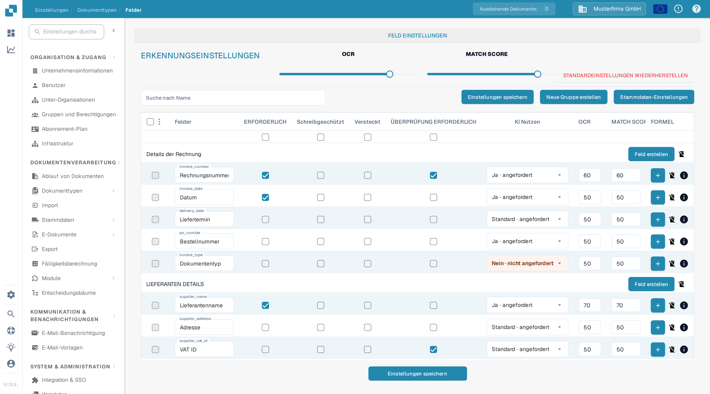
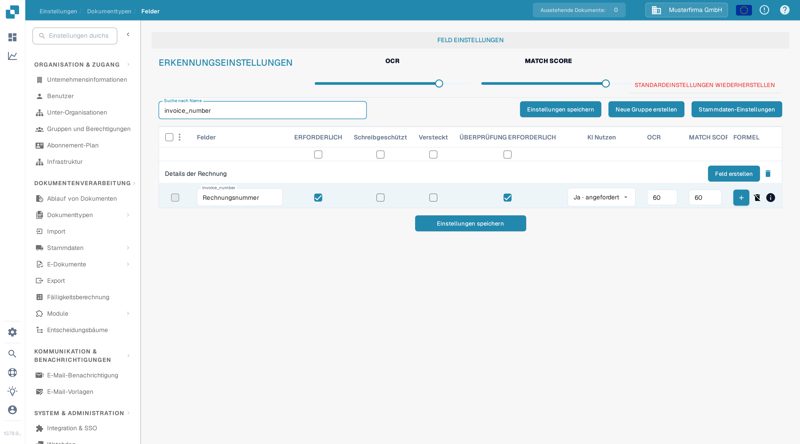

# Festlegen von Validierung und Match Score

In **Felder** können Sie Validierung und Erkennungsschwellenwerte für einen Dokumenttyp festlegen. Diese Seite verwendet **Rechnung** in einer Dokumentationstestorganisation. Sie erläutert das aktuelle Kontrollkästchen **ÜBERPRÜFUNG ERFORDERLICH** und die **Match Score**-Steuerung.

## Felder-Einstellungen öffnen

1. Gehen Sie zu **Einstellungen → Dokumenttypen → Rechnung → Felder**.
2. Verwenden Sie **Suche nach Name**, um ein Feld zu finden, zum Beispiel `invoice_number` (angezeigt als **Rechnungsnummer**).
3. Prüfen Sie die Feldzeile, bevor Sie eine Einstellung ändern. **ERFORDERLICH**, **Schreibgeschützt**, **Versteckt** und **ÜBERPRÜFUNG ERFORDERLICH** sind getrennte Kontrollkästchen.

<figure><figcaption>Die Erkennungssteuerungen stehen über der Feldliste.</figcaption></figure>

## ÜBERPRÜFUNG ERFORDERLICH (Force Validation)

Aktivieren Sie **ÜBERPRÜFUNG ERFORDERLICH** in der Feldzeile, um für dieses Feld eine strengere Validierung anzuwenden. Das Kontrollkästchen ist von **ERFORDERLICH** getrennt: Ein Feld als erforderlich zu markieren wählt ÜBERPRÜFUNG ERFORDERLICH nicht automatisch mit aus. Das Kontrollkästchen kann nicht verfügbar sein, wenn ein Feld ausgeblendet oder schreibgeschützt ist. Klicken Sie nach dem Ändern der Feldkonfiguration auf **Einstellungen speichern**.

Die alten Anweisungen schlugen vor, hier numerische Grenzwerte oder reguläre Ausdrücke einzugeben. Die aktuelle Felder-Tabelle zeigt in der Zelle ÜBERPRÜFUNG ERFORDERLICH keinen Regeleditor. Für feldspezifische Regeln siehe [Konfigurieren von Feldeigenschaften](configuring-field-properties-1.md).

## Match Score

**Match Score** ist ein numerischer Schwellenwert, kein fester Referenzwert. Die Regler **OCR** und **MATCH SCORE** unter **ERKENNUNGSEINSTELLUNGEN** wenden ihren Wert auf die Feldzeilen des Dokumenttyps an; verwenden Sie das **MATCH SCORE**-Eingabefeld einer Feldzeile für einen einzelnen Wert. In der Testorganisation zeigen beide Regler **80**, die Zeile `invoice_number` zeigt **60**. Prüfen Sie die betroffenen Felder und klicken Sie dann auf **Einstellungen speichern**.

<figure><figcaption>Suchen Sie nach einem Feld, um sein Kontrollkästchen ÜBERPRÜFUNG ERFORDERLICH und seinen Match-Score-Wert zu prüfen.</figcaption></figure>

**OCR** ist ein separater Erkennungsschwellenwert neben dem Match Score. **STANDARDEINSTELLUNGEN WIEDERHERSTELLEN** setzt die Einstellungen zurück; verwenden Sie es nur, wenn Sie Ihre eigenen Schwellenwerte verwerfen möchten. Weitere Feldoptionen finden Sie in der [Felder-Übersicht](README.md).
