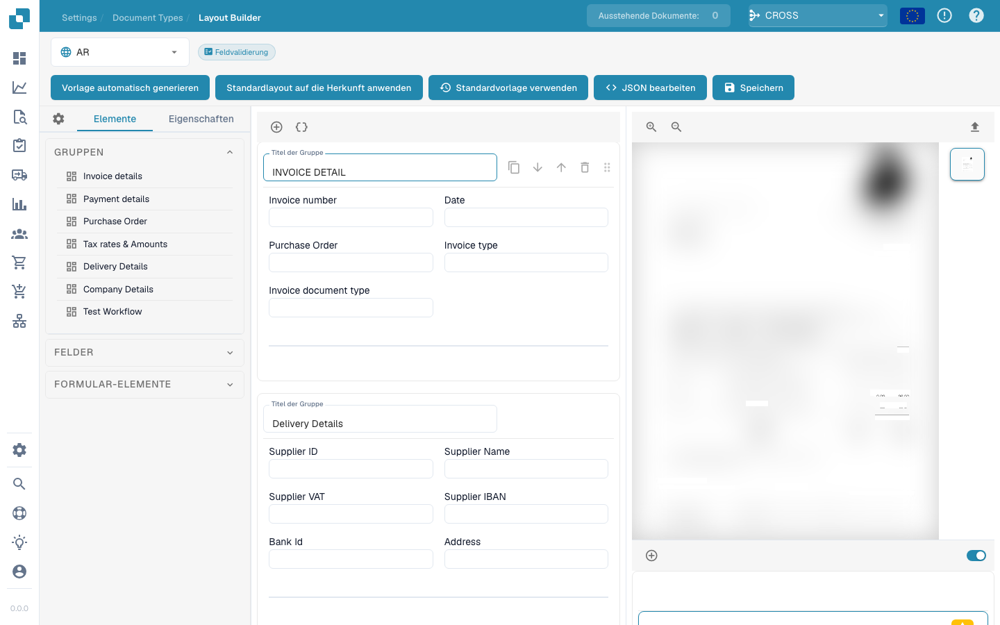

# Layout-Manager

<figure><figcaption></figcaption></figure>

#### Überblick

Mit dem Layout-Manager können Administratoren die Darstellung von Dokumenttypen visuell konfigurieren und ändern. Dazu legen sie Eigenschaften für Datenfelder und Gruppen fest. So lassen sich Extraktionsmodelle und manuelle Eingabefelder auf die Struktur der in DocBits gescannten oder hochgeladenen Dokumente abstimmen.

#### Hauptbestandteile

1. **Gruppen und Felder**:
   * **Gruppen**: Sie fassen zusammengehörige Felder innerhalb eines Dokumenttyps zusammen, beispielsweise Rechnungs- oder Zahlungsdetails. Gruppen lassen sich auf- und zuklappen sowie entsprechend der logischen Gliederung des Dokuments anordnen.
   * **Felder**: Einzelne Datenpunkte innerhalb einer Gruppe, beispielsweise Rechnungsnummer oder Zahlungsbedingungen. Für jedes Feld lässt sich festlegen, wie Daten erfasst, angezeigt und verarbeitet werden.
2. **Eigenschaftenbereich**:
   * Dieser Bereich zeigt die Eigenschaften des ausgewählten Felds oder der ausgewählten Gruppe und ermöglicht unter anderem folgende Einstellungen:
     * **Label**: Die sichtbare Feldbeschriftung in der Benutzeroberfläche.
     * **Field Name**: Der systeminterne technische Bezeichner.
     * **Element Width in Percentage**: Die Breite des Felds in Prozent der Layoutbreite.
     * **Tab Index**: Die Reihenfolge beim Navigieren mit der Tabulatortaste.
     * **Run Script on Change**: Legt fest, ob beim Ändern des Feldwerts ein Skript ausgeführt wird.
     * **Display Label On Left**: Legt fest, ob die Beschriftung links neben dem Feld oder darüber erscheint.
     * **Is Textarea**: Legt fest, ob das Feld ein mehrzeiliges Textfeld für längere Inhalte ist.
     * **Select Model Type**: Auswahl des Modelltyps, der dieses Feld extrahiert.
     * **Field Length**: Die maximal zulässige Länge des Feldinhalts.
     * **Banned Keywords**: Schlüsselwörter, die im Feld nicht zulässig sind.
3. **Vorlagenvorschau**:
   * Zeigt anhand der aktuellen Layoutkonfiguration in Echtzeit eine Vorschau des Dokuments. So können Sie die Übereinstimmung mit der tatsächlichen Dokumentstruktur prüfen und die Einstellungen für die Dokumentenverarbeitung verfeinern.



