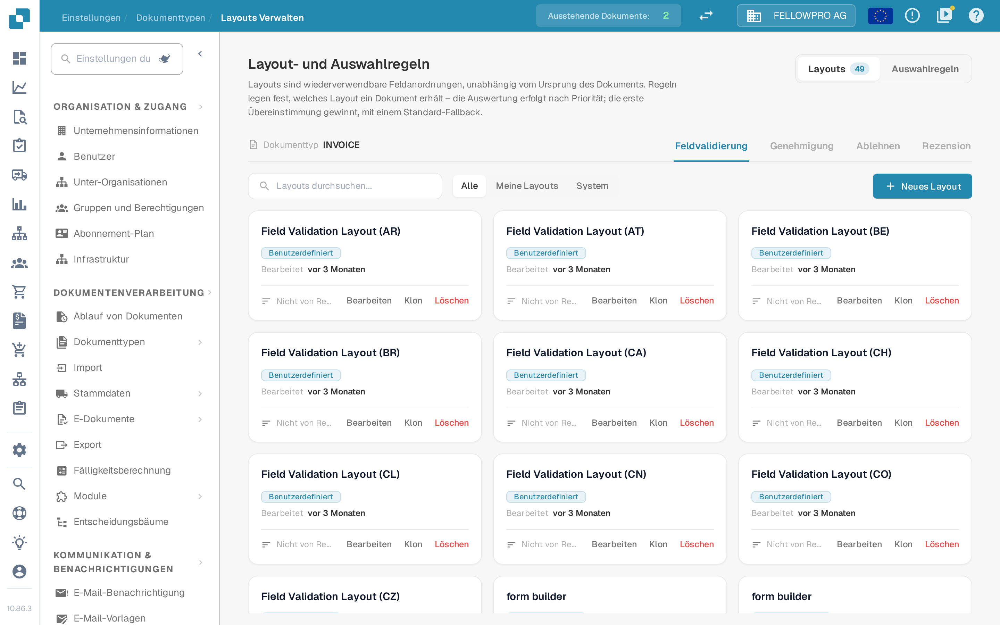

# Layout-Manager

<figure><figcaption>Der Layout-Manager für den Belegtyp Invoice.</figcaption></figure>

Der **Layout-Manager** bestimmt, wie ein Belegtyp für die Personen aussieht, die Belege validieren, genehmigen, ablehnen und prüfen: welche Felder und Gruppen auf dem Bildschirm erscheinen, in welcher Reihenfolge und wie sich jedes Feld verhält. Jeder Belegtyp hat seine eigenen Layouts.

Die Seite öffnet sich als **Layout- und Auswahlregeln**: Layouts sind wiederverwendbare Feldanordnungen, unabhängig vom Ursprung des Belegs, und Regeln legen fest, welches Layout ein Beleg erhält.

#### Bildschirme und Layouttypen

Validierung, Genehmigung, Ablehnung und Prüfung sind eigene Bildschirme, und jeder von ihnen hat eigene Layouts, eigene Regeln und ein eigenes Standardlayout – eine Genehmigungsregel ändert nie den Validierungsbildschirm. Mit den Reitern **Feldvalidierung**, **Genehmigung**, **Ablehnen** und **Rezension** wechseln Sie den Bildschirm.

#### Layout-Karten

Auf dem Reiter **Layouts** ist jedes Layout des gewählten Bildschirms eine Karte. Eine Karte zeigt den Layoutnamen, ob es zu Ihrer Organisation gehört (**Benutzerdefiniert**) oder das Systemstandard-Layout ist, wann es zuletzt bearbeitet wurde und ob eine Auswahlregel darauf verweist. **Bearbeiten** öffnet das Layout im Layout Builder, **Klon** kopiert es unter einem Namen Ihrer Wahl und **Löschen** entfernt es – das Systemstandard-Layout lässt sich nur ansehen, nicht ändern oder löschen. **Neues Layout** fragt nach einem Namen und öffnet den Layout Builder mit dem neuen, leeren Layout. Der Filter über den Karten wechselt zwischen **Alle**, **Meine Layouts** und **System**.

#### Der Layout Builder

**Bearbeiten** öffnet den [Layout Builder](navigating-the-layout-manager.md):

* **Struktur**, **Felder** und **Elemente** auf der linken Seite – das Layout als Baum, jedes Feld des Belegtyps mit einem Zähler der bereits platzierten Felder sowie die Gruppen und Formularelemente, die Sie auf die Arbeitsfläche ziehen können.
* Die **Arbeitsfläche** in der Mitte zeigt das Layout so, wie der Anwender es sieht. **Hauptlayout** und **Tabelle** wechseln zwischen der Seite und einer Positionstabelle, **Beleg** öffnet den Beispielbeleg daneben.
* Der Bereich **Eigenschaften** auf der rechten Seite folgt dem ausgewählten Element; seine Einstellungen sind in Anzeige, Verhalten, Werte und Listen, Automatisierung sowie Rahmen und Abstände gruppiert.

**Speichern** in der Kopfzeile sichert das Layout. Die übrigen Aktionen der Kopfzeile finden Sie unter [Änderungen speichern und anwenden](save-and-apply-changes.md).

#### Welches Layout ein Beleg erhält

Der Reiter **Auswahlregeln** jedes Bildschirms enthält die Regeln, die das Layout bestimmen; die Auswertung erfolgt nach Priorität, die erste Übereinstimmung gewinnt, und ein Standard-Fallback greift, wenn keine Regel passt. Siehe [Layout-Auswahlregeln](layout-selection-rules.md).

#### Verwandte Seiten

* [Zweck und Verwendung](purpose-and-use.md)
* [Navigieren im Layout-Manager](navigating-the-layout-manager.md)
* [Konfigurieren von Feldeigenschaften](configuring-field-properties.md)
* [Verwendung der Vorlagenvorschau](using-the-template-preview.md)
* [Änderungen speichern und anwenden](save-and-apply-changes.md)
* [Layout-Auswahlregeln](layout-selection-rules.md)
* [Bewährte Vorgehensweisen](best-practices.md)
* [Fehlerbehebung](troubleshooting.md)
