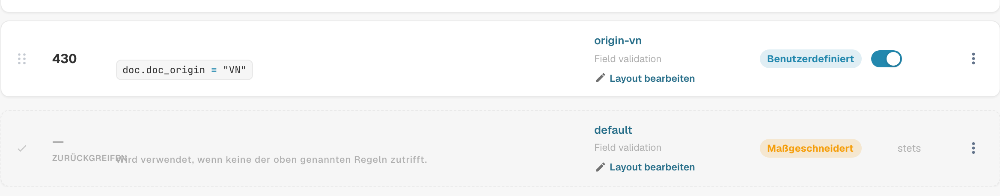
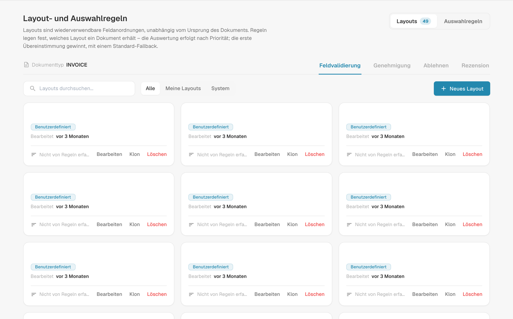
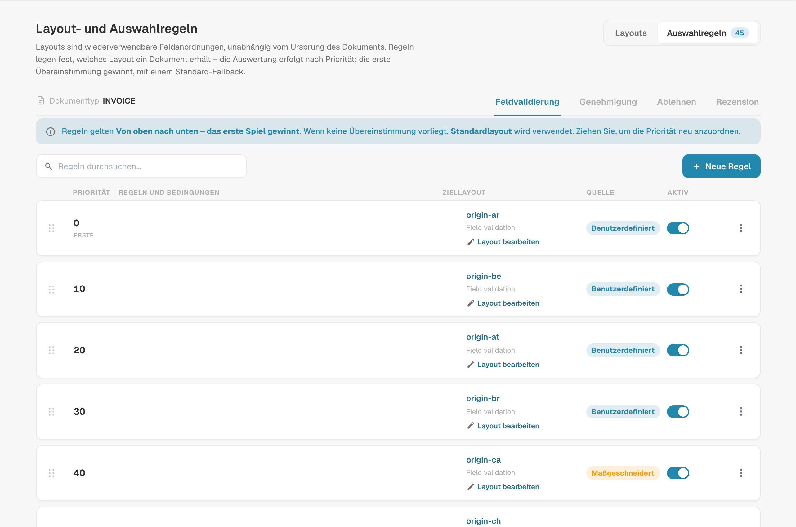
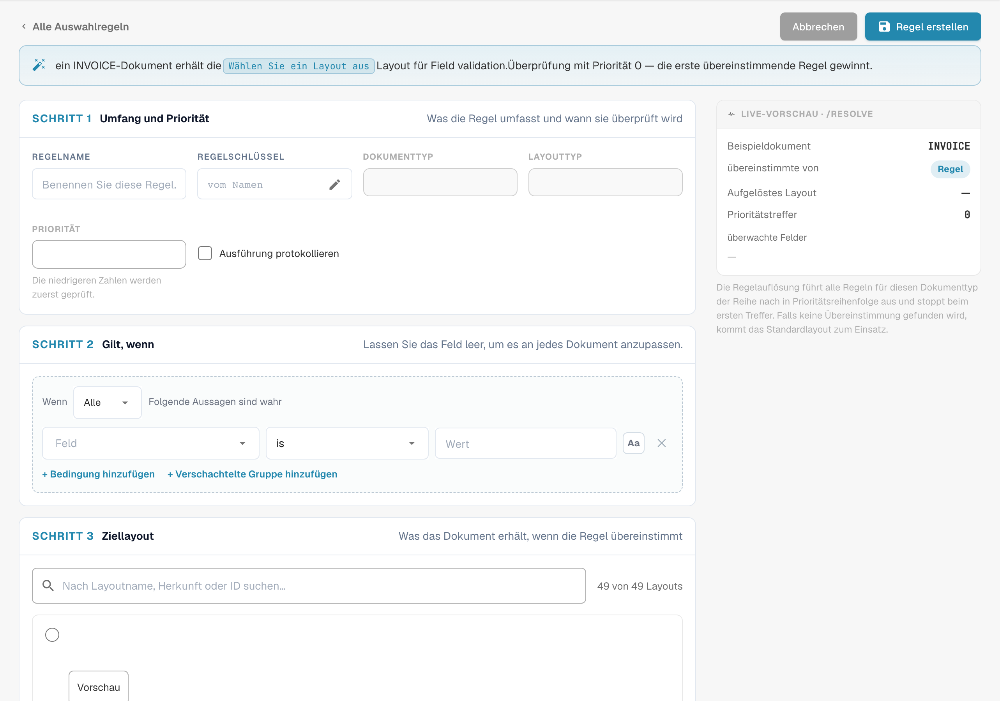
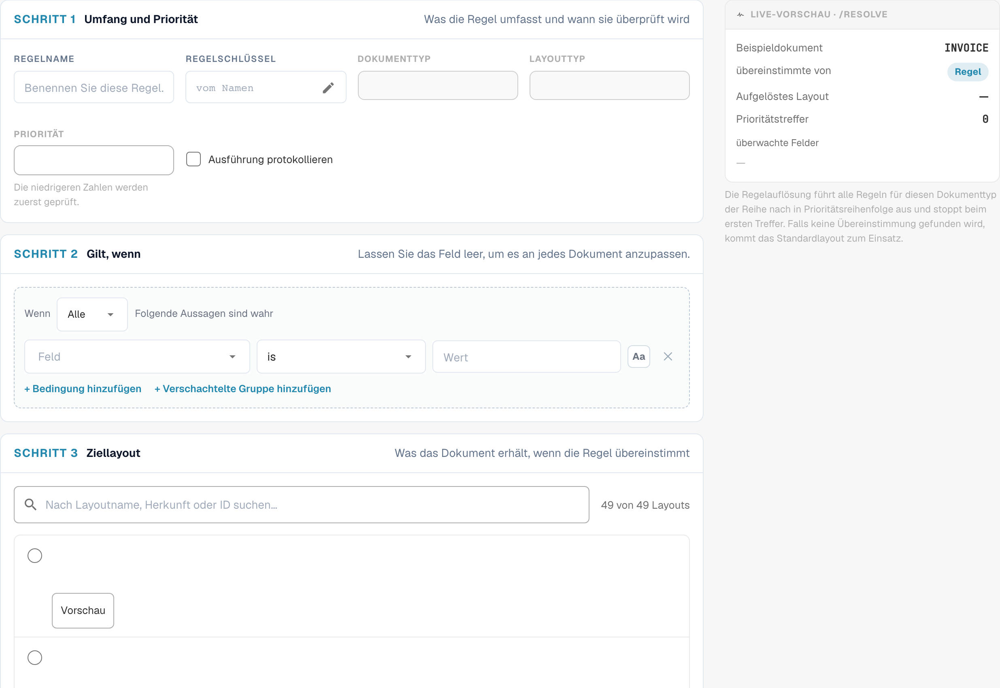

# Layout-Auswahlregeln

## Überblick

Ein **Layout** legt fest, welche Felder und Gruppen ein Benutzer auf den Bildschirmen **Validierung**, **Genehmigung**, **Ablehnung** und **Prüfung** eines Dokuments sieht – und in welcher Reihenfolge. Layouts gestalten Sie im [Layout-Manager](README.md).

Klassisch wählte DocBits das Layout anhand der **Herkunft** des Dokuments: dem Land bzw. der Region aus den Spracheinstellungen des Dokuments, etwa `DE` oder `US`. Jede Herkunft hatte ihre eigene Kopie des Layouts, und nichts anderes konnte die Auswahl beeinflussen.

Mit **Layout-Auswahlregeln** werden Layouts zu wiederverwendbaren Bausteinen, die von der Herkunft unabhängig sind, und **Regeln** entscheiden, welches Layout ein Dokument erhält:

> *Wenn* das Dokument eine Bedingung erfüllt, *dann* erhält es dieses Layout. Die Regeln werden von oben nach unten geprüft; **die erste passende Regel gewinnt**. Passt keine Regel, wird das **Standardlayout** verwendet.

Die Herkunft steht weiterhin zur Verfügung – als eine Bedingung unter vielen. Eine Regel kann genauso gut den Lieferanten, den Betrag, den Dokumentstatus, die Extraktionsmethode oder ein beliebiges Kopffeld auswerten.

### Probleme, die sie lösen

| Anforderung | Klassische herkunftsbasierte Layouts | Mit Auswahlregeln |
| --- | --- | --- |
| Die Rechnungen eines Lieferanten benötigen zusätzliche Felder (Projekt, Zollnummer) | ohne neue Herkunft nicht möglich | Regel *Supplier ID is 20723* → Layout „Rechnung mit Projektfeldern“ |
| DE-, AT- und CH-Dokumente sollen gleich aussehen | drei Kopien desselben Layouts, die gepflegt werden müssen | ein Layout, eine Regel pro Herkunft (oder eine ANY-Gruppe), die darauf verweist |
| E-Rechnungen benötigen einen einfacheren Bildschirm als gescannte PDFs | nicht möglich | Regel *Extraction Method is ELECTRONIC_DOCUMENT* → Layout „E-Rechnung“ |
| Rechnungen mit hohem Wert benötigen mehr Felder auf dem Genehmigungsbildschirm | nicht möglich | Approval-Regel *Total Amount greater than 10000* → Layout „Genehmigung hoher Beträge“ |
| Der zweite Genehmiger soll einen anderen Bildschirm sehen als der erste | eigener Layouttyp „zweite Genehmigung“ | Approval-Regel *Document Status is Pending second approval* → Layout „Zweite Genehmigung“ |

## Regelbasierte Layouts aktivieren

Regelbasierte Layouts werden **pro Dokumenttyp** von einem **Organisationsadministrator** eingeschaltet.

1. Gehen Sie zu **Einstellungen → Dokumenttypen**.
2. Klicken Sie auf das **Einstellungen**-Symbol (Zahnrad) auf der Karte des Dokumenttyps.
3. Öffnen Sie **Manage Layouts** und schalten Sie den Schalter ein.

<figure><figcaption>
Der Schalter Manage Layouts in den zusätzlichen Einstellungen eines Dokumenttyps
</figcaption></figure>

Der Link **Layouts** auf der Karte des Dokumenttyps öffnet nun **Layout- und Auswahlregeln**.

### Was beim Einschalten passiert

DocBits wandelt Ihre vorhandenen herkunftsbasierten Layouts einmalig in Regeln um – für diesen Dokumenttyp und für jeden Bildschirm:

* Das Layout der Herkunft **DEFAULT** wird zum **Standardlayout** (dem Fallback).
* Jedes Layout einer bestimmten Herkunft wird zu einer Regel **„Layout for XX“** mit der Bedingung *Document Origin is XX*, die auf dieses Layout verweist. Diese Regeln erhalten Prioritäten in Zehnerschritten (zum Beispiel 2000, 2010, 2020 …), sodass Sie eigene Regeln davor, dazwischen oder danach einordnen können.

<figure><figcaption>
Standardlayout am Ende der Layout-Auswahlregeln.
</figcaption></figure>

Es wird nichts gelöscht oder an den Layouts selbst geändert. Unmittelbar nach der Aktivierung erhält daher jedes Dokument genau das Layout, das es auch vorher erhalten hat. Erst wenn Sie Regeln hinzufügen oder ändern, ändert sich das Verhalten.

**Beim Ausschalten** kehrt der Dokumenttyp sofort zur herkunftsbasierten Auswahl zurück. Die Regeln bleiben erhalten, werden aber nicht verwendet, und sie wirken wieder, sobald Sie den Schalter erneut einschalten.

## Der Bildschirm „Layouts & Selection Rules“

<figure><figcaption>
Layoutübersicht mit den Registerkarten Layouts und Auswahlregeln.
</figcaption></figure>

* **Layouts / Auswahlregeln** (oben rechts) wechseln zwischen der Liste der Layouts und der Liste der Regeln. Die Zahlen zeigen, wie viele es jeweils gibt.
* **Field Validation / Approval / Reject / Review** wechseln den **Bildschirm**. Jeder Bildschirm hat eigene Layouts, eigene Regeln und ein eigenes Standardlayout – eine Approval-Regel ändert niemals den Validierungsbildschirm.
* Auf dem Tab **Layouts** können Sie Layouts erstellen, bearbeiten, klonen und löschen. Jede Karte zeigt, ob eine Regel das Layout verwendet („Not targeted by rules“, wenn keine es tut). Filtern Sie mit **All / My layouts / System**; Systemlayouts werden mit DocBits ausgeliefert und können angezeigt und geklont, aber nicht geändert werden.


Erste und zweite Genehmigung teilen sich die **Approval**-Layouts und -Regeln. Damit die zweite Genehmigungsstufe einen eigenen Bildschirm erhält, fügen Sie eine Approval-Regel mit der Bedingung *Document Status is Pending second approval* hinzu – siehe das [Beispiel](#unterschiedliche-bildschirme-fur-erste-und-zweite-genehmigung).


## So wird ein Layout ausgewählt

Jedes Mal, wenn ein Dokument geöffnet wird, und erneut nach dem Speichern, bestimmt DocBits dessen Layout für den aktuellen Bildschirm:

1. Die **aktiven Regeln** des Bildschirms werden in der Reihenfolge ihrer **Priorität** geprüft (niedrigste Zahl zuerst). **Die erste Regel, deren Bedingung zutrifft, gewinnt**, und ihr Layout wird verwendet.
2. Passt keine Regel, wird das **Standardlayout** verwendet.
3. Gibt es auch kein Standardlayout, greift DocBits auf die klassische herkunftsbasierte Auswahl zurück.

Regeln, deren Layout gelöscht wurde oder leer ist, werden übersprungen.

### Ein durchgängiges Beispiel

Regeln des Bildschirms **Field Validation**:

| Priorität | Regel | Bedingung | Layout |
| --- | --- | --- | --- |
| 5 | Beispiel-Lieferant-Rechnungen | *Supplier ID is DEMO-LIEFERANT-01* | Rechnung mit Projektfeldern |
| 10 | E-Rechnungen | *Extraction Method is ELECTRONIC_DOCUMENT* | E-Rechnung |
| 2020 | Layout for DE | *Document Origin is DE* | Field Validation Layout (DE) |
| — | Standardlayout | — | Field Validation Layout (Base) |

Welches Layout jedes Dokument erhält:

| Dokument | Lieferant | Extraktion | Herkunft | Layout | Begründung |
| --- | --- | --- | --- | --- | --- |
| 1 | DEMO-LIEFERANT-01 | E-Rechnung | DE | Rechnung mit Projektfeldern | Priorität 5 passt zuerst; spätere Regeln werden nicht geprüft |
| 2 | 10040 | E-Rechnung | DE | E-Rechnung | Priorität 5 passt nicht, Priorität 10 schon |
| 3 | 10040 | gescanntes PDF | DE | Field Validation Layout (DE) | nur die Herkunftsregel passt |
| 4 | 10040 | gescanntes PDF | US | Field Validation Layout (Base) | keine Regel passt → Standard |

**Die Reihenfolge ist entscheidend**: Platzieren Sie spezifische Regeln (ein Lieferant) oberhalb allgemeiner Regeln (ein Land).

### Wenn ein Benutzer ein Feld ändert, das die Regeln auswerten

Das Layout wird immer anhand der **aktuellen** Werte des Dokuments gewählt. Korrigiert ein Benutzer auf dem Validierungsbildschirm zum Beispiel den Lieferanten, wählt DocBits das Layout nach dem Speichern erneut, und der Bildschirm kann zu einem anderen Layout wechseln. Es gehen keine Daten verloren: Ein Feld, das nicht Teil des neuen Layouts ist, behält seinen Wert; es wird nur nicht angezeigt, bis wieder ein Layout gilt, das es enthält.

## Auswahlregeln verwalten

<figure><figcaption>
Deutsche Liste der Layout-Auswahlregeln; konfigurierte Namen sind ausgeblendet.
</figcaption></figure>

Jede Zeile zeigt die **Priorität** (die erste Zeile ist mit **FIRST** markiert), den **Regelnamen und -schlüssel** mit den zugehörigen **Bedingungen**, das **Ziellayout**, das **Quellen**-Badge und einen Schalter **Aktiv**.

| Aufgabe | Vorgehen |
| --- | --- |
| Eine Regel erstellen | **Neue Regel** |
| Eine Regel bearbeiten | Auf die Zeile klicken |
| Die Reihenfolge ändern | Den Griff links in der Zeile nach oben oder unten ziehen. Die neue Reihenfolge wird sofort gespeichert. |
| Eine Regel ausschalten | Schalter **Aktiv**. Inaktive Regeln werden ignoriert. |
| Duplizieren oder löschen | Menü **⋮** der Zeile |
| Eine Regel suchen | **Regeln durchsuchen…** |

Das Badge **Quelle** zeigt, woher eine Regel stammt: **System**-Regeln werden mit DocBits ausgeliefert. Wenn Sie eine bearbeiten, wird eine Kopie für Ihre Organisation erstellt und als **Customized** angezeigt; das Original bleibt unverändert und kann wiederhergestellt werden. Von Ihnen erstellte Regeln sind **Custom**.

### Das Standardlayout

Die letzte Zeile, markiert mit **FALLBACK** und **is_default**, ist das Standardlayout: Es wird verwendet, wenn keine der Regeln darüber passt, und hat keine Bedingung. Es wird beim Einschalten der Funktion erstellt (aus dem Layout der Herkunft DEFAULT).


Um ein anderes Fallback-Layout zu verwenden, erstellen Sie eine Regel **ohne jede Bedingung** und geben ihr die höchste Prioritätsnummer, sodass sie zuletzt geprüft wird. Sie passt auf jedes Dokument, das keine frühere Regel getroffen hat, noch bevor das Standardlayout erreicht wird.


## Eine Regel erstellen

Klicken Sie auf dem Tab Selection rules des Bildschirms, den Sie ändern möchten, auf **Neue Regel**.

<figure><figcaption>
Geltungsbereich, Bedingungen und Ziellayout im deutschen Regeleditor.
</figcaption></figure>

Der Satz oben fasst die Regel zusammen, während Sie Geltungsbereich, Bedingungen und Ziellayout festlegen. Die Aufnahme zeigt einen noch leeren, ungespeicherten Entwurf.

### Schritt 1 – Geltungsbereich & Priorität

| Einstellung | Wirkung |
| --- | --- |
| **Regelname** | Wird in der Regelliste angezeigt. Beschreiben Sie den Geschäftsfall: „Beispiel-Lieferant-Rechnungen“, „E-Rechnungen“, „Genehmigung hoher Beträge“. |
| **Regelschlüssel** | Wird aus dem Namen erzeugt und bleibt gleich, wenn Sie die Regel umbenennen. |
| **Document Type** / **Layout type** | Der Dokumenttyp und der Bildschirm, für den die Regel gilt. Wird übernommen von der Stelle, an der Sie **Neue Regel** angeklickt haben. |
| **Priorität** | Niedrigere Zahlen werden zuerst geprüft. Lassen Sie Lücken (5, 10, 20 …), damit Sie später Regeln einfügen können. |

### Schritt 2 – Applies when

Die Bedingung, die ein Dokument erfüllen muss. Sie können verwenden:

* **Dokumentattribute**: Document Origin, Extraction Method, Document Status, Sub Document Type,
* **Kopffelder**: Supplier ID, Total Amount, Currency, Purchase Order und jedes weitere Feld des Dokumenttyps,
* einen **benutzerdefinierten JSON-Pfad** (Advanced).

Tabellenspalten sind nicht verfügbar: Das Layout wird einmal für das gesamte Dokument gewählt.

Lassen Sie den Schritt leer, damit die Regel bei dieser Priorität auf jedes Dokument passt. Wie Bedingungen funktionieren – ALL / ANY, verschachtelte Gruppen, alle Operatoren, leere Werte, Groß-/Kleinschreibung – wird unter [Regelbedingungen (Applies when)](../rule-conditions-applies-when.md) erklärt.

### Schritt 3 – Ziellayout

Klicken Sie auf das Layout, das das Dokument erhalten soll. Die Liste zeigt Ihre eigenen Layouts und die Systemlayouts des ausgewählten Bildschirms. Ein Layout kann nicht gelöscht werden, solange eine Regel darauf verweist.

### Live-Vorschau · /resolve

Der Bereich rechts zeigt, was die Regel für ein Beispieldokument bewirkt, das die Werte Ihrer Bedingungen hat:

| Zeile | Bedeutung |
| --- | --- |
| **Sample document** | Die für die Vorschau verwendeten Werte, entnommen aus Ihren Bedingungen |
| **matched_by** | `rule`, wenn eine Regel gepasst hat, andernfalls das Standardlayout |
| **Resolved layout** | Das Layout, das das Beispieldokument erhalten würde |
| **Priority hit** | Die Priorität der Regel, die gepasst hat |
| **watched_fields** | Die Felder, von denen die Layoutauswahl abhängt. Ändert ein Benutzer eines davon, wird das Layout erneut gewählt. |

Klicken Sie zum Speichern auf **Create Rule** (beim Bearbeiten auf **Save rule**). **Cancel** führt zurück zur Regelliste.

## Beispiele

### Zusätzliche Felder für einen Lieferanten

Bildschirm **Field Validation** · Priorität **5** · *Supplier ID is DEMO-LIEFERANT-01* · Ziel *Rechnung mit Projektfeldern* (ein Klon Ihres Standardlayouts mit den zusätzlichen Feldern für Projekt und Kostenstelle).

### Ein Layout für mehrere Länder

Bildschirm **Field Validation** · Priorität **100** · **ANY of**: *Document Origin is Deutsch*, *Document Origin is Austria*, *Document Origin is Switzerland* · Ziel *DACH-Rechnung*. Deaktivieren Sie die migrierten Regeln „Layout for AT“ und „Layout for CH“, falls sie auf ältere Kopien verweisen.

### Ein einfacherer Bildschirm für E-Rechnungen

Bildschirm **Field Validation** · Priorität **10** · *Extraction Method is ELECTRONIC_DOCUMENT* · Ziel *E-Rechnung* (ohne OCR-bezogene Felder).

### Ein strengerer Genehmigungsbildschirm für hohe Beträge

Bildschirm **Approval** · Priorität **10** · *Total Amount greater than 10000* · Ziel *Genehmigung hoher Beträge* (mit Kostenstelle, Budgetverantwortlichem und Vertragsnummer).

### Unterschiedliche Bildschirme für erste und zweite Genehmigung

Bildschirm **Approval** · Priorität **5** · *Document Status is Pending second approval* · Ziel *Second Approval Layout*. Dokumente in der ersten Genehmigungsstufe passen nicht und erhalten das Approval-Standardlayout.

<figure><figcaption>
Ungespeicherter Entwurf im Editor für Layout-Auswahlregeln.
</figcaption></figure>

### Ein spezieller Ablehnungsbildschirm für bestimmte Lieferanten

Bildschirm **Reject** · Priorität **10** · *Supplier ID is one of* `10040, 10041` · Ziel *Ablehnung mit Grundcodes*.

## Best Practices

* **Spezifisch vor allgemein.** Lieferantenregeln oberhalb von Länderregeln, Länderregeln oberhalb des Standardlayouts.
* **Lassen Sie Prioritätslücken** (5, 10, 20 …), damit neue Regeln ohne Neunummerierung hineinpassen.
* **Stützen Sie Bedingungen auf verlässliche Felder.** Lieferant und Herkunft werden früh gesetzt und ändern sich selten. Bedingungen auf Felder, die Benutzer häufig bearbeiten, lassen den Bildschirm während der Arbeit das Layout wechseln.
* **Klonen Sie, statt bei null anzufangen.** Klonen Sie Ihr Standardlayout und passen Sie es an, damit alle Layouts dieselbe Grundstruktur behalten.
* **Prüfen Sie die Live-Vorschau** und öffnen Sie nach Regeländerungen ein echtes Dokument jeder Art.
* **Behalten Sie für jeden Bildschirm ein sinnvolles Standardlayout**, damit kein Dokument ohne Layout bleibt.

## Fehlerbehebung

| Symptom | Was zu prüfen ist |
| --- | --- |
| Ein Dokument erhält das falsche Layout | Eine frühere Regel passt zuerst. Sehen Sie sich die Regeln darüber an oder den **Priority hit** in der Vorschau. |
| Das Standardlayout wird verwendet, obwohl eine Regel passen sollte | Ist die Regel **Aktiv**? Passt die Bedingung auf den exakten Wert (Groß-/Kleinschreibung, Leerzeichen)? Befindet sich die Regel auf dem richtigen **Bildschirm**-Tab? |
| Das Layout wechselt, während ein Benutzer arbeitet | Ein Feld in **watched_fields** wurde geändert. Stützen Sie die Regel auf ein stabileres Feld. |
| Ein Layout kann nicht gelöscht werden | Eine Regel verweist noch darauf. Ändern Sie zuerst das Ziel dieser Regel oder löschen Sie sie. |
| Es wird überhaupt kein Layout angezeigt | Keine Regel hat gepasst, es gibt kein Standardlayout und kein herkunftsbasiertes Layout für diesen Bildschirm. Fügen Sie eine Regel ohne Bedingung als Auffangregel hinzu. |
| Nach der Aktivierung hat sich nichts geändert | Erwartetes Verhalten: Die Aktivierung bildet die bisherige herkunftsbasierte Auswahl nach. Fügen Sie eigene Regeln hinzu. |
| Die zweite Genehmigung zeigt das Layout der ersten Genehmigung | Fügen Sie oberhalb der anderen Approval-Regeln eine Approval-Regel auf *Document Status is Pending second approval* hinzu. |

## Verwandte Seiten

* [Regelbedingungen (Applies when)](../rule-conditions-applies-when.md)
* [Benutzerdefinierte Validierungsregeln](../custom-validation-rules.md)
* [Transformationsregeln](../transformation-rules.md)
* [Navigieren im Layout-Manager](navigating-the-layout-manager.md)
