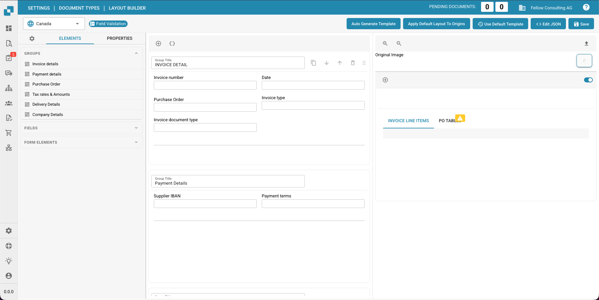

# Navigieren im Layout-Manager

## Die Navigation im Layout-Manager von DocBits und das Bearbeiten von Gruppen und Feldern ist entscheidend für die Kontrolle über die Struktur und das Erscheinungsbild von Dokumenten.

## Hier sind die Schritte zur Verwendung des Layout-Managers und zum Bearbeiten von Gruppen und Feldern:

### Navigieren im Layout-Manager:

### Öffnen des Layout-Managers:

* Melden Sie sich bei DocBits an und navigieren Sie zu dem Bereich, in dem Sie den Layout-Manager verwenden möchten.
* Diese Option finden Sie unter "Dokumenttypen verwalten".

Auswählen des Dokumenttyps:

* Wählen Sie den Dokumenttyp aus, den Sie bearbeiten möchten.
* Der Layout-Manager zeigt die Struktur dieses Dokumenttyps an.

<figure><figcaption>
Layout Builder Invoice
</figcaption></figure>

Navigieren durch Gruppen und Felder:

* Im Layout-Manager sehen Sie eine Baumstruktur, die die Gruppen und Felder des ausgewählten Dokumenttyps darstellt.

* Sie können durch diese Struktur navigieren, um die Bereiche zu bearbeiten, die Sie möchten.

### Gruppen und Felder bearbeiten:

<mark style="color:red;">**Hinweis:**</mark> **Wenn der Titel eines Feldes geändert wurde, müssen Sie das Feld im Layout-Builder löschen und erneut hinzufügen, damit die Änderungen wirksam werden.**

Hinzufügen einer Gruppe oder eines Feldes:

* Klicken Sie auf die Schaltfläche "Neue Gruppe erstellen", je nachdem, ob Sie eine neue Gruppe oder ein neues Feld hinzufügen möchten.

* Geben Sie den Namen der neuen Gruppe oder des neuen Feldes ein und wählen Sie alle gewünschten Einstellungen aus, wie z.B. den Feldtyp (Text, Zahl, Datum usw.).

#### Entfernen einer Gruppe oder eines Feldes:

* Wählen Sie die Gruppe oder das Feld aus, das Sie entfernen möchten.
* Klicken Sie auf die Schaltfläche "Löschen" oder verwenden Sie die entsprechende Tastenkombination (normalerweise "Entf" oder "Del").

#### Ändern einer Gruppe oder eines Feldes:

* Doppelklicken Sie auf die Gruppe oder das Feld, das Sie ändern möchten.
* Ändern Sie alle gewünschten Eigenschaften, wie z.B. den Namen, die Position, die Größe oder die Einstellungen des Feldtyps.

#### Anordnen von Gruppen und Feldern:

* Ziehen Sie Gruppen oder Felder per Drag & Drop, um ihre Reihenfolge zu ändern oder sie innerhalb oder außerhalb anderer Gruppen zu platzieren.

#### Änderungen speichern:

* Vergessen Sie nicht, Ihre Änderungen zu speichern, bevor Sie den Layout-Manager verlassen.
* Klicken Sie auf die Schaltfläche "Speichern".

Indem Sie diese Schritte befolgen, können Sie effektiv im Layout-Manager von DocBits navigieren und Gruppen sowie Felder innerhalb eines Dokumenttyps bearbeiten. Dies ermöglicht es Ihnen, die Struktur und das Erscheinungsbild Ihrer Dokumente entsprechend Ihren Bedürfnissen anzupassen.
