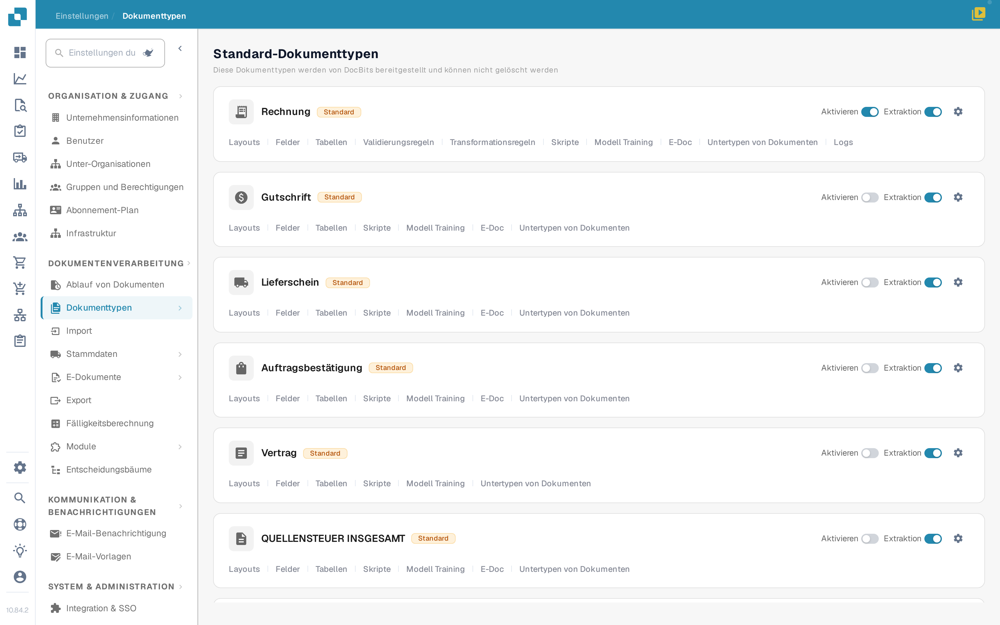
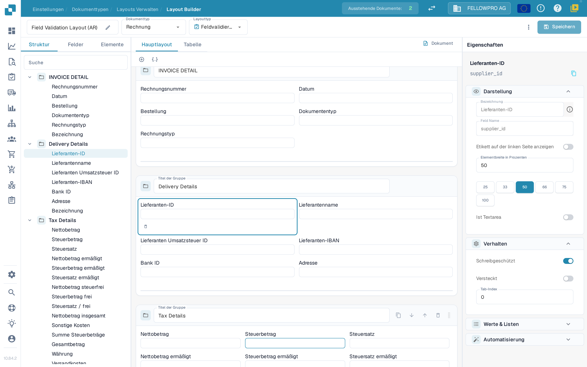
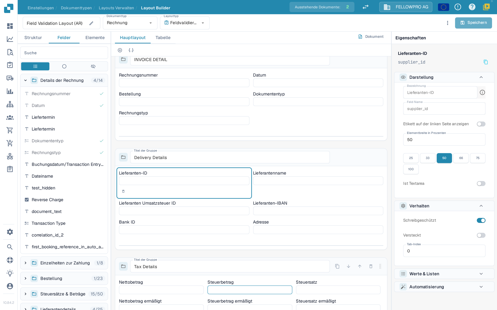
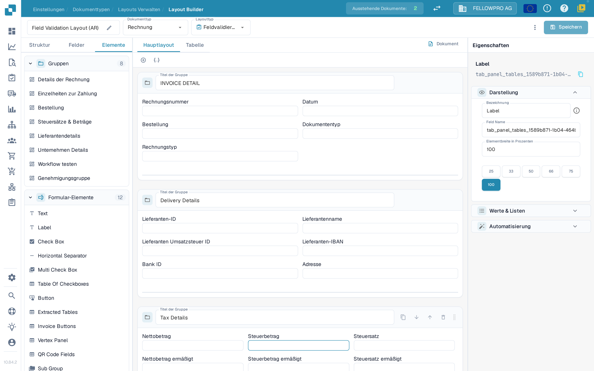

# Im Layout Builder navigieren

Verwenden Sie den **Layout Builder**, um die Gruppen und Felder anzuordnen, die Benutzer in einem Dokument sehen. Die Aufnahmen in diesem Artikel zeigen die deutsche Oberfläche am Beispiel des Rechnungs-Layouts in einer Sandbox-Organisation.

## Das Rechnungs-Layout öffnen

1. Gehen Sie zu **Einstellungen → Dokumenttypen**.
2. Suchen Sie die Karte **Rechnung** und wählen Sie darunter **Layouts**. Der Layout Builder öffnet sich für diesen Dokumenttyp.
3. In der Kopfzeile sehen Sie den Namen des Layouts (umbenennen mit dem Stift-Symbol), den **Dokumenttyp** und den **Layouttyp**. Über den **Layouttyp** wechseln Sie zu einem anderen Layout desselben Dokumenttyps.

<figure><figcaption>
Öffnen Sie <strong>Layouts</strong> auf der Karte Rechnung.
</figcaption></figure>

## Mit den drei Tabs arbeiten

Das Panel auf der linken Seite hat drei Tabs: **Struktur**, **Felder** und **Elemente**. Der Layout Builder öffnet mit dem Tab **Felder**.

**Struktur** zeigt das Layout als Baum, in derselben Reihenfolge, in der Gruppen und Felder im Dokument erscheinen. Klappen Sie eine Gruppe über das Chevron-Symbol auf, um ihre Felder zu sehen; den technischen Feldnamen zeigt das Panel **Eigenschaften**. Das Suchfeld filtert den Baum, und wenn Sie eine Zeile auswählen, wird dasselbe Element auf der Arbeitsfläche ausgewählt.

<figure><figcaption>
Der Struktur-Baum, die Arbeitsfläche und das Eigenschaften-Panel.
</figcaption></figure>

**Felder** listet alle Felder, die der Dokumenttyp anbietet, gruppiert nach ihren Gruppen. Der Zähler neben einem Gruppennamen zeigt, wie viele ihrer Felder bereits platziert sind, zum Beispiel **4/14**. Die drei Symbolschalter unter dem Suchfeld begrenzen die Liste: alle Felder, nur die noch nicht platzierten Felder oder nur die ausgeblendeten Felder. Jede Zeile zeigt die Feldbezeichnung; ein grünes Häkchen rechts markiert Felder, die bereits im Layout stehen, und platzierte Felder erscheinen ausgegraut.

<figure><figcaption>
Filtern Sie die Felder und erkennen Sie platzierte Felder am Häkchen.
</figcaption></figure>

**Elemente** enthält die Bausteine, die Sie auf die Arbeitsfläche ziehen: **Gruppen** mit den Gruppen dieses Layouts und **Formular-Elemente** mit Text, Label, Check Box, Horizontal Separator, Multi Check Box, Table Of Checkboxes, Button, Extracted Tables, Invoice Buttons, Vertex Panel, QR Code Fields und Sub Group.

<figure><figcaption>
Die Paletten Gruppen und Formular-Elemente.
</figcaption></figure>

## Elemente platzieren und anordnen

- Ziehen Sie ein Feld aus **Felder** oder ein Element aus **Elemente** in die Gruppe, in der es erscheinen soll. Bereits platzierte Felder tragen im Tab **Felder** ein Häkchen.
- Ziehen Sie ein Feld innerhalb einer Gruppe oder zwischen Gruppen, um es neu anzuordnen.
- Das **+** über der Arbeitsfläche fügt eine leere Gruppe hinzu; das JSON-Symbol daneben erzeugt eine Gruppe aus einer JSON-Definition.
- In der Kopfzeile einer Gruppe benennen Sie die Gruppe im Feld **Titel der Gruppe** um, kopieren ihr JSON, verschieben sie nach unten oder oben oder löschen sie. Mit dem Ziehgriff am rechten Rand der Kopfzeile verschieben Sie die Gruppe.
- Wählen Sie ein Feld auf der Arbeitsfläche aus, um rechts seine Eigenschaften zu öffnen. Die kleine Symbolleiste unter dem ausgewählten Feld entfernt es aus dem Layout.

## Das Eigenschaften-Panel

Das Panel **Eigenschaften** auf der rechten Seite ist immer geöffnet und folgt dem Element, das Sie ausgewählt haben. Seine Einstellungen sind in vier Abschnitte gegliedert: **Darstellung**, **Verhalten**, **Werte & Listen** und **Automatisierung**. Unter **Darstellung** finden Sie die Bezeichnung, den Feldtyp und die **Elementbreite in Prozenten**, die Sie aus den Werten 25, 33, 50, 66, 75 und 100 Prozent wählen. Die einzelnen Optionen beschreibt [Feldeigenschaften konfigurieren](configuring-field-properties.md).

Validierung, OCR und Abgleich gehören zum Feld selbst, nicht zum Layout: Konfigurieren Sie sie in den separaten [Fields-Einstellungen](../fields/configuring-field-properties-1.md).

## Vorschau und Speichern

Die Arbeitsfläche zeigt das Layout so, wie es später im Dokument aussieht. Wechseln Sie mit den Tabs **Hauptlayout** und **Tabelle** zwischen der Seite und der Tabelle mit den Positionen, und öffnen Sie mit **Dokument** das Beispieldokument neben der Arbeitsfläche. Siehe [Die Vorlagenvorschau verwenden](using-the-template-preview.md).

Wählen Sie abschließend **Speichern** in der Kopfzeile. Die weiteren Aktionen der Kopfzeile – darunter Vorlagenerzeugung, Standardvorlagen und das Anwenden eines Layouts auf Origins – beschreibt [Änderungen speichern und anwenden](save-and-apply-changes.md).
