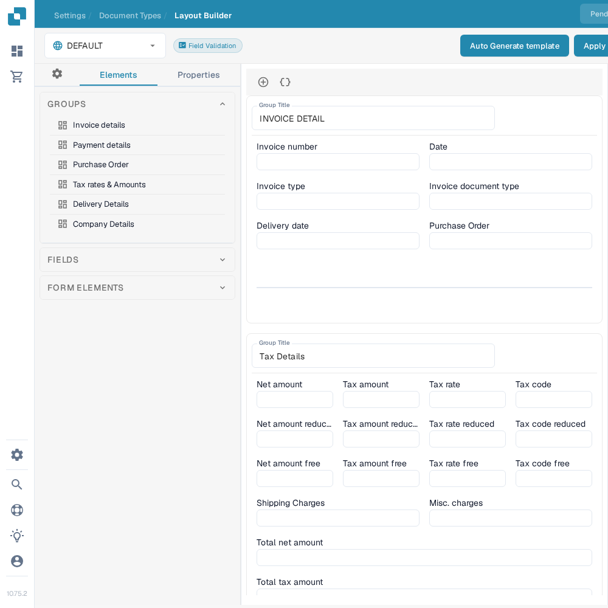
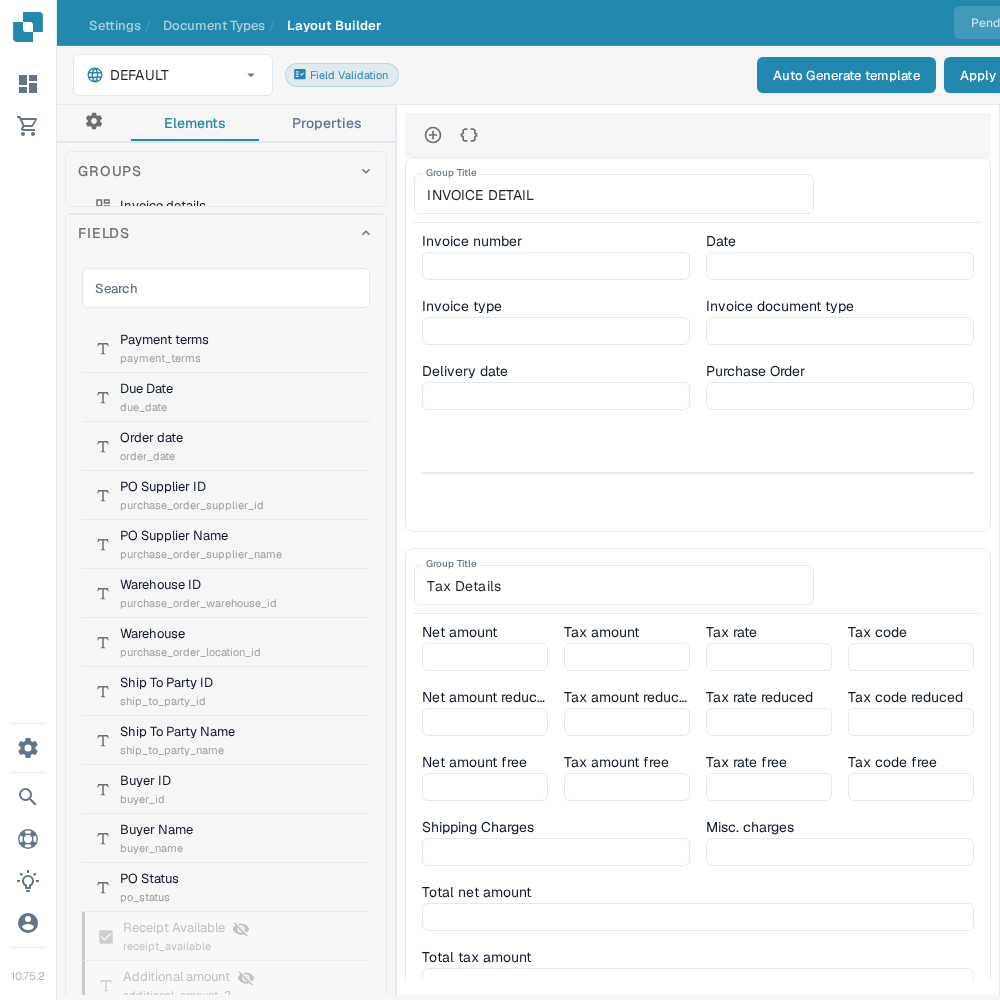

# Im Layout Builder navigieren

Verwenden Sie den **Layout Builder**, um die Felder und Gruppen anzuordnen, die Benutzer in einem Dokument sehen. Diese Anleitung verwendet das englische **Invoice**-Layout in einer Sandbox-Organisation.

## Das Invoice-Layout öffnen

1. Gehen Sie zu **Settings → Document Types**.
2. Suchen Sie **Invoice** und wählen Sie auf der Karte **Layouts**. Der Layout Builder öffnet sich für diesen Dokumenttyp.
3. Prüfen Sie die Layout-Auswahl oben links. Im folgenden Beispiel wird **DEFAULT** angezeigt.

<figure><figcaption>Öffnen Sie **Layouts** über die Invoice-Karte.</figcaption></figure>

## Gruppen und Felder finden

Das linke Panel **Elements** hat drei Bereiche. **Groups** listet die Dokumentabschnitte auf; die mittlere Arbeitsfläche zeigt deren aktuelle Anordnung. Wählen Sie ein Feld auf der Arbeitsfläche aus und öffnen Sie **Properties**, um dessen Anzeigeeinstellungen zu ändern. Die verfügbaren Optionen finden Sie unter [Feldeigenschaften konfigurieren](configuring-field-properties.md).

<figure><figcaption>Die Groups-Liste und die Arbeitsfläche des Invoice-Layouts.</figcaption></figure>

Öffnen Sie **Fields**, um die verfügbaren Dokumentfelder zu finden. Verwenden Sie bei langen Listen das Suchfeld und ziehen Sie das Feld dann auf der Arbeitsfläche in die gewünschte Gruppe. Felder, die bereits im Layout platziert sind, können in der Liste als nicht verfügbar erscheinen.

<figure><figcaption>Durchsuchen Sie die verfügbaren Felder, bevor Sie eines platzieren.</figcaption></figure>

Öffnen Sie **Form Elements** für visuelle Steuerelemente wie Text, Label, Check Box, Trennlinie, Button und Sub Group. Ziehen Sie das gewünschte Element auf die Arbeitsfläche und prüfen Sie anschließend dessen **Properties**.

<figure><figcaption>Die aktuelle Palette der Form Elements.</figcaption></figure>

## Anordnen und speichern

- Wählen Sie einen Gruppentitel auf der Arbeitsfläche aus, um den Titel zu ändern. Das **+** über der Arbeitsfläche fügt eine Gruppe hinzu; das danebenliegende Klammer-Symbol öffnet das erweiterte JSON-Gruppenformular.
- Fahren Sie mit der Maus über eine Gruppe, um die Aktionen JSON kopieren, nach oben, nach unten, löschen und den Ziehgriff zu sehen. Um Felder neu anzuordnen, ziehen Sie sie innerhalb von Gruppen oder zwischen Gruppen.
- Wählen Sie ein Feld auf der Arbeitsfläche aus, um **Properties** zu öffnen. Das Löschen-Symbol entfernt es aus diesem Layout. Für Validierung, OCR oder Abgleich verwenden Sie die separaten [Fields-Einstellungen](../fields/configuring-field-properties-1.md).
- Wählen Sie nach dem Bearbeiten **Save** in der oberen Leiste. Lesen Sie [Änderungen speichern und anwenden](save-and-apply-changes.md), bevor Sie die anderen Aktionen der oberen Leiste verwenden, darunter Vorlagenerzeugung, Standardvorlagen und das Anwenden eines Layouts auf Origins.
