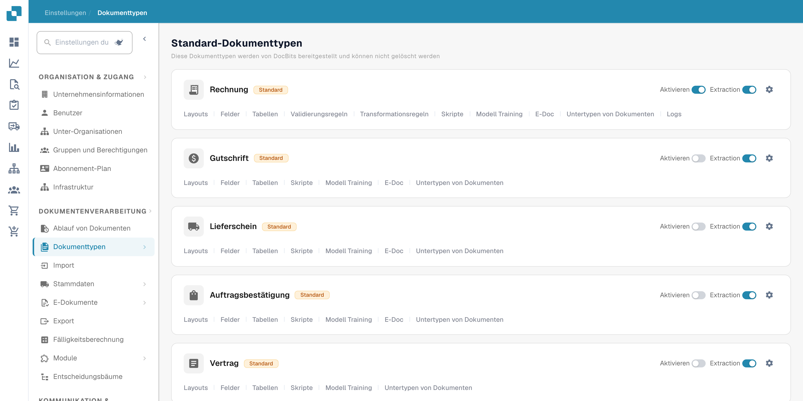
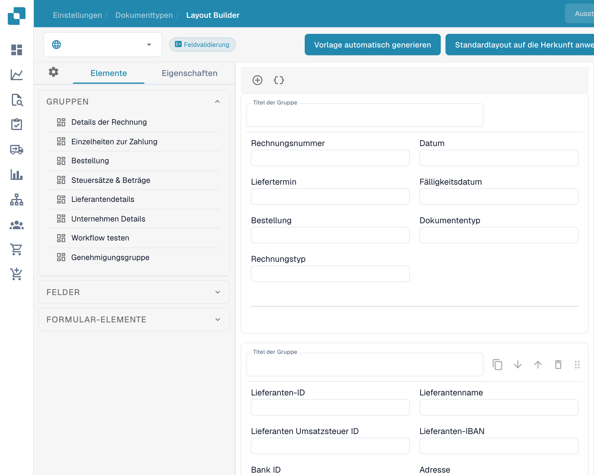
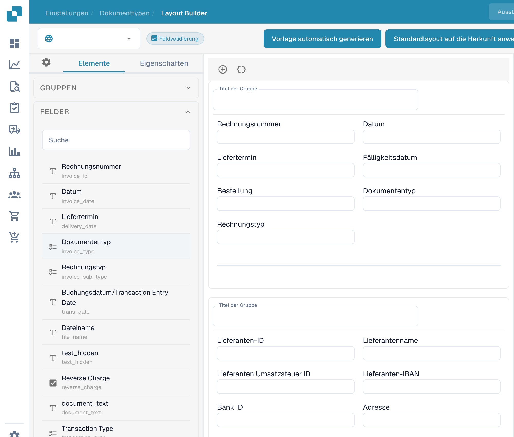
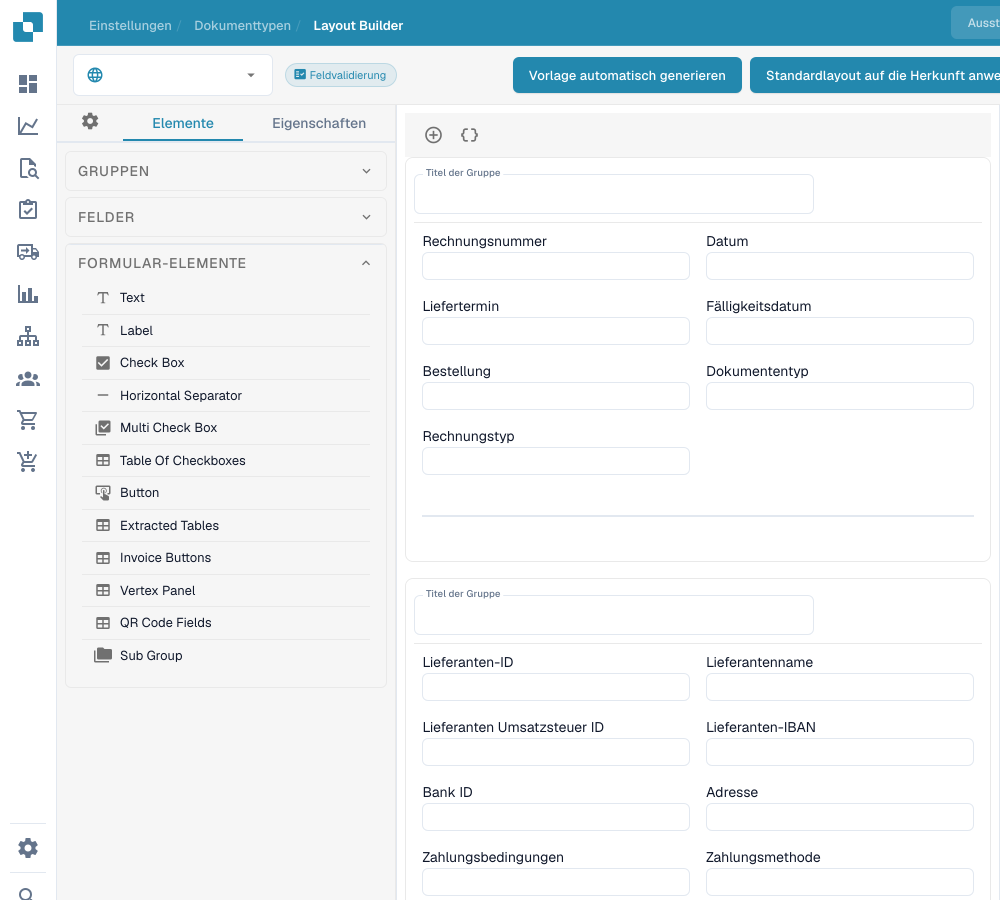

# Im Layout Builder navigieren

Verwenden Sie den **Layout-Editor**, um die Felder und Gruppen anzuordnen, die Benutzer in einem Dokument sehen. Die Aufnahmen zeigen die deutsche Oberfläche mit dem Layout **Standard** für Rechnungen. Eingabewerte sind ausgeblendet; die Dokumentvorschau liegt außerhalb des Bildausschnitts.

## Das Rechnungs-Layout öffnen

1. Gehen Sie zu **Einstellungen → Dokumenttypen**.
2. Suchen Sie **Rechnung** und wählen Sie auf der Karte **Layouts**. Der Layout Builder öffnet sich für diesen Dokumenttyp.
3. Prüfen Sie die Layout-Auswahl oben links. Im Beispiel ist der Auswahlwert aus Datenschutzgründen ausgeblendet.

<figure><figcaption>
Deutsche Dokumenttypen: Öffnen Sie Layouts auf der Karte Rechnung.
</figcaption></figure>

## Gruppen und Felder finden

Das linke Panel **Elemente** hat drei Bereiche. **Gruppen** listet die Dokumentabschnitte auf; die mittlere Arbeitsfläche zeigt deren aktuelle Anordnung. Wählen Sie ein Feld auf der Arbeitsfläche aus und öffnen Sie **Eigenschaften**, um dessen Anzeigeeinstellungen zu ändern. Die verfügbaren Optionen finden Sie unter [Feldeigenschaften konfigurieren](configuring-field-properties.md).

<figure><figcaption>
Gruppen und Arbeitsfläche im deutschen Layout Builder. Eingabewerte sind ausgeblendet; die Dokumentvorschau liegt außerhalb des Bildausschnitts.
</figcaption></figure>

Öffnen Sie **Felder**, um die verfügbaren Dokumentfelder zu finden. Verwenden Sie bei langen Listen das Suchfeld und ziehen Sie das Feld dann auf der Arbeitsfläche in die gewünschte Gruppe. Felder, die bereits im Layout platziert sind, können in der Liste als nicht verfügbar erscheinen.

<figure><figcaption>
Deutsches Panel Felder mit Suche und Feldbezeichnungen. Technische Feldschlüssel bleiben unverändert.
</figcaption></figure>

Einzelne Bausteinnamen bleiben auch bei deutscher UI-Sprache englisch. Öffnen Sie **Formular-Elemente** für visuelle Steuerelemente wie Text, Label, Check Box, Trennlinie, Button und Sub Group. Ziehen Sie das gewünschte Element auf die Arbeitsfläche und prüfen Sie anschließend dessen **Eigenschaften**.

<figure><figcaption>
Panel Formular-Elemente in der deutschen Oberfläche. Bezeichnungen einzelner Bausteine wie Check Box bleiben im Produkt englisch.
</figcaption></figure>

## Anordnen und speichern

- Wählen Sie einen Gruppentitel auf der Arbeitsfläche aus, um den Titel zu ändern. Das **+** über der Arbeitsfläche fügt eine Gruppe hinzu; das danebenliegende Klammer-Symbol öffnet das erweiterte JSON-Gruppenformular.
- Fahren Sie mit der Maus über eine Gruppe, um die Aktionen JSON kopieren, nach oben, nach unten, löschen und den Ziehgriff zu sehen. Um Felder neu anzuordnen, ziehen Sie sie innerhalb von Gruppen oder zwischen Gruppen.
- Wählen Sie ein Feld auf der Arbeitsfläche aus, um **Eigenschaften** zu öffnen. Das Löschen-Symbol entfernt es aus diesem Layout. Für Validierung, OCR oder Abgleich verwenden Sie die separaten [Fields-Einstellungen](../fields/configuring-field-properties-1.md).
- Wählen Sie nach dem Bearbeiten **Speichern** in der oberen Leiste. Lesen Sie [Änderungen speichern und anwenden](save-and-apply-changes.md), bevor Sie die anderen Aktionen der oberen Leiste verwenden, darunter Vorlagenerzeugung, Standardvorlagen und das Anwenden eines Layouts auf Origins.
