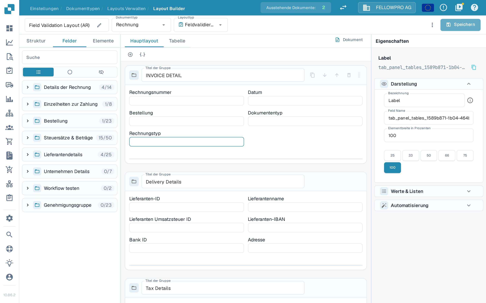
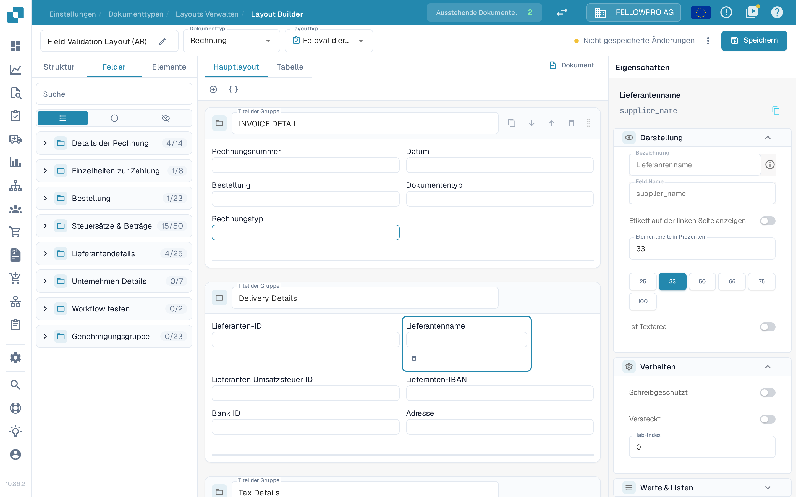
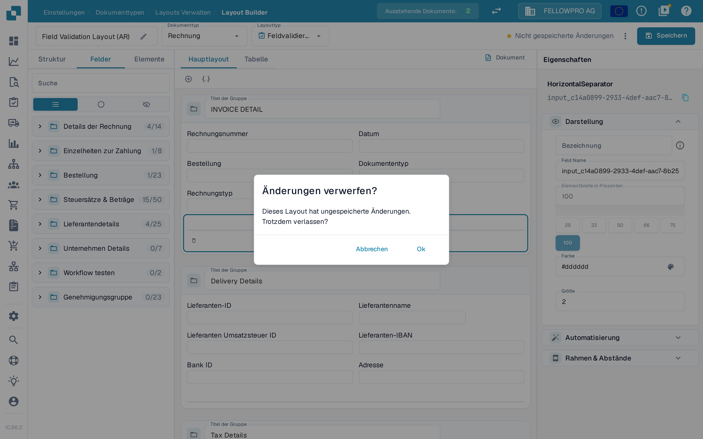
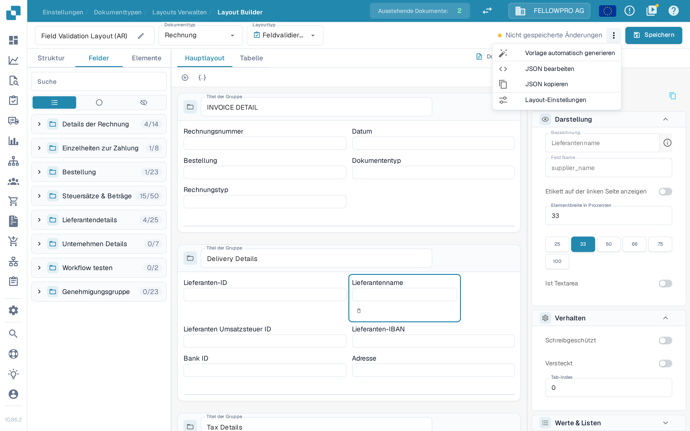

# Änderungen speichern und anwenden

Änderungen im Layout Builder werden erst wirksam, wenn Sie sie speichern. Beim Speichern wird das Layout für den Belegtyp hinterlegt, sodass neue Belege es verwenden.

## Ihre Änderungen speichern

Nachdem Sie das Layout bearbeitet haben, wählen Sie oben rechts in der Kopfzeile **Speichern**.

<figure><figcaption>Die Schaltfläche **Speichern** befindet sich oben rechts im Layout Builder.</figcaption></figure>

Während Sie arbeiten, zeigt die Kopfzeile den Stand Ihrer Änderungen:

- Eine Schaltfläche **Speichern** ohne Hinweis daneben bedeutet, dass das Layout unverändert ist.
- **Nicht gespeicherte Änderungen** erscheint, sobald Sie das Layout ändern. Wählen Sie **Speichern**, um die Änderungen zu sichern.

<figure><figcaption>Der Hinweis **Nicht gespeicherte Änderungen** erscheint, solange das Layout noch nicht gespeichert ist.</figcaption></figure>

Nach dem erfolgreichen Speichern ersetzt der Zeitpunkt der letzten Speicherung den Hinweis. **Speichern** erneut zu wählen ist unbedenklich: Hat sich seit dem letzten Speichern nichts geändert, wird auch nichts geschrieben.

Wenn Sie den Layout Builder mit nicht gespeicherten Änderungen verlassen wollen, fragt DocBits unter **Änderungen verwerfen?** nach. Wählen Sie **Abbrechen**, um zu bleiben und zu speichern, oder **Ok**, um ohne Speichern zu gehen.

<figure><figcaption>Rückfrage beim Verlassen mit nicht gespeicherten Änderungen.</figcaption></figure>

## Weitere Aktionen in der Kopfzeile

Das Menü mit den drei Punkten neben **Speichern** enthält die übrigen Layout-Aktionen:

- **Vorlage automatisch generieren** – erzeugt ein Layout automatisch aus den Feldern des Belegtyps.
- **JSON bearbeiten** – bearbeitet die Layout-Definition direkt als JSON.
- **JSON kopieren** – kopiert die Layout-Definition in die Zwischenablage.
- **Layout-Einstellungen** – öffnet die allgemeinen Layout-Einstellungen.

**Vorlage automatisch generieren** ersetzt das bestehende Layout. Prüfen Sie daher vorher, welches Layout geöffnet ist. **JSON bearbeiten** richtet sich an fortgeschrittene Anwender und sollte nur verwendet werden, wenn Ihnen das Format der Vorlage vertraut ist.

<figure><figcaption>Die Aktionen im Menü mit den drei Punkten.</figcaption></figure>

## Die Änderungen anwenden

Nach dem Speichern verwendet der Belegverarbeitungs-Workflow das Layout für diesen Belegtyp:

- Neue Belege, die mit diesem Belegtyp verarbeitet werden, nutzen das aktualisierte Layout.
- Bereits verarbeitete Belege behalten das Layout, mit dem sie erfasst wurden.

## Die Änderungen testen

Öffnen Sie nach dem Speichern einen Beleg dieses Belegtyps und prüfen Sie, ob die Felder und Gruppen wie gewünscht erscheinen. Fehlt etwas, kehren Sie in den Layout Builder zurück, passen das Layout an und speichern erneut.
