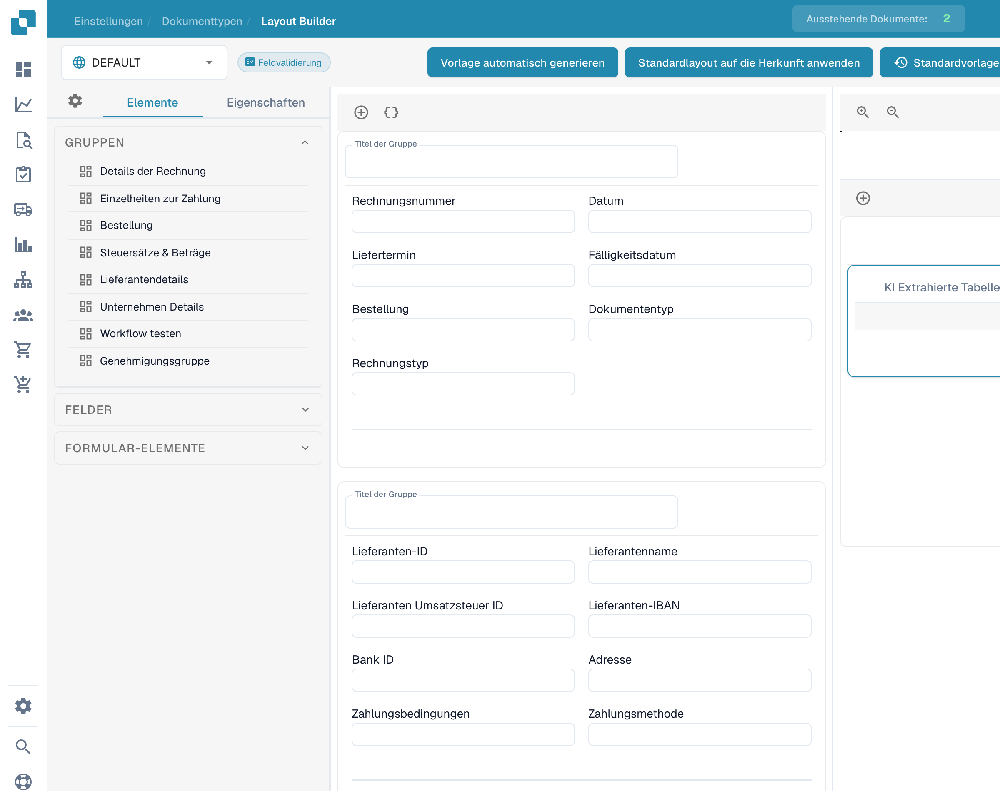

# Verwendung der Vorlagenvorschau

Öffnen Sie für den gewünschten Dokumenttyp ein bestehendes Layout im **Layout-Builder**. Die Arbeitsfläche zeigt die angeordneten Gruppen und Felder. Links stehen die Registerkarten **Elemente** und **Eigenschaften** zur Verfügung.

<figure><figcaption>
Vorlagenvorschau im deutschen Layout-Builder.
</figcaption></figure>

## Layout kontrollieren

1. Prüfen Sie die gewählte Herkunft und den Bildschirm, beispielsweise **Feldvalidierung**.
2. Vergleichen Sie Reihenfolge, Gruppierung und sichtbare Felder mit dem gewünschten Benutzerablauf.
3. Wählen Sie ein Element und prüfen Sie seine **Eigenschaften**.
4. Kontrollieren Sie die Darstellung nach beabsichtigten Änderungen, bevor Sie das Layout speichern.

Die Arbeitsfläche ist eine Vorschau der Formularstruktur. Sie ersetzt keinen Test des gespeicherten Layouts an einem repräsentativen Dokument. Weitere Hinweise finden Sie unter [Feldeigenschaften konfigurieren](configuring-field-properties.md).
