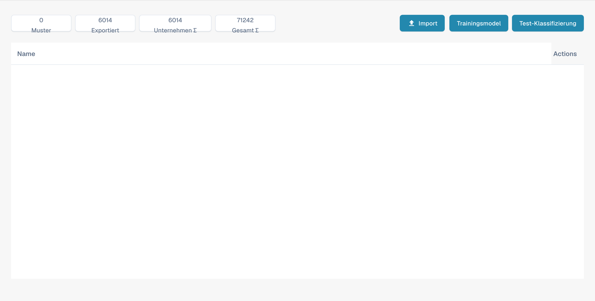

# Modelltraining

Das Modelltraining bietet Administratoren eine Übersicht über Trainingsbeispiele und die Funktionen zum Importieren, Trainieren und Prüfen eines Modells für den gewählten Dokumenttyp.

<figure><figcaption>
Deutsche Übersicht zum Modelltraining.
</figcaption></figure>

## Kennzahlen

| Anzeige | Bedeutung |
| --- | --- |
| **Muster** | Für das Training verfügbare Beispieldokumente |
| **Exportiert** | Erfolgreich exportierte Dokumente |
| **Unternehmen Σ** | Organisationsbezogene Gesamtzahl |
| **Gesamt Σ** | Übergreifende Gesamtzahl |

## Import und Prüfung

- **Import** öffnet die Auswahl für neue Trainingsdaten. Siehe [Daten für das Modelltraining importieren](import-data-model-training.md).
- **Trainingsmodel** führt zur Funktion für das Modelltraining.
- **Test-Klassifizierung** dient der Prüfung der Klassifizierung an Beispieldokumenten.

Verwenden Sie repräsentative Beispiele und prüfen Sie ein trainiertes Modell an bisher nicht verwendeten Dokumenten. Die Tabellenspalte für Aktionen ist im Produkt derzeit noch mit **Actions** beschriftet.
