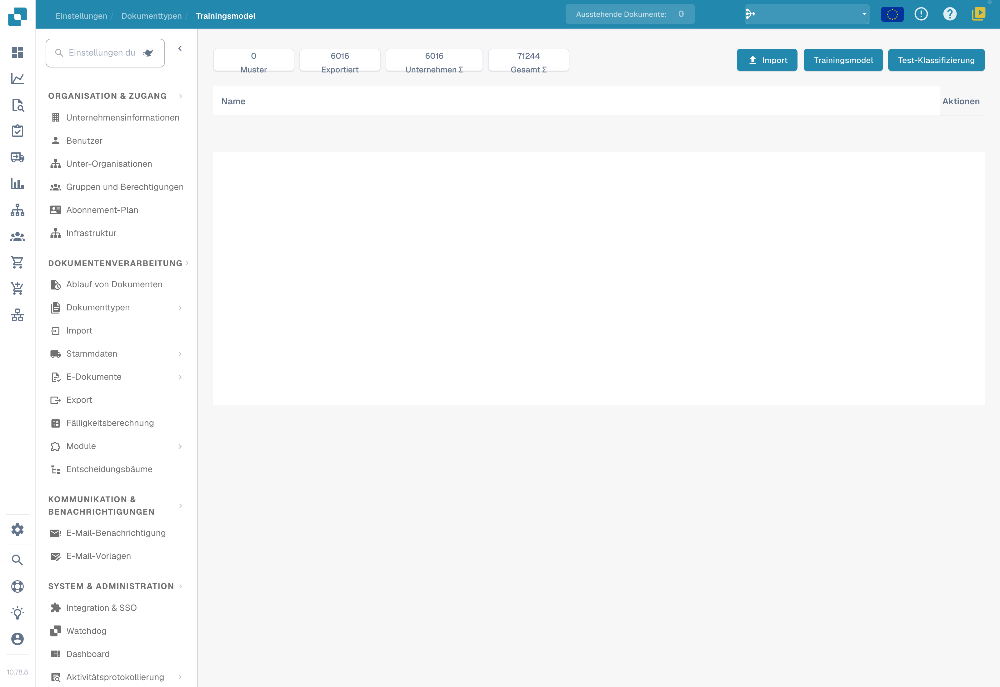
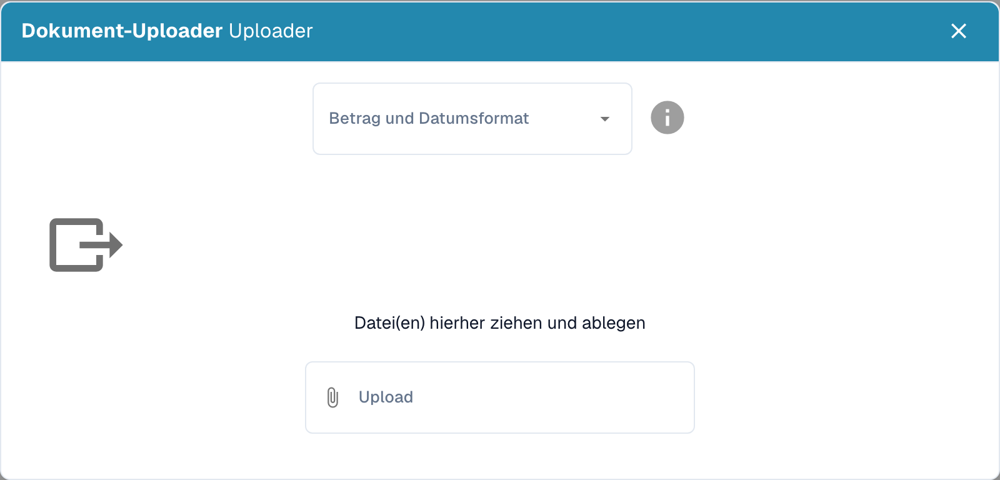

# Datenimport: Modelltraining

Bereite Dokumente vor, die die Formate, Sprachen und Dokumenttypen deiner Organisation abdecken. Verwende ausschließlich Dateiformate, die deine Installation akzeptiert. Entferne Duplikate und trenne Trainingsdokumente von den für die Bewertung vorgesehenen Dokumenten.

## Import öffnen

Öffne in den Einstellungen des gewünschten Dokumenttyps das Modelltraining und wähle die Importfunktion.

<figure><figcaption>
Deutsche Modelltrainingsansicht mit ausgeblendeten Einträgen. Die Aktion ist in dieser Version fehlerhaft mit „Trainingsmodel“ beschriftet. Es wurde kein Training oder Klassifizierungstest gestartet.
</figcaption></figure>

## Formate und Dateien auswählen

Wähle das zu den Dateien passende Zahlen- und Datumsformat und anschließend die zu importierenden Dokumente. `1.234,56` und `1,234.56` verwenden beispielsweise unterschiedliche Trennzeichen. Auch ein Datum wie `05/06/2026` muss entsprechend dem gewählten Format interpretiert werden.

<figure><figcaption>
Leerer deutscher Importdialog ohne ausgewählte Dateien. Der tatsächliche Titel „Dokument-Uploader Uploader“ enthält eine bekannte Dopplung; kein Import wurde gestartet.
</figcaption></figure>

Prüfe die Auswahl vor dem Import. Warte das Ende der Verarbeitung ab und kontrolliere Fehler sowie den zugewiesenen Dokumenttyp. Korrigiere falsche Klassifikationen und Extraktionen, bevor du die Beispiele für das Training nutzt.

## Trainieren und bewerten

Trainiere das Modell mit den Funktionen und Berechtigungen deiner Version. Bewerte das Ergebnis anschließend mit einer getrennten Stichprobe. Zusätzliche Trainingsdokumente garantieren allein keine höhere Genauigkeit. Siehe [Modell testen](testing-the-model.md).
