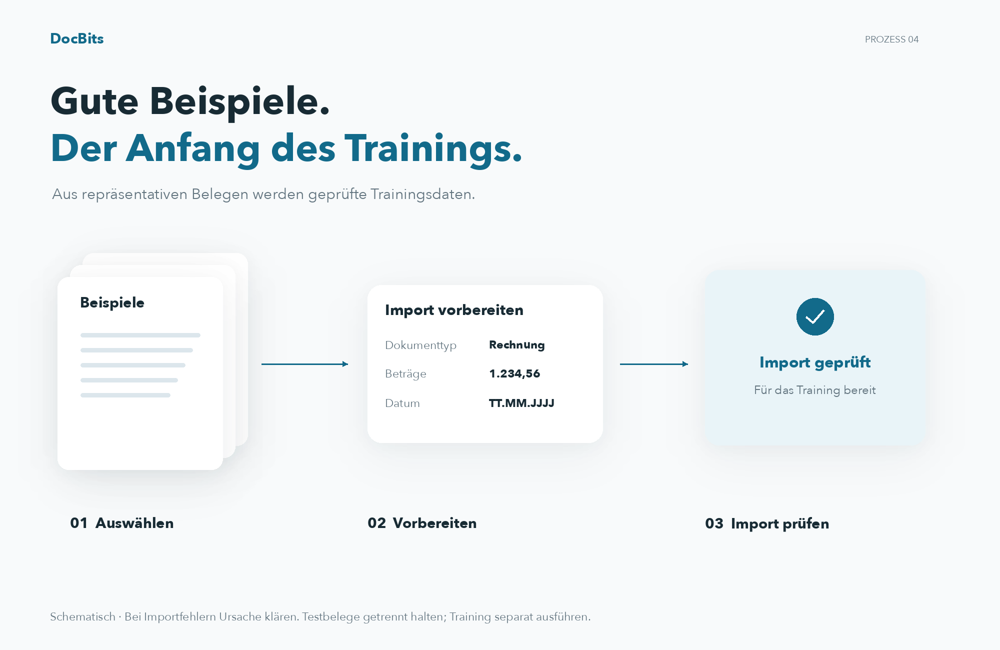
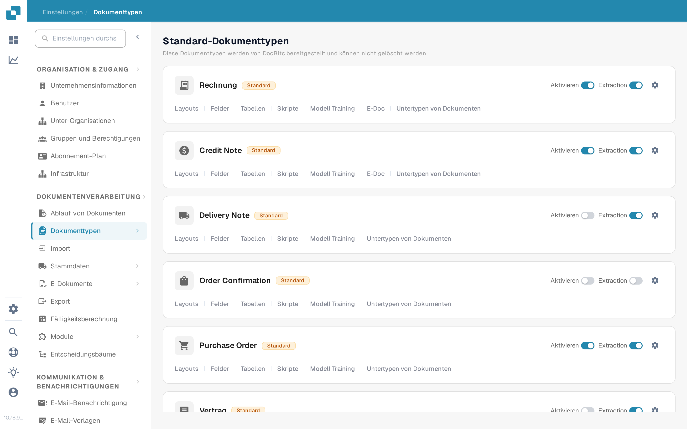
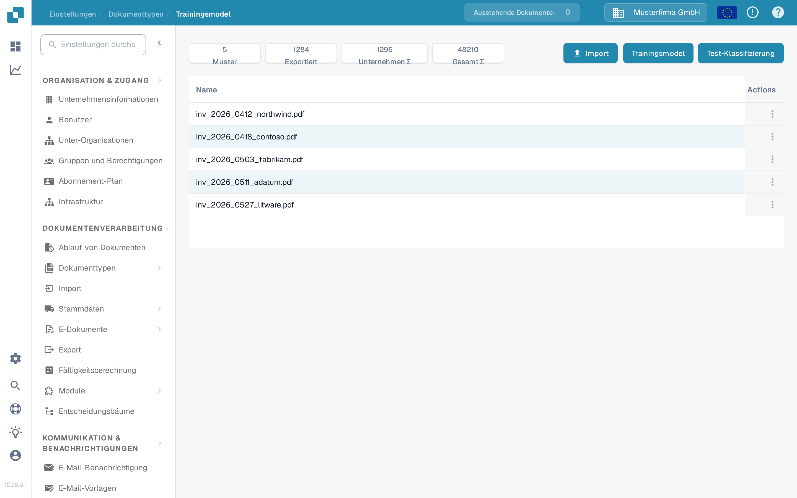
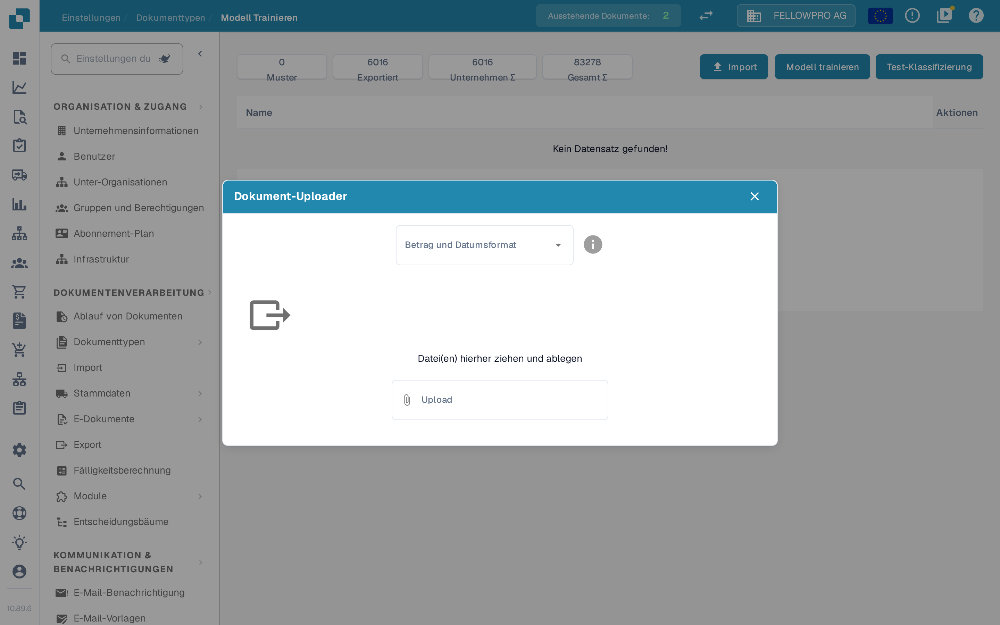
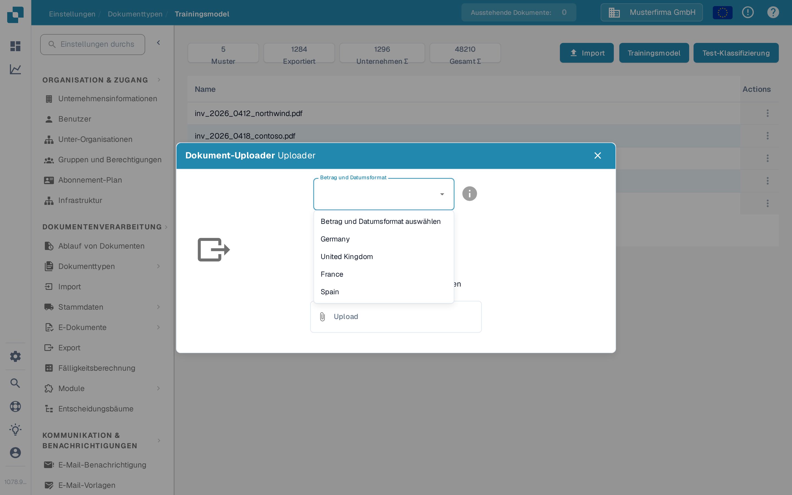
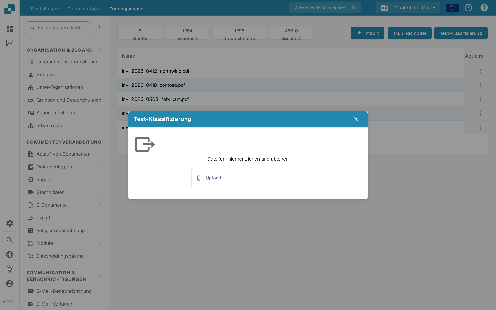

# Datenimport: Modelltraining

## Beispiele vorbereiten, importieren und prüfen

<figure><figcaption>
Beispiele vorbereiten, importieren und prüfen
</figcaption></figure>

Wählen Sie repräsentative Beispielbelege, bereiten Sie die verfügbaren Importoptionen vor und kontrollieren Sie den Importstatus. Erst erfolgreich importierte Beispiele stehen für das weitere Training bereit. Klären Sie Importfehler vor dem nächsten Schritt und halten Sie unabhängige Testbelege vom Trainingsdatensatz getrennt.

Verwenden Sie diese Seite, um Beispiel-PDFs für einen Dokumenttyp hinzuzufügen und anschließend sein Klassifizierungsmodell zu trainieren oder zu testen. Sie benötigen Zugriff auf **Einstellungen** und **Dokumenttypen**. Den Zweck der Trainingsfunktionen finden Sie unter [Zweck und Verwendung: Modelltraining](purpose-and-use-model-training.md).

## Den Dokumenttyp öffnen

1. Wechseln Sie zu **Einstellungen → Dokumenttypen**.
2. Suchen Sie den Dokumenttyp, den Sie trainieren möchten. Wählen Sie in seiner Zeile **Modell Training**. Das folgende Beispiel verwendet **Rechnung**.

<figure><figcaption>
Modell Training öffnen Sie über den gewählten Dokumenttyp.
</figcaption></figure>

Die übrigen Steuerelemente auf dieser Karte haben andere Zwecke: **Aktivieren** schaltet den Dokumenttyp ein, **Extraction** wechselt seinen Extraktionsmodus, das Zahnrad öffnet seine Einstellungen, und die übrigen Links öffnen andere Konfigurationsbereiche. Nur um Modell Training zu öffnen, müssen Sie nichts davon ändern.

Die Seite **Trainingsmodel** zeigt die Anzahl der Beispiele und eine Liste der hochgeladenen Trainingsdokumente. Im gezeigten Beispiel enthält die Liste fünf PDF-Dokumente; Ihre Organisation kann andere Dokumente und Zahlen anzeigen.

<figure><figcaption>
Die drei Aktionen befinden sich oben rechts über der Trainingsliste.
</figcaption></figure>

## Beispiel-PDFs importieren

1. Wählen Sie **Import**.
2. Wählen Sie das **Betrag und Datumsformat**, das zum Beispieldokument passt. Wählen Sie zum Beispiel **United States** für US-Nummern- und Datumsformate. Diese Auswahl sagt DocBits, wie Werte im hochgeladenen Dokument zu lesen sind; sie ändert nicht die Sprache der App.
3. Ziehen Sie PDF-Dateien in den Dialog oder wählen Sie sie über **Upload** aus. Der aktuelle Import für Beispieldokumente akzeptiert **PDF-Dateien**; andere Dateitypen werden abgelehnt. Mit der Auswahl der Dateien beginnt der Upload.
4. Schließen Sie den Dialog und prüfen Sie, ob die Dokumente in der Trainingsliste erscheinen. Meldet DocBits einen Upload-Fehler oder dass ein Dokument bereits existiert, korrigieren Sie die Datei oder wählen Sie ein anderes Beispiel, bevor Sie fortfahren.

<figure><figcaption>
Wählen Sie das Format, bevor Sie Beispiel-PDFs auswählen.
</figcaption></figure>

<figure><figcaption>
Wählen Sie das Format des Dokuments, nicht Ihre bevorzugte Oberflächensprache.
</figcaption></figure>

Aktionen zu importierten Beispielen finden Sie unter [Trainingsdaten verwalten](manage-training-data.md).

## Das Modell trainieren und prüfen

Wenn die gewünschten Beispiel-PDFs in der Liste stehen, wählen Sie **Trainingsmodel**. DocBits kann das Training im Hintergrund verarbeiten; warten Sie die Abschlussmeldung ab, bevor Sie das neue Modell als fertig betrachten. Die Beispielanzahl und eine auf dieser Seite angezeigte Plan-Grenze gehören zu Ihrer Organisation.

Um die Klassifizierung zu prüfen, wählen Sie **Test-Klassifizierung** und laden Sie in dem Dialog eine separate Beispiel Datei hoch. Nach der Verarbeitung zeigt DocBits, ob der vorhergesagte Dokumenttyp mit dieser Seite übereinstimmt, und meldet Einzelheiten zur Klassifizierung. Der leere Test-Dialog unten wird ohne hochgeladene Datei gezeigt.

<figure><figcaption>
Mit Test-Klassifizierung prüfen Sie das Modell mit einem weiteren Dokument.
</figcaption></figure>

Zur Deutung des Ergebnisses siehe [Das Modell testen](testing-the-model.md). Wenn das Ergebnis schlecht ist, prüfen Sie die [Trainingsdaten](manage-training-data.md) und die [Fehlerbehebung](troubleshooting.md), bevor Sie weitere Beispiele hinzufügen.
