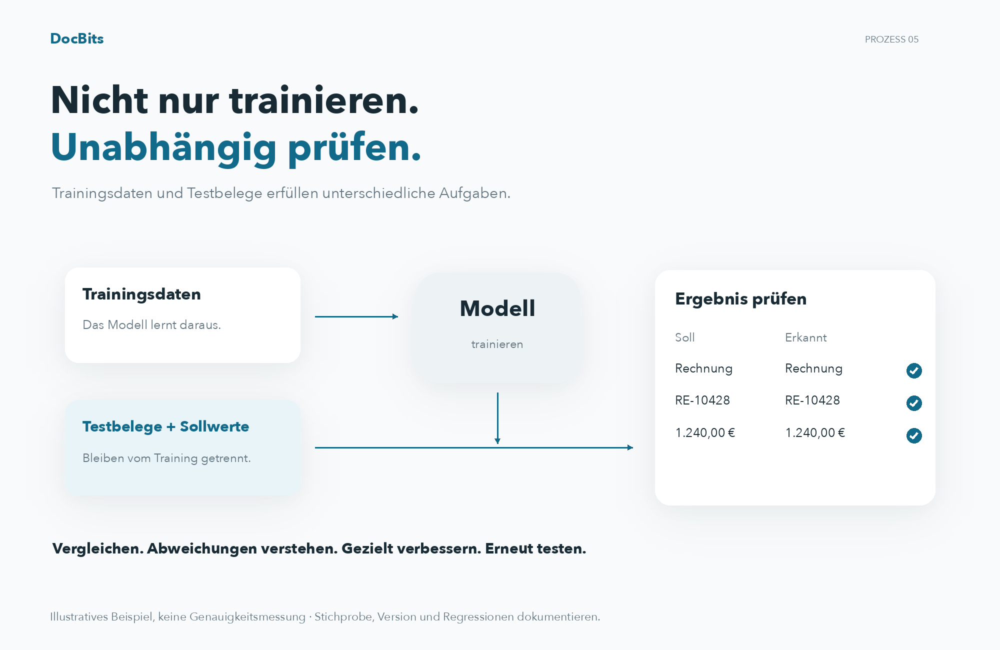

# Testen des Modells

## Mit unabhängigen Testbelegen prüfen

<figure><figcaption>
Mit unabhängigen Testbelegen prüfen
</figcaption></figure>

Trainingsdaten und Testbelege erfüllen unterschiedliche Aufgaben. Legen Sie für unabhängige Testbelege die erwarteten Dokumenttypen und Feldwerte fest und vergleichen Sie diese mit den Vorhersagen. Dokumentieren Sie Modellversion, Stichprobe, Abweichungen und technische Fehler. Verbessern Sie gezielt und wiederholen Sie den Test mit demselben Prüfprotokoll. Die dargestellten Werte sind ein Beispiel und keine Genauigkeitsmessung.

Teste mit repräsentativen Dokumenten, die nicht für das Training verwendet wurden. Halte für jedes Dokument die erwarteten Antworten fest: den Dokumenttyp und bei einer Bewertung der Extraktion auch die Feldwerte.

## Test durchführen

1. Öffne das Modelltraining des zu prüfenden Dokumenttyps.
2. Wähle den Klassifikationstest, sofern deine Version diese Funktion bietet.
3. Wähle die Stichprobe und starte die Bewertung mit den verfügbaren Optionen.
4. Warte den Abschluss ab und dokumentiere Ergebnisse und Fehler. Ein technischer Fehler oder ein unvollständiger Test gilt nicht als korrekte Klassifikation.

<figure><figcaption>
Deutsche Modelltrainingsansicht mit ausgeblendeten Einträgen. Die Aktion ist in dieser Version fehlerhaft mit „Trainingsmodel“ beschriftet. Es wurde kein Training oder Klassifizierungstest gestartet.
</figcaption></figure>

## Ergebnisse bewerten

Vergleiche Vorhersagen mit den erwarteten Antworten und untersuche Fehler nach Typ und Format. Wenn du Genauigkeit, Präzision, Recall oder F1-Wert berechnest, nenne auch Stichprobengröße und bewertete Kategorien. Schreibe dem Produkt keine Kennzahlen zu, die deine Version nicht anzeigt. Du kannst sie getrennt aus exportierten oder protokollierten Ergebnissen berechnen.

Klassifikations- und Extraktionsregeln sind vom Modelltraining getrennte Einstellungen. Prüfe ihren Einfluss, wenn sie an der Verarbeitung beteiligt sind. Ändere eine Regel nicht allein, um einen Fehler in der Teststichprobe zu verdecken.

## Verbessern und erneut testen

Korrigiere Trainingsdaten, Kennzeichnungen oder tatsächlich verfügbare Einstellungen und trainiere das Modell bei Bedarf erneut. Wiederhole den Test nach demselben Verfahren und behalte eine unabhängige Stichprobe. Dokumentiere Version, Daten, Ergebnisse und Regressionen. Ein gutes Stichprobenergebnis garantiert keine identische Leistung bei allen zukünftigen Dokumenten.
