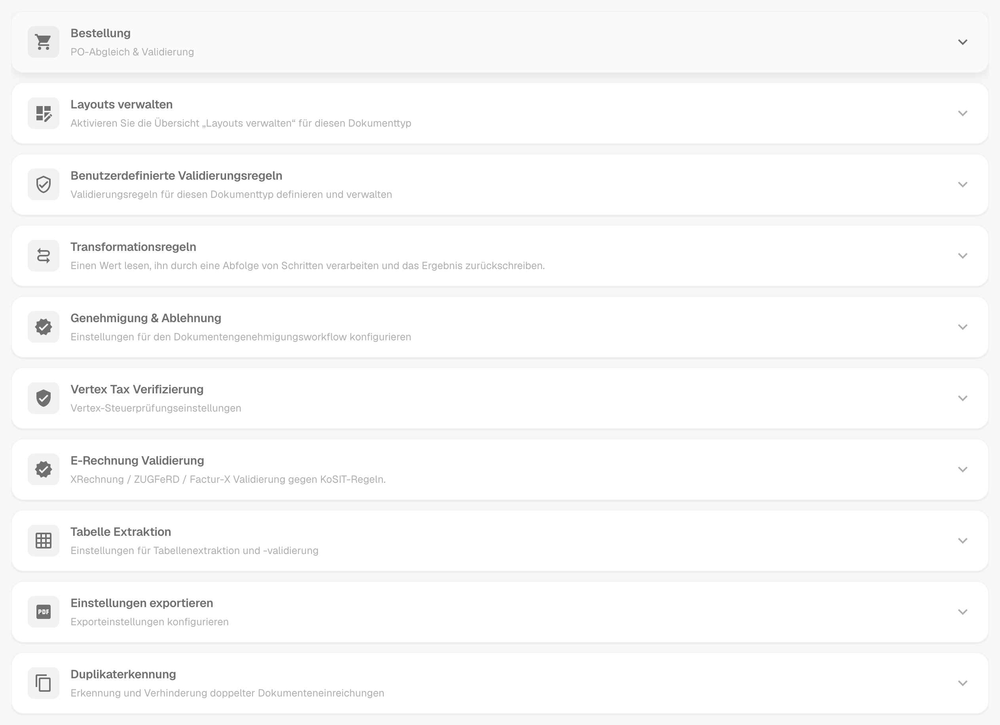
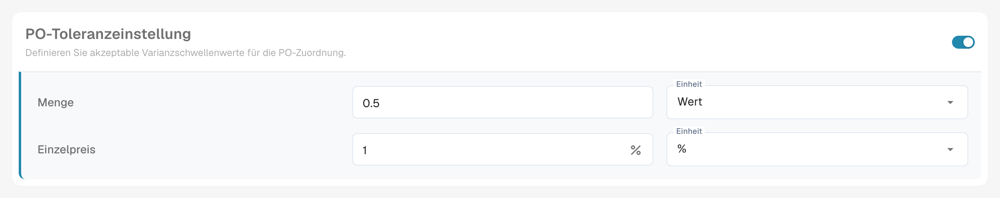
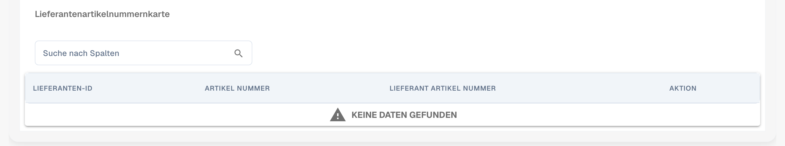
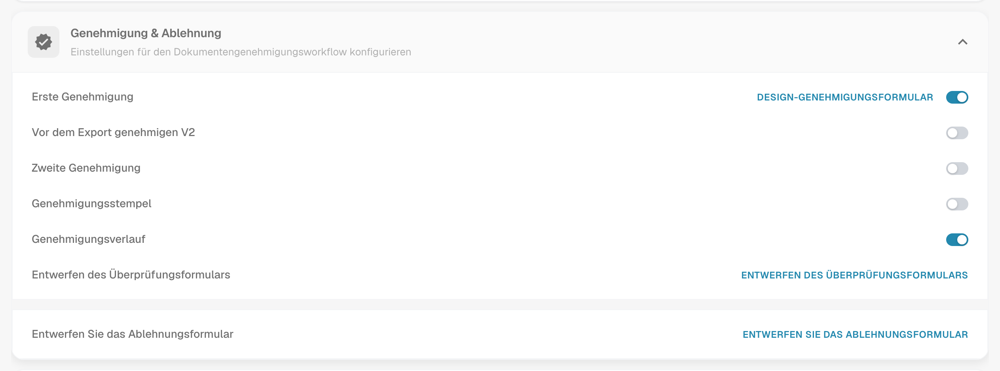
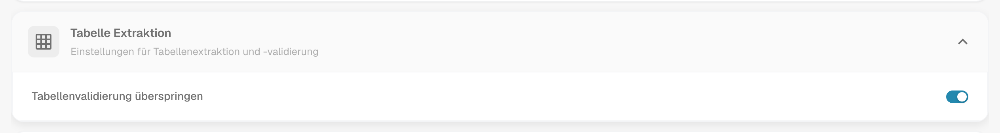
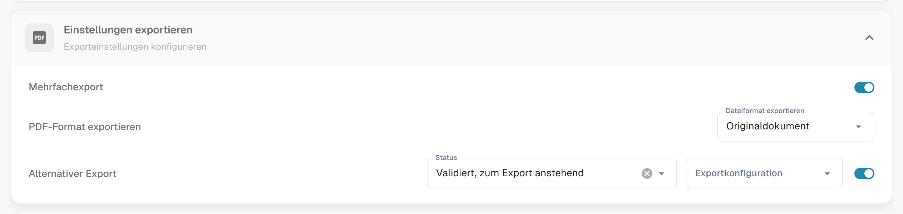
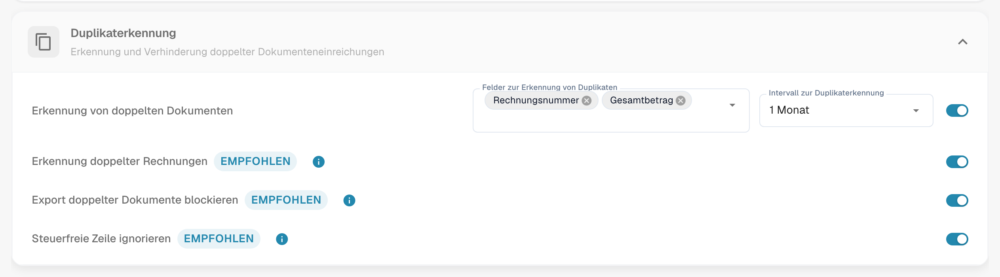

# Weitere Einstellungen

## Übersicht

Unter **Weitere Einstellungen** finden Sie die Optionen, die zu einem einzelnen Dokumenttyp gehören, zum Beispiel zur Rechnung. Eine Einstellung, die Sie hier aktivieren, gilt nur für diesen Dokumenttyp. Die Seite besteht aus einklappbaren Karten, eine pro Thema. Öffnen Sie eine Karte, um ihre Einstellungen zu sehen.

<figure><figcaption>
Die Karten der Seite Weitere Einstellungen, alle eingeklappt.
</figcaption></figure>

## Zugriff

1. Navigieren Sie zu **Einstellungen** → **Globale Einstellungen** → **Dokumenttypen**.
2. Wählen Sie den Dokumenttyp aus und klicken Sie auf **Weitere Einstellungen**.

Die Brotkrümelnavigation oben auf der Seite zeigt **Einstellungen / Dokumenttypen / Weitere Einstellungen**. Der Einstellungs-Assistent rechts auf der Seite erklärt die Einstellungen der geöffneten Karte.

| Karte | Was Sie dort einstellen |
| ----- | ----------------------- |
| Bestellung | PO-Abgleich, Toleranzen, Export von PO-Positionen, Lieferantenartikelnummern |
| Layouts verwalten | Schalter für die Übersicht Layouts verwalten |
| Benutzerdefinierte Validierungsregeln | Ihre eigenen Validierungsregeln für diesen Dokumenttyp |
| Transformationsregeln | Regeln, die einen Wert lesen, schrittweise ändern und zurückschreiben |
| Genehmigung & Ablehnung | Genehmigungsworkflow sowie die Formulare "In Prüfung" und "Ablehnen" |
| [Vertex Tax Verifizierung](vertex-tax-verification.md) | Das Formular für die Vertex-Steuerprüfung gestalten |
| E-Rechnung Validierung | Validierung von XRechnung-, ZUGFeRD- und Factur-X-Rechnungen |
| Tabelle Extraktion | Validierung extrahierter Tabellen überspringen |
| Einstellungen exportieren | Mehrfachexport, PDF-Format, alternativer Export |
| Duplikaterkennung | Doppelte Dokumente erkennen und blockieren |

## Bestellung

Die Karte **Bestellung** (**PO-Abgleich & Validierung**) steuert, wie Dokumente dieses Typs mit Bestellungen abgeglichen werden.

<figure><figcaption>
Die Karte Bestellung mit ihren Optionen.
</figcaption></figure>

* [**Bestellung**](purchase-order/purchase-order.md): Schaltet um, ob der Beleg im Bildschirm für den Bestellabgleich verarbeitet wird. Sie können auch angeben, auf welcher Menge der Abgleich basiert.
* [**PO-Match serverseitig**](purchase-order/purchase-order-matching-rules.md): Gleicht mit dem konfigurierbaren Regelwerk ab. **PO-Abgleichsregeln konfigurieren** öffnet die [Regelseite](purchase-order/purchase-order-matching-rules.md).
* [**PO-Tabelle im Layout-Builder**](purchase-order/po-table-in-layout-builder.md): Ermöglicht die Einbindung von Bestelltabellen in den Layout-Builder für angepasste Dokumentlayouts.
* [**Automatische Prüfung auf PO-Aktualisierungen**](purchase-order/auto-check-for-po-updates.md): Zeigt im Bildschirm für den Bestellabgleich einen visuellen Indikator an, wenn eine Bestellung aktualisiert wurde, und fordert die Benutzer auf, die Daten zu aktualisieren.
* **Automatische Aktualisierung der PO-Daten**: Aktualisiert die PO-Daten automatisch, wenn neue Daten verfügbar sind. Dieser Schalter gehört zu **Automatische Prüfung auf PO-Aktualisierungen**.
* [**Status der verbrauchten Bestellposition**](purchase-order/consumed-po-line-status.md): Versieht die Bestellpositionen im Abgleichbildschirm mit einer Farbcodierung.
* [**Berechnung des PO-Einzelpreises**](purchase-order/calculate-po-unit-price.md): Berechnet den PO-Einzelpreis anhand des Nettobetrags und der Menge, anstatt ihn zu extrahieren.
* [**Nicht übereinstimmende PO-Zeilen exportieren**](purchase-order/export-not-matched-po-lines.md): Wenn deaktiviert, werden nur abgeglichene Positionen exportiert. Wenn aktiviert, werden alle Bestellpositionen exportiert, auch wenn sie nicht abgeglichen wurden.
* **Bereits übereinstimmende Zeilen ignorieren**: Überspringt Positionen, die bereits abgeglichen wurden, bei einem neuen Abgleichprozess.
* [**Dokumentstatus für Einkaufsbestellung aktualisieren**](purchase-order/update-document-purchase-order-status.md): Aktualisiert die Spalte "PO-Status" auf dem Dashboard, sobald sich der Status der Bestellung ändert.
* [**Automatischen Export für nicht abgleichbare Bestellpositionen zulassen**, **Automatische Zuordnung & Export sichtbar für** und **Verwenden Sie den Nettobetrag der Zeilen für den angezeigten Gesamtbetrag.**](purchase-order/auto-match-and-export-options.md): Legen fest, wer die Verknüpfungen für Auto Match & Export sieht und welche Dokumente automatisch exportiert werden dürfen.

### Die Abgleichsregeln als Diagramm ansehen

Die PO-Abgleichsregeln sind mehr als eine Liste. DocBits kann das aktive Regelwerk als Flussdiagramm zeichnen. Sie sehen, in welcher Reihenfolge die Regeln versucht werden und wo der Abgleich endet.

1. Schalten Sie in der Karte **Bestellung** **PO-Match serverseitig** ein und klicken Sie auf **PO-Abgleichsregeln konfigurieren**.
2. Klicken Sie oben auf der Seite auf **Regelwerk als Diagramm**. Das Diagramm öffnet sich in einem Panel neben den Regeln.

<figure><figcaption>
Das Regelwerk als Diagramm. Fünf Stufen, von oben nach unten.
</figcaption></figure>

Lesen Sie das Diagramm von oben nach unten. DocBits versucht die Stufen in dieser Reihenfolge: **Einzelabgleich**, **Mehrfachabgleich**, **Summenabgleich**, **Abweichungsabgleich** und **Rückfall-Logik**. Jede Stufe hat bis zu drei Durchläufe: **Exakter Abgleich aller Regeln**, **Abgleich mit Toleranz** und **Abgleich mit Gebindegrößen**. Ein grüner Pfeil bedeutet, dass eine Übereinstimmung gefunden wurde und die Verarbeitung endet. Ein roter Pfeil bedeutet, dass es keine Übereinstimmung gibt, sodass DocBits mit dem nächsten Schritt weitermacht. Am Ende steht das Ergebnis **Match gefunden** oder **Kein Match gefunden**.

Unter dem Diagramm listet das Panel **Regeln nach Priorität, je Stufe** auf. Zu jeder Regel sehen Sie die Spalten, die sie vergleicht, die Toleranz und die Optionen **Automatische Übereinstimmung**, **Manuelle Übereinstimmung** und **Rückfall**.

<figure><figcaption>
Unter dem Diagramm: die Regeln jeder Stufe mit den Spalten, die sie vergleichen.
</figcaption></figure>

**Beispiel.** Eine Rechnungsposition hat die Artikelnummer 4711, die Menge 10 und den Stückpreis 10.40. Die Bestellposition hat die Artikelnummer 4711, die Menge 10 und den Stückpreis 10.00. Die Toleranz für den Stückpreis beträgt 5 %.

* Der Durchlauf **1.1 Exakter Abgleich aller Regeln** schlägt fehl, weil 10.40 nicht 10.00 ist. Der rote Pfeil führt zum nächsten Durchlauf.
* Der Durchlauf **1.2 Abgleich mit Toleranz** ist erfolgreich. Die Abweichung beträgt 4 %, das liegt innerhalb von 5 %. Der grüne Pfeil führt zu **Match gefunden**, und die Verarbeitung endet.

Im Diagramm ist das der Pfad 1.1, dann 1.2, dann **Match gefunden**. Den Pfad, den ein einzelnes Dokument genommen hat, finden Sie unter [Touchless Intelligence: Bestellabgleich-Diagnose](../../../../touchless-po-matching-diagnosis.md). Alle Details zur Regelseite finden Sie unter [Regeln für die Übereinstimmung von Bestellungen](purchase-order/purchase-order-matching-rules.md).

### PO-Toleranzeinstellung

<figure><figcaption>
Toleranz für Menge und Einzelpreis.
</figcaption></figure>

Mit der [**PO-Toleranzeinstellung**](purchase-order/purchase-order-tolerance-settings-additional-purchase-order-tolerance.md) legen Sie Toleranzstufen für Menge und Einzelpreis fest, damit geringfügige Abweichungen nicht als Nichtübereinstimmung markiert werden. Für jeden Wert wählen Sie den Betrag und die Einheit, entweder einen absoluten **Wert** oder einen Prozentsatz (**%**). Der Block enthält außerdem die [**Zusätzliche PO-Toleranzeinstellung**](purchase-order/purchase-order-tolerance-settings-additional-purchase-order-tolerance.md#einstellung-zur-konfiguration-zusatzlicher-bestelltoleranzeinstellungen) für Fracht, Gebühren und Steuern sowie den [**PO-Deaktivierungsstatus**](purchase-order/purchase-order-disable-statuses.md).


Wenn das Dokumenttyp-Attribut `CUSTOM_RANGE_FOR_PO_TOLERANCE` aktiviert ist, stammen die Toleranzen für Einzelpreis und Menge aus diesen Dokumenttyp-Einstellungen und nicht aus dem Regelwerk. Das Regeldiagramm auf der [Seite zu den PO-Abgleichsregeln](purchase-order/purchase-order-matching-rules.md) zeigt in diesem Fall einen Hinweis an.


### Lieferantenartikelnummernkarte

<figure><figcaption>
Die Lieferantenartikelnummernkarte.
</figcaption></figure>

Die [**Lieferantenartikelnummernkarte**](purchase-order/supplier-item-number-map-admin-documentation.md) ordnet Lieferantenartikelnummern Ihren internen Artikelnummern zu, sodass Positionen auch dann übereinstimmen, wenn der Lieferant eigene Nummern verwendet. Suchen Sie nach Spalte, um einen Eintrag zu finden.

## Layouts verwalten, Benutzerdefinierte Validierungsregeln und Transformationsregeln

Drei Karten befinden sich direkt unter der Karte Bestellung:

* **Layouts verwalten** schaltet die Übersicht Layouts verwalten für diesen Dokumenttyp ein. Siehe den [Layout Manager](../layout-manager/README.md).
* **Benutzerdefinierte Validierungsregeln** schaltet Ihre eigenen Validierungsregeln ein. **Validierungsregeln verwalten** öffnet sie. Siehe [Benutzerdefinierte Validierungsregeln](../custom-validation-rules.md).
* **Transformationsregeln** schaltet die Transformationsregeln ein. **Transformationsregeln verwalten** öffnet sie. Siehe [Transformationsregeln](../transformation-rules.md).

<figure><figcaption>
Die drei Karten mit ihren Schaltern.
</figcaption></figure>

## Genehmigung und Ablehnung

Die Karte **Genehmigung & Ablehnung** enthält den Genehmigungsworkflow und die Formulare, die Benutzer sehen, wenn sie ein Dokument prüfen oder ablehnen.

<figure><figcaption>
Die Karte Genehmigung &#x26; Ablehnung.
</figcaption></figure>

* **Erste Genehmigung**: Dokumente müssen genehmigt werden, bevor sie exportiert werden können. **Design-Genehmigungsformular** öffnet den **Layout Builder** für den Genehmigungsbildschirm.
* **Vor dem Export genehmigen V2**: Aktiviert Approval V2, das dynamische Felder anstelle statischer Felder unterstützt.
* **Zweite Genehmigung**: Fügt eine zusätzliche Genehmigungsebene hinzu.
* [**Genehmigungsstempel**](approval/approval-stamp.md): Fügt dem Dokument einen Stempel hinzu, wenn es genehmigt wird.
* [**Genehmigungsverlauf**](approval/approval-history.md): Zeigt den Genehmigungsverlauf im Genehmigungsbildschirm und in der Feldvalidierung an.
* **Entwerfen des Überprüfungsformulars**: Konfiguriert das Layout des Prüfformulars mit dem **Layout Builder**.
* **Entwerfen Sie das Ablehnungsformular**: Konfiguriert das Layout des Ablehnungsformulars mit dem **Layout Builder**.

Zum **Layout Builder** siehe den [Layout Manager](../layout-manager/README.md).

## Vertex Tax Verifizierung

Die Karte **Vertex Tax Verifizierung** enthält **Steuerprüfung für Design Vertex**. Sie öffnet den Layout Builder für das Formular, das Benutzer sehen, wenn DocBits die Steuer des Lieferanten mit der von Vertex berechneten Steuer vergleicht. Siehe [Vertex Tax Verifizierung](vertex-tax-verification.md) für die Integration, die Toleranz und das Ergebnis.

## E-Rechnung Validierung

Die Karte **E-Rechnung Validierung** schaltet die Validierung eingehender E-Rechnungen ein und legt fest, ob der Lieferant benachrichtigt wird, wenn eine Rechnung abgelehnt wird. Siehe [E-Rechnung Validierung](../../../document-processing/e-documents/validation-rules.md).

## Tabelle Extraktion

<figure><figcaption>
Die Karte Tabelle Extraktion.
</figcaption></figure>

* **Tabellenvalidierung überspringen**: Umgeht die Standardvalidierung von Tabellendaten. Verwenden Sie diese Option, wenn eine flexible Datenhandhabung erforderlich ist oder wenn bestimmte Validierungsschritte übersprungen werden können, um die Leistung zu verbessern.

## Einstellungen exportieren

<figure><figcaption>
Die Karte Einstellungen exportieren.
</figcaption></figure>

* **Mehrfachexport**: Erlaubt es, ein Dokument mehr als einmal zu exportieren.
* **PDF-Format exportieren**: **Dateiformat exportieren** legt das PDF-Format fest, das beim Export von Dokumenten verwendet wird, zum Beispiel **Originaldokument**.
* [**Alternativer Export**](purchase-order/alternate-export.md): Richtet einen alternativen Export für einen ausgewählten Dokumentstatus ein. Wählen Sie den **Status** und die **Exportkonfiguration**, die dafür ausgeführt wird, und schalten Sie die Einstellung dann ein.

## Duplikaterkennung

<figure><figcaption>
Die Karte Duplikaterkennung.
</figcaption></figure>

Die Karte enthält **Erkennung von doppelten Dokumenten** mit den Feldern, die festlegen, was als Duplikat gilt, und dem Intervall, in dem Dokumente verglichen werden, sowie die Optionen **Erkennung doppelter Rechnungen**, **Export doppelter Dokumente blockieren** und **Steuerfreie Zeile ignorieren**. Alle drei tragen die Kennzeichnung **Empfohlen**. Siehe [Erkennung doppelter Belege](duplicate-document-handling.md), wie ein markiertes Dokument behandelt wird.
