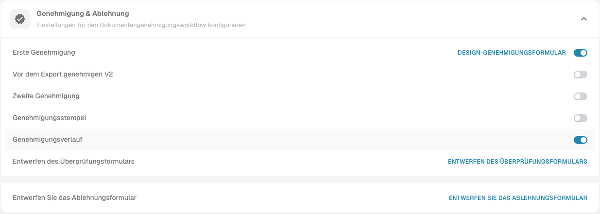

# Zulassung

Mit den Zulassungsoptionen legen Sie fest, wie ein Dokument geprüft wird, bevor es DocBits verlässt. Die Optionen werden je Dokumenttyp eingerichtet. Beginnen Sie daher mit dem Typ, den Ihr Team nutzt, z. B. **Rechnung**.

1. Öffnen Sie **Einstellungen** → **Dokumenttypen**.
2. Wählen Sie beim Dokumenttyp das **Zahnrad-Symbol**, um **Weitere Einstellungen** zu öffnen.
3. Scrollen Sie zu **Genehmigung & Ablehnung**. Prüfen Sie die vier Hauptoptionen und die gegebenenfalls zusätzlich sichtbare V2-Option, bevor Sie eine Einstellung ändern.

<figure><figcaption>Deutsche Dev-Ansicht für Rechnung mit unverändert vorgefundenen Einstellungen: Erste Genehmigung und Genehmigungsverlauf sind ein; V2, zweite Genehmigung und Genehmigungsstempel sind aus. Diese Momentaufnahme ist keine Konfigurationsempfehlung.</figcaption></figure>

| Option | Wofür sie da ist |
| --- | --- |
| **Erste Genehmigung** | Verlangt eine Genehmigungsentscheidung, bevor das Dokument exportiert werden kann. Bei eingeschalteter erster Genehmigung ist zusätzlich **Vor dem Export genehmigen V2** sichtbar. |
| **Zweite Genehmigung** | Fügt einen weiteren Genehmigungsschritt hinzu, wenn eine Entscheidung für Ihren Prozess nicht ausreicht. |
| **Genehmigungsstempel** | Versieht ein genehmigtes Dokument mit einem Genehmigungsvermerk. Einrichtung und Download-Optionen siehe [Genehmigungsstempel](approval-stamp.md). |
| **Genehmigungsverlauf** | Speichert eine Aufzeichnung der Genehmigungsentscheidungen. Die Einstellung und das Prüfen des Verlaufs siehe [Genehmigungsverlauf](approval-history.md). |

Wählen Sie die Optionen, die Ihr eigener Prozess verlangt. Prüfen Sie den Genehmigungspfad anschließend mit einem Testdokument ohne echten Kundenbezug und mit den dafür vorgesehenen Prüferrollen, bevor Sie ihn auf echte Dokumente anwenden. Das Bild zeigt die verfügbaren Einstellungen; während dieser Dokumentationsprüfung wurden kein Genehmigungsfluss durchlaufen und keine Exporte ausgeführt.
