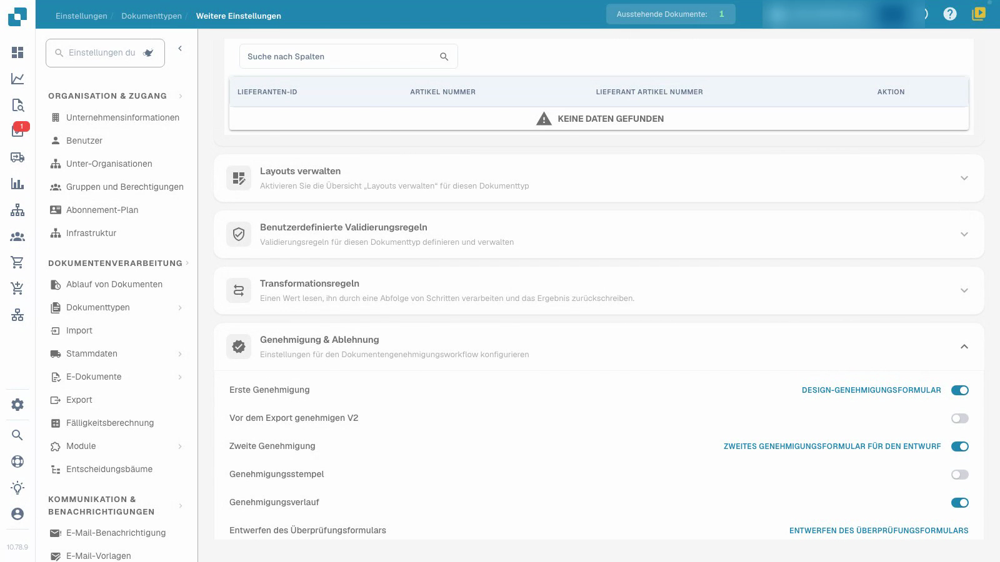
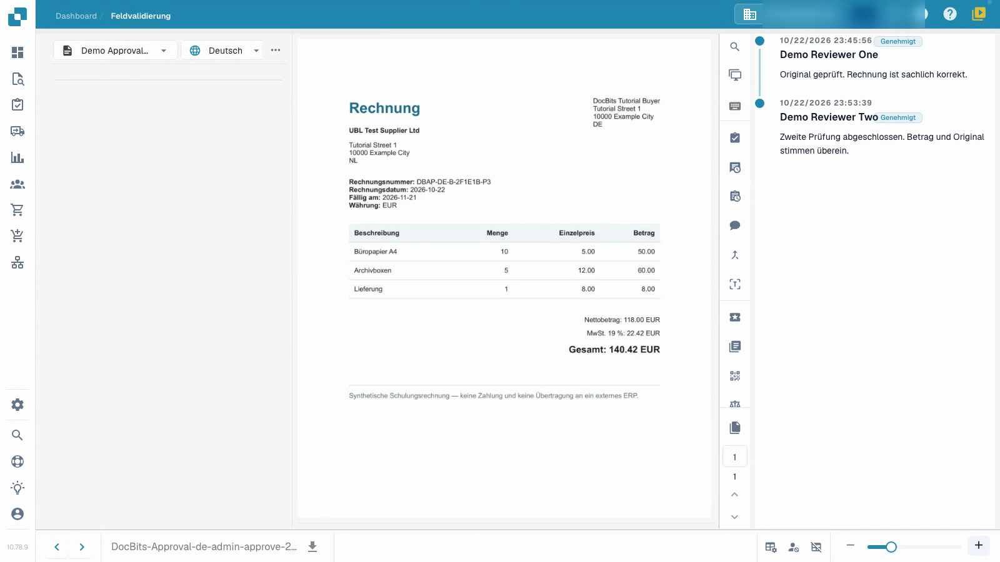

# Rechnungsfreigaben konfigurieren und testen

Dieses Video zeigt die Konfiguration und das Testen von Genehmigungen.


Rechnungsfreigaben konfigurieren und testen


[Video mit Untertiteln ansehen](https://docbits-videos.fra1.cdn.digitaloceanspaces.com/settings-assistant/invoice-approval-admin/v2/de.html)

Gezeigt wird die tatsächliche Anwendung. Die Bezeichnungen können je nach eingesetzter Version abweichen.

Konfigurieren Sie die Genehmigung für den von Ihrem Prozess verwendeten Dokumenttyp. Identifizieren Sie die vorgesehenen Prüfer und entscheiden Sie, ob Sie eine zweite unabhängige Prüfung benötigen. Das Video verwendet einen separaten Dokumenttyp und temporäre Prüferkonten ohne Administratorrechte.

## Dokumenttyp konfigurieren

Öffnen Sie **Einstellungen → Dokumenttypen**, wählen Sie den vorgesehenen Typ und öffnen Sie **Weitere Einstellungen → Genehmigung & Ablehnung**. Wählen Sie die für Ihren Prozess erforderlichen Einstellungen und laden Sie die Seite neu, um zu prüfen, was gespeichert wurde.

| Einstellung | Zweck |
| --- | --- |
| Erste Genehmigung | Erfordert eine Genehmigungsentscheidung, bevor das Dokument zum Export weitergeleitet wird. |
| Zweite Genehmigung | Fügt dem konfigurierten Prozess eine zweite Genehmigungsstufe hinzu. |
| Genehmigungsverlauf | Hält die erfassten Entscheidungen zur Überprüfung verfügbar. |
| Genehmigungsstempel | Konfiguriert eine Markierung auf einem genehmigten Dokument; siehe die separate Stempelanleitung. |

Die zusätzliche V2-Option und die Formulardesigner sind separate Einstellungen. Dieses Tutorial verwendet vorbereitete Standard-Genehmigungsformulare.

## Mit den vorgesehenen Rollen testen

1. Ordnen Sie die beiden Prüfer getrennten Gruppen zu und gewähren Sie ihnen den vorgesehenen Zugriff auf die zugewiesenen Dokumente. In diesem Beispiel hat das erste Konto die Genehmigungsberechtigung für die erste Stufe und das zweite Konto die Berechtigung für die zweite Stufe. Ein Schalter allein weist keine Person zu oder erteilt diese Berechtigung.
2. Verwenden Sie das erste normale Prüferkonto, um die zugewiesene, bereits validierte Rechnung zu prüfen, eine Notiz hinzuzufügen und die erste Genehmigung zu erteilen. Stellen Sie sicher, dass das gespeicherte Dokument noch auf die zweite Genehmigung wartet. Prüfen Sie, ob dieses Konto die zweite Stufe nicht ausführen kann, wenn seine Berechtigungen dies verbieten.
3. Weisen Sie die wartende Rechnung dem anderen autorisierten Prüfer zu. Verwenden Sie dieses zweite normale Prüferkonto, um sie zu prüfen und die zweite Genehmigung mit einer separaten Notiz zu erteilen.
4. Öffnen Sie den Verlauf erneut und überprüfen Sie beide unterschiedlichen Prüfer, Zeiten und Notizen. Lehnen Sie auch eine separate Testrechnung mit Begründung ab und überprüfen Sie diese Entscheidung nach dem Neuladen.

<figure><figcaption>
Gespeicherte Genehmigungseinstellungen im eigenen Testtyp.
</figcaption></figure>

<figure><figcaption>
Zwei verschiedene Prüfer und beide gespeicherten Notizen.
</figcaption></figure>

## Ergebnis überprüfen

Unterscheiden Sie zwischen erster Freigabe, ausstehender zweiter Freigabe und Ablehnung. Prüfen Sie, dass die Rechnungswerte nach jeder Entscheidung unverändert erhalten bleiben. In diesem isolierten Test wartet der Testkanal auf den Datenabruf und hat kein externes ERP-Ziel. Der technische Status `pending_data_fetch`, wenn er angezeigt wird, bedeutet, dass auf den Datenabruf gewartet wird. Der Genehmigungsverlauf allein beweist keine ERP-Übertragung.

Testen Sie die konfigurierten Rollen, die Zuweisung und den vollständigen Entscheidungspfad, bevor Sie den Prozess auf reale Geschäftsbelege anwenden.

## Verwandte Seiten

- [Gruppen, Benutzer und Berechtigungen](../../../groups-users-and-permissions/README.md)
- [Genehmigungsverlauf](approval-history.md)
- [Genehmigungsstempel](approval-stamp.md)
