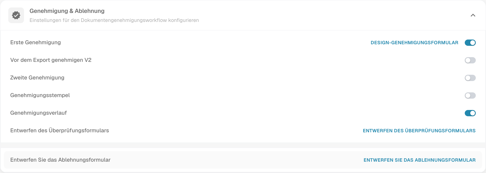

# Genehmigungsverlauf

Der Genehmigungsverlauf dient dazu, vorhandene Genehmigungs- und Ablehnungsentscheidungen eines Dokuments nachzuvollziehen. Welche Einträge verfügbar sind, hängt von der bisherigen Verarbeitung und Ihren Berechtigungen ab.

## Einstellung finden

1. Öffnen Sie **Einstellungen → Dokumenttypen**.
2. Öffnen Sie über das Zahnrad den betreffenden Dokumenttyp.
3. Wechseln Sie zum Bereich **Genehmigung & Ablehnung** und prüfen Sie **Genehmigungsverlauf**. Ändern Sie die Einstellung nur, wenn dies für Ihren Ablauf vorgesehen ist.

<figure><figcaption>
Aktuelle deutsche Einstellungen „Genehmigung &amp; Ablehnung“ mit dem Schalter „Genehmigungsverlauf“. Die Abbildung zeigt den vorgefundenen Zustand; es wurde nichts geändert und keine Genehmigungsentscheidung ausgeführt.
</figcaption></figure>

## Entscheidungen prüfen

Öffnen Sie das betroffene Dokument und den dort angebotenen Genehmigungsverlauf, sofern verfügbar. Prüfen Sie die aufgezeichnete Entscheidung, den Bearbeiter sowie Zeitpunkt und Reihenfolge. Kommentare können ergänzende Gründe enthalten, wenn sie erfasst wurden.

Beurteilen Sie das Ergebnis anhand des Entscheidungstexts und nicht allein nach einer Farbe. Eine leere Historie belegt keine Genehmigung. Die Abbildung zeigt nur die Konfiguration; für diese Anleitung wurde weder ein Dokument genehmigt oder abgelehnt noch eine tatsächliche Entscheidungshistorie erzeugt.
