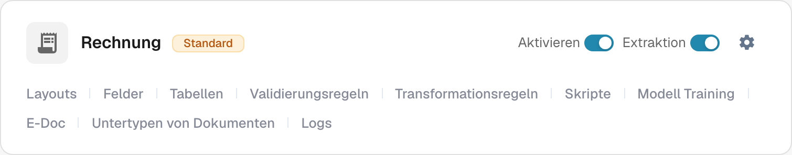
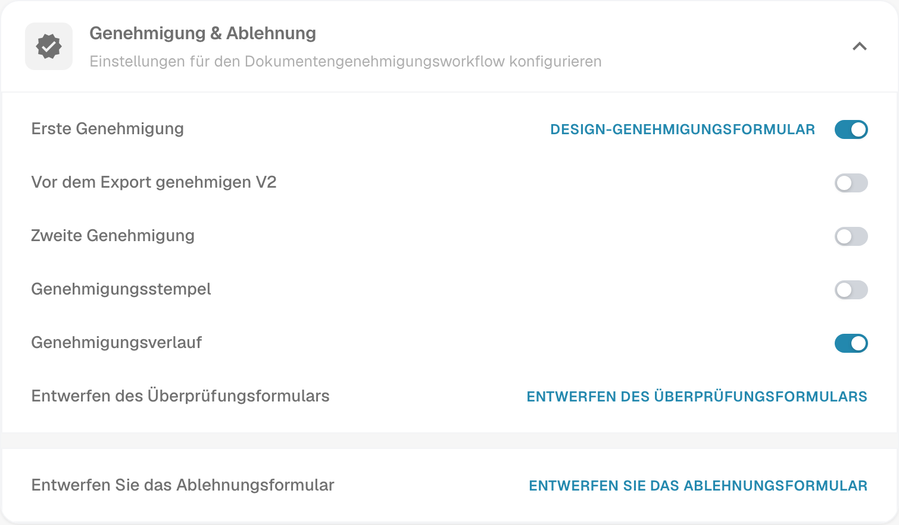

# Genehmigungsstempel

Ein Genehmigungsstempel ist eine Anmerkung im Genehmigungsworkflow, wenn die Option für den betreffenden Dokumenttyp aktiviert ist. Er hilft dem Prüfer nachzuvollziehen, wer ein Dokument wann genehmigt hat. Prüfen Sie die Anmerkung und das PDF-Ergebnis mit einer Testrechnung in dem Workflow, den Ihre Organisation tatsächlich verwendet.

## Option finden

1. Öffnen Sie mit einem Administratorkonto **Einstellungen → Dokumenttypen**. Suchen Sie den Dokumenttyp, den Sie konfigurieren möchten, z. B. **Rechnung**, und wählen Sie das **Zahnradsymbol** auf dieser Karte. Es öffnet **Weitere Einstellungen** für diesen Dokumenttyp.

   <figure><figcaption>
Echte Rechnungskarte aus der deutschen Dev-Oberfläche. Das Zahnrad öffnet Weitere Einstellungen; kein Steuerelement wurde geändert.
</figcaption></figure>

   **Aktivieren** steuert die Verfügbarkeit des Dokumenttyps, **Extraktion** dessen Extraktionsmodus. Die Links im Kartenfuß öffnen eigene Bereiche: **Layouts**, **Felder**, **Tabellen**, **Validierungsregeln**, **Transformationsregeln**, **Skripte**, **Modell Training**, **E-Doc**, **Untertypen von Dokumenten** und **Logs**. Welche Links verfügbar sind, hängt von den Modulen und Einstellungen des Dokumenttyps ab. Zum Genehmigungsstempel gelangen Sie über das Zahnrad.

2. Klappen Sie in **Weitere Einstellungen** den Bereich **Genehmigung & Ablehnung** auf. Suchen Sie **Genehmigungsstempel** neben **Erste Genehmigung**, **Zweite Genehmigung** und **Genehmigungsverlauf**. Die Aufnahme zeigt die vorhandene Einstellung des Stempels **ausgeschaltet**; in Ihrer Organisation kann ein anderer Zustand gelten. Sie zeigt kein genehmigtes Dokument.

   <figure><figcaption>
Echte deutsche Dev-Ansicht von Genehmigung &amp; Ablehnung. Die Schalterzustände wurden ausschließlich gelesen.
</figcaption></figure>

   **Erste Genehmigung**, **Vor dem Export genehmigen V2**, **Zweite Genehmigung** und **Genehmigungsverlauf** sind vom Stempel getrennte Workflow-Einstellungen. Die angezeigten Design-Links öffnen die jeweiligen Editoren für Genehmigungs-, Überprüfungs- oder Ablehnungsformulare. Um die Stempel-Einstellung anzusehen, müssen Sie diese Editoren nicht öffnen.

3. Ändern Sie **Genehmigungsstempel** erst, nachdem Sie den Ablauf von Genehmigungen und Exporten in Ihrer Organisation abgestimmt haben. **Eine Schalteränderung speichert die Einstellung sofort.** Halten Sie den vorherigen Zustand fest, damit Sie die Wirkung an einer Testrechnung überprüfen können.

## Eine Genehmigung prüfen

Schicken Sie eine synthetische Rechnung dieses Dokumenttyps durch den konfigurierten Genehmigungsworkflow. Genehmigen Sie sie im Genehmigungsschritt dieses Workflows mit einem berechtigten Testkonto. Öffnen Sie das genehmigte Dokument erneut und prüfen Sie, ob die Anmerkung den erwarteten Namen und das Datum enthält. Prüfen Sie auch das heruntergeladene PDF, das Ihr Workflow tatsächlich verwendet. Fehlt der Stempel, prüfen Sie Dokumenttyp, Genehmigungsstatus, Einstellung und Exportkonfiguration.

Ein Genehmigungsstempel ist von **Zweiter Genehmigung** und **Genehmigungsverlauf** getrennt. Das Aktivieren einer Option beweist nicht, dass die anderen konfiguriert sind. Die verfügbaren Dashboard-Downloadaktionen und das IDM-Exportformat hängen von der Umgebung ab und wurden für diese Seite nicht geprüft; dieser Leitfaden verspricht daher keine bestimmten Beschriftungen im Downloadmenü und keinen automatischen IDM-Output.

Die beiden Aufnahmen zeigen echte deutsche Dev-Ansichten. Bei dieser Prüfung wurde kein Schalter geändert und kein Dokument genehmigt oder exportiert. Der gestempelte Endzustand benötigt eine eigene synthetische Testrechnung im genehmigten Zustand.
