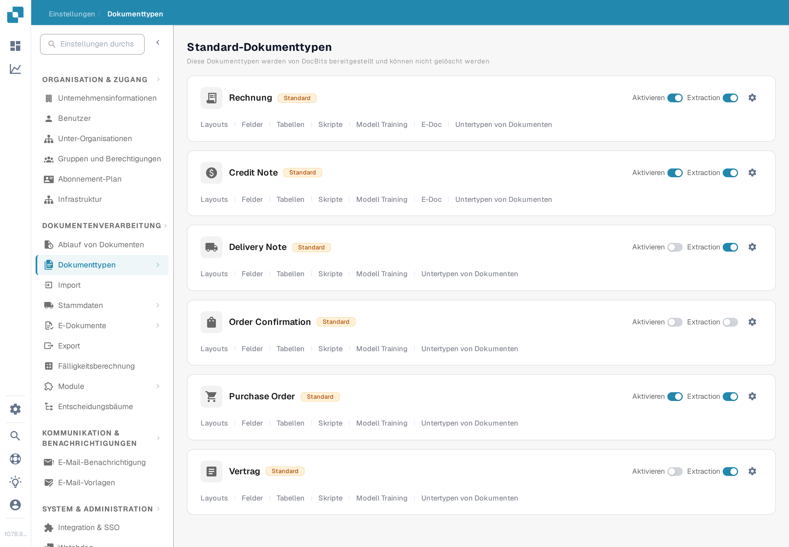

# Genehmigungsstempel

Ein Genehmigungsstempel ist eine Anmerkung, die während der Dokumentgenehmigung hinzugefügt wird, wenn die Option für diesen Dokumenttyp aktiviert ist. Er ist nützlich, wenn ein Prüfer sehen muss, wer ein Dokument wann genehmigt hat. Die vorherige Seite zeigte sechs Screenshots einer älteren Oberfläche und behandelte die Optionen Stempel, IDM-Export und PDF-Download, als wären sie bereits gemeinsam geprüft. Prüfen Sie jedes Ergebnis in Ihrem eigenen Arbeitsablauf, bevor Sie sich darauf verlassen.

## Option finden

1. Öffnen Sie mit einem Administratorkonto **Einstellungen → Dokumenttypen**. Suchen Sie den Dokumenttyp, den Sie konfigurieren möchten, z. B. **Rechnung**, und wählen Sie das **Zahnradsymbol** auf dieser Karte aus. Das Zahnrad öffnet **Weitere Einstellungen** für diesen Dokumenttyp; **Layouts** und **Felder** öffnen andere Editoren.

   <figure><figcaption>
Öffnen Sie das Zahnrad auf dem passenden Dokumenttyp.
</figcaption></figure>

2. Klappen Sie in **Weitere Einstellungen** den Bereich **Genehmigung & Ablehnung** auf. Suchen Sie den Schalter **Genehmigungsstempel** neben **Vor dem Export genehmigen V2**, **Zweite Genehmigung** und **Genehmigungsverlauf**. Der Screenshot zeigt die synthetische Beispielorganisation (Musterfirma GmbH) mit ausgeschaltetem Stempel. Er zeigt kein gestempeltes Dokument.

   <figure><figcaption>
Prüfen Sie die Einstellung Genehmigungsstempel für den gewählten Dokumenttyp.
</figcaption></figure>

3. Aktivieren Sie den Schalter erst, nachdem Sie in Ihrer Organisation vereinbart haben, wie Genehmigungen und Exporte ablaufen. Bewahren Sie eine Aufzeichnung der vorherigen Einstellung auf, damit Sie die Wirkung an einer Testrechnung überprüfen können.

## Eine Genehmigung prüfen

Schicken Sie eine synthetische Rechnung dieses Dokumenttyps durch den konfigurierten Genehmigungsworkflow. Genehmigen Sie sie auf dem Bildschirm **Bereit zur Genehmigung** mit einem berechtigten Testkonto. Der aktuelle DocBits-Webclient prüft die Option Genehmigungsstempel während der Genehmigung und fügt eine Stempelanmerkung mit dem Namen des Genehmigenden und dem Datum hinzu. Öffnen Sie das genehmigte Dokument erneut und prüfen Sie die Anmerkung und das heruntergeladene PDF, das Ihr Workflow tatsächlich verwendet. Fehlt der Stempel, prüfen Sie den Dokumenttyp, den Genehmigungsstatus, die Einstellung und die Exportkonfiguration.

Ein Genehmigungsstempel ist von **Zweiter Genehmigung** und **Genehmigungsverlauf** getrennt. Das Aktivieren einer Option beweist nicht, dass die anderen konfiguriert sind. Die verfügbaren Dashboard-Downloadaktionen und das IDM-Exportformat hängen von der Umgebung ab und wurden für diese Seite nicht geprüft; dieser Leitfaden nennt daher keine bestimmten Beschriftungen im Downloadmenü und keinen automatischen IDM-Output.

Die beiden neuen Screenshots wurden in der englischen Test-A-Sandbox visuell geprüft. Es wurde kein Schalter geändert und kein Dokument genehmigt oder exportiert; der gestempelte Endzustand benötigt eine eigene synthetische genehmigte Rechnung.
