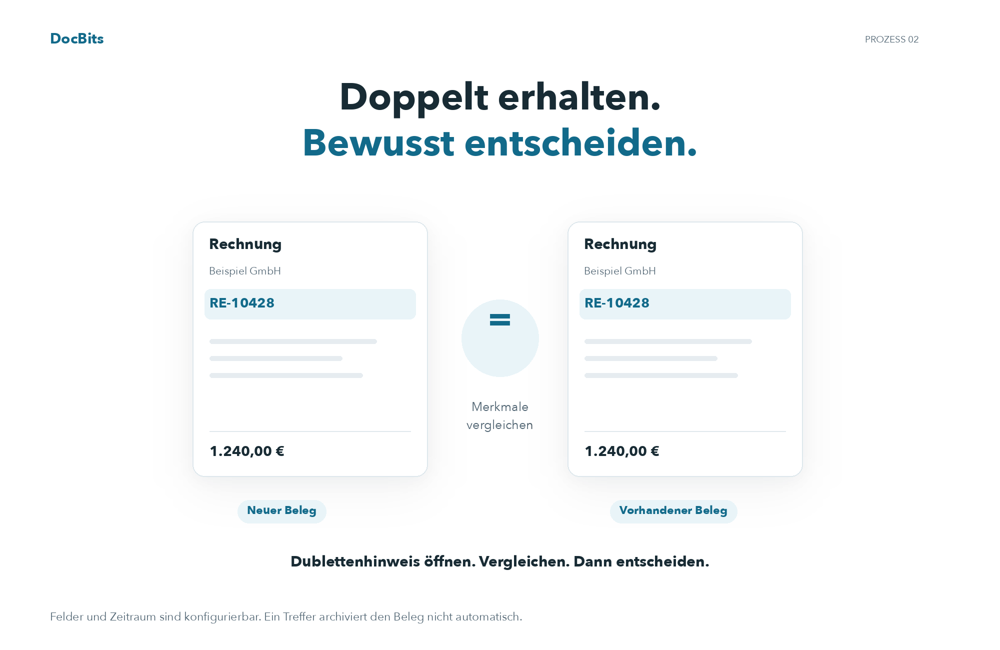
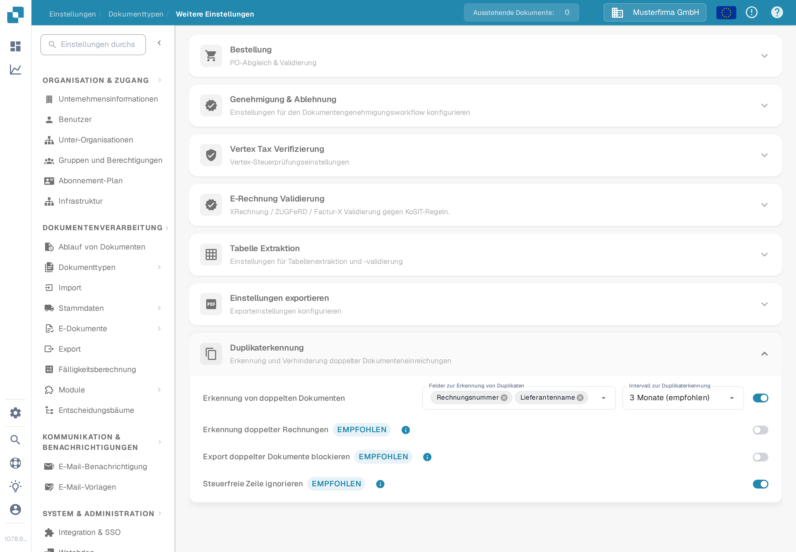
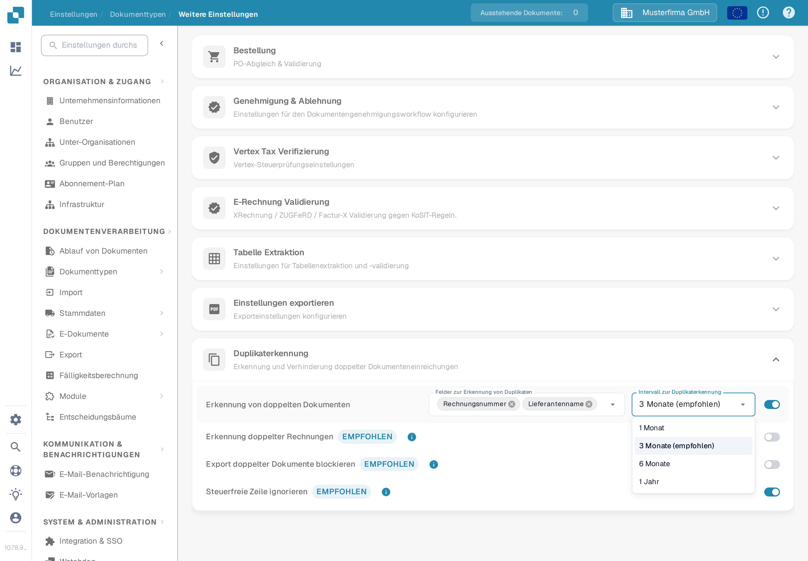

# Erkennung von Duplikaten

## Dubletten erkennen und bewusst entscheiden

<figure><picture><source srcset="../../../../../.gitbook/assets/intro-process-02-dubletten-de-dark-20261029.png" media="(prefers-color-scheme: dark)"></picture><figcaption>
Dubletten erkennen und bewusst entscheiden
</figcaption></figure>

DocBits vergleicht die konfigurierten Felder innerhalb des gewählten Zeitraums. Öffnen Sie bei einem Treffer den Dublettenhinweis und vergleichen Sie die Belege, bevor Sie fortfahren oder archivieren. Die Exportblockierung ist eine eigene Einstellung; ein Treffer archiviert einen Beleg nicht automatisch.

Mit der **Erkennung von Duplikaten** markieren Sie Dokumente, die innerhalb eines gewählten Zeitraums mit einem anderen Dokument in ausgewählten Feldern übereinstimmen. Die Optionen gehören zu jedem Dokumenttyp.

## Einstellungen öffnen

1. Öffnen Sie **Einstellungen → Dokumenttypen**.
2. Wählen Sie beim Dokumenttyp, den Sie konfigurieren möchten, **Einstellungen**.
3. Öffnen Sie in **Weitere Einstellungen** den Abschnitt **Duplikaterkennung**.

<figure><figcaption>
Die Rechnungseinstellungen zeigen vier separate Schalter. Die Auswahl für Felder und Intervall erscheint erst, wenn die Erkennung aktiviert ist.
</figcaption></figure>

## Festlegen, was als Duplikat gilt

1. Schalten Sie **Erkennung von doppelten Dokumenten** ein. Die Auswahlmenüs **Felder zur Erkennung von Duplikaten** und **Intervall zur Duplikaterkennung** erscheinen.
2. Wählen Sie die Felder aus, die übereinstimmen müssen. Bei einer Rechnung wählen Sie zum Beispiel **Lieferanten-ID** und **Rechnungsnummer**. Wählen Sie Felder, die Dokumente in Ihrem eigenen Prozess voneinander unterscheiden.
3. Wählen Sie ein Intervall: **1 Monat**, **3 Monate (empfohlen)**, **6 Monate** oder **1 Jahr**. Ein längeres Intervall prüft einen breiteren Datumsbereich und kann länger laden.

Jede Änderung wird beim Ausführen gespeichert; dieser Abschnitt hat keine eigene Speichern-Schaltfläche. Wenn Sie die Erkennung ausschalten, werden die Auswahlmenüs für Felder und Intervall ausgeblendet.

Für den Dokumenttyp **Rechnung** bietet dieser Abschnitt zusätzlich **Erkennung doppelter Rechnungen**, **Export doppelter Dokumente blockieren** und **Steuerfreie Zeile ignorieren**. Diese Funktionen sind eigene Schalter; aktivieren Sie nur das Verhalten, das Ihr Rechnungsprozess braucht. Die zusätzlichen Schalter werden für andere Dokumenttypen nicht angezeigt. Die **Erkennung doppelter Rechnungen** vergleicht Rechnungsnummern im DocBits-Dashboard mit denen in Infor und erzeugt eine zusätzliche Gutschriftgebühr.

<figure><figcaption>
Aktivieren Sie die Erkennung, bevor Sie die Vergleichsfelder und das Zeitintervall auswählen.
</figcaption></figure>

<figure><figcaption>
Drei Monate sind im Menü als empfohlenes Intervall markiert.
</figcaption></figure>

## Ein markiertes Dokument prüfen

Wenn DocBits eine Übereinstimmung findet, zeigt die Zeile des Dokuments im **Dashboard** ein Duplikat-Symbol. Wählen Sie das Symbol, um die übereinstimmenden Datensätze im Seitenpanel zu vergleichen. Das Symbol erscheint nur, wenn eine Übereinstimmung vorliegt.

Wenn Sie ein markiertes Dokument öffnen, bietet die Duplikat-Warnung **View Duplicate**, **Proceed Anyway** und – falls das Dokument noch nicht archiviert wurde – **Archive** an. Prüfen Sie die übereinstimmenden Datensätze, bevor Sie eine Aktion wählen. Einen Leitfaden zur Dokumentenliste finden Sie im [Dashboard-Leitfaden](../../dashboard/README.md).
