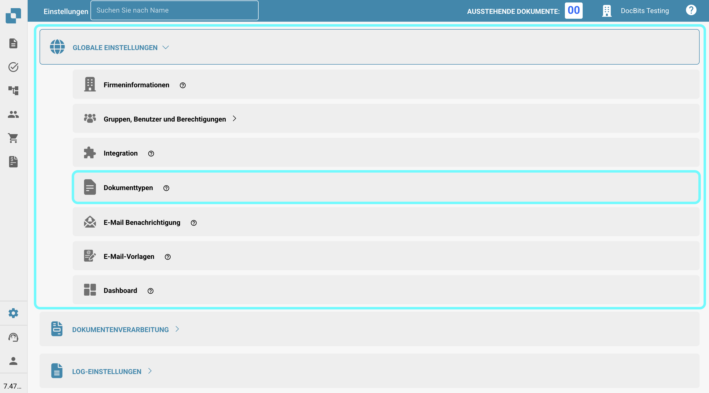
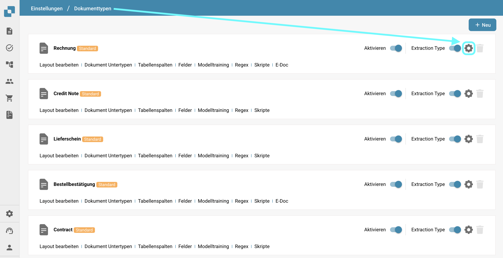
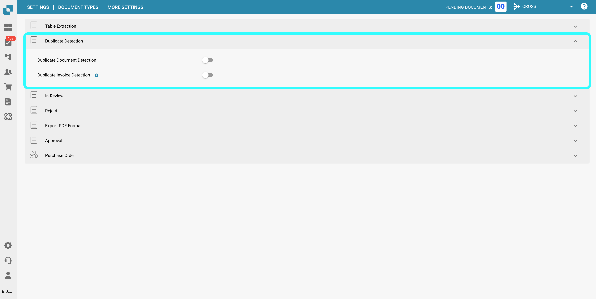
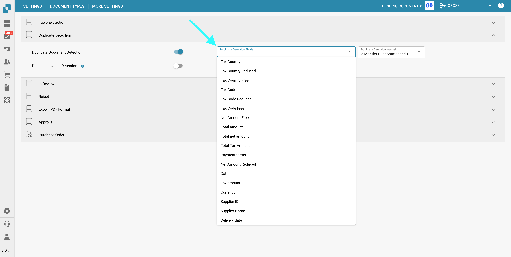
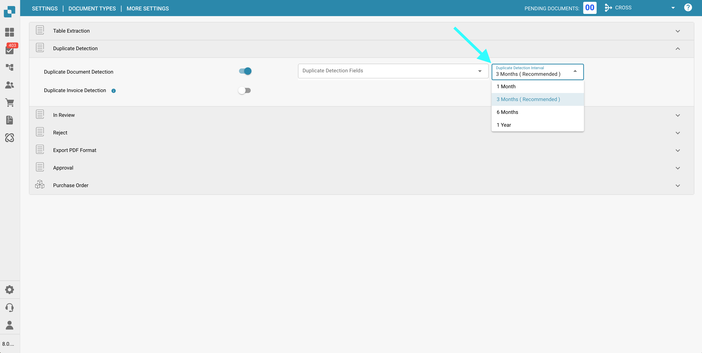
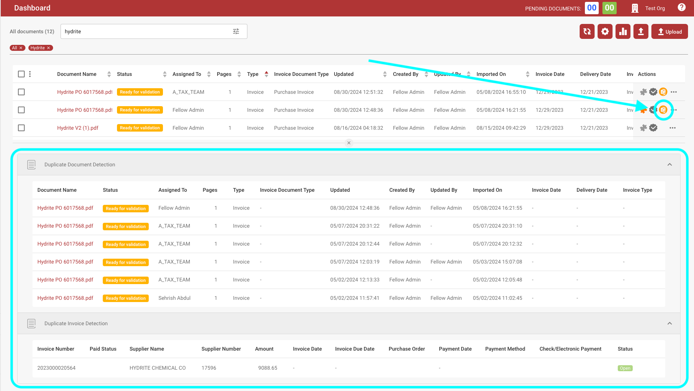
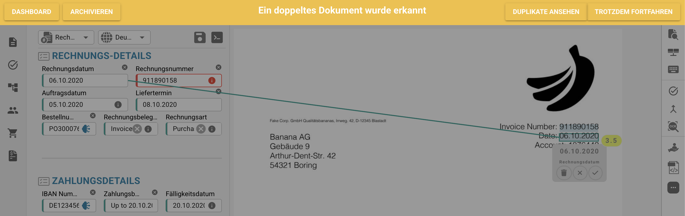

# Erkennung von Duplikaten

## Übersicht

In **DocBits** können Sie nach doppelten Dokumenten filtern, indem Sie angeben, welche Felder übereinstimmen müssen, und ein Zeitintervall definieren, während dessen Duplikate erkannt werden sollen.

Diese Seite bietet eine detaillierte Anleitung, wie Sie die Funktion **Erkennung von Duplikaten** effektiv aktivieren und nutzen können.

## Aktivierung der Erkennung von Duplikaten

Um die Erkennung von doppelten Dokumenten in **DocBits** zu aktivieren, befolgen Sie diese Schritte:

1.  Navigieren Sie zu **Einstellungen** → **Globale Einstellungen** → **Dokumenttypen**.

    <figure><figcaption></figcaption></figure>
2.  Wählen Sie den gewünschten **Dokumenttyp** aus und klicken Sie auf **Weitere Einstellungen**.

    <figure><figcaption></figcaption></figure>
3.  Gehen Sie zum Abschnitt **Erkennung von Duplikaten**.

    <figure><figcaption></figcaption></figure>

DocBits bietet zwei Optionen zur Identifizierung doppelter Dokumente:

1. **Erkennung von doppelten Dokumenten**:\
   Diese Funktion überprüft auf doppelte Dokumente, die basierend auf den ausgewählten Kriterien in **DocBits** hochgeladen wurden. Wenn ein Dokument die ausgewählten Kriterien in anderen Dokumenten erfüllt, wird es als Duplikat gekennzeichnet.
2.  **Erkennung doppelter Rechnungen** (Nur verfügbar für den **Rechnungs**-Dokumenttyp):\
    Diese Funktion erfordert das Synchronisieren von Lieferantenrechnungen von Infor zu DocBits. Sie vergleicht die Rechnungsnummern im DocBits-Dashboard mit denen in Infor. Wenn dieselbe Rechnungsnummer mehr als einmal erscheint, wird sie als Duplikat gekennzeichnet.

    <mark style="color:red;">**Hinweis**</mark>: Die Verwendung der Funktion **Erkennung doppelter Rechnungen** führt zu einer zusätzlichen Gutschriftgebühr.

## Filter, welche Dokumente als Duplikate erkannt werden sollen

Sobald die **Erkennung von Duplikaten** aktiviert ist, stehen zwei Dropdown-Menüs zur Konfiguration zur Verfügung:

*   **Felder zur Erkennung von Duplikaten**\
    Wählen Sie die Felder aus, die zur Identifizierung von Duplikaten verwendet werden sollen (z. B. Lieferanten-ID, Datum, Rechnungsnummer usw.). Dokumente, die diesen Feldern entsprechen, werden als Duplikate gekennzeichnet.

    <figure><figcaption></figcaption></figure>
*   **Intervall zur Duplikaterkennung**

    Verwenden Sie diese Einstellung, um den Zeitraum zu definieren, innerhalb dessen Duplikate erkannt werden. Dokumente, die innerhalb des ausgewählten Intervalls hochgeladen werden, werden anhand der ausgewählten Felder miteinander verglichen.

    **Verfügbare Optionen:**

    * 1 Monat
    * 3 Monate (Empfohlen)
    * 6 Monate
    * 1 Jahr

    <mark style="color:red;">**Hinweis**</mark>: Ein 3-Monats-Intervall wird empfohlen, um eine optimale Leistung sicherzustellen. Die Auswahl eines längeren Intervalls kann zu langsameren Ladezeiten des Dashboards führen.

    <figure><figcaption></figcaption></figure>

## Anzeigen doppelter Dokumente im Dashboard

Sobald die **Erkennung von Duplikaten** aktiviert ist, wird bei allen als Duplikate identifizierten Dokumenten ein Duplikatindikator-Symbol im Dashboard angezeigt.

*   Klicken Sie auf dieses Symbol, um die übereinstimmenden Datensätze in einer nebeneinander angeordneten Split-Screen-Ansicht für einen einfachen Vergleich zu öffnen. \
    <mark style="color:red;">**Hinweis**</mark>: Das Symbol erscheint nur, wenn mindestens ein Duplikat für das Dokument erkannt wurde.

    <figure><figcaption></figcaption></figure>
*   Beim Anzeigen eines gekennzeichneten Dokuments erscheint oben eine Warnleiste, die darauf hinweist, dass das Dokument ein Duplikat ist.

    <figure><figcaption></figcaption></figure>
