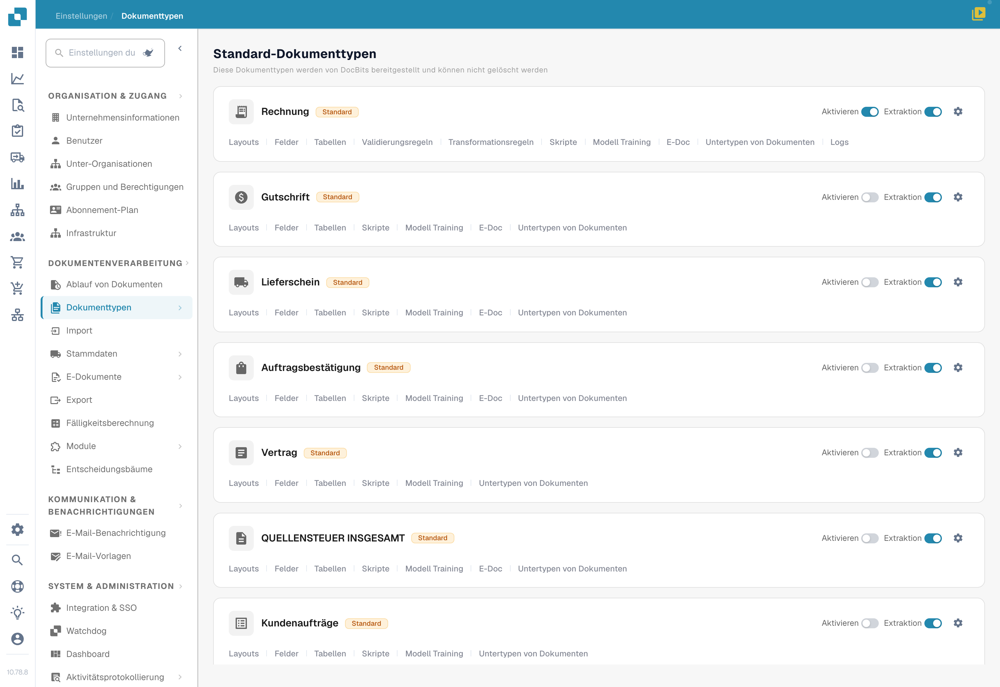
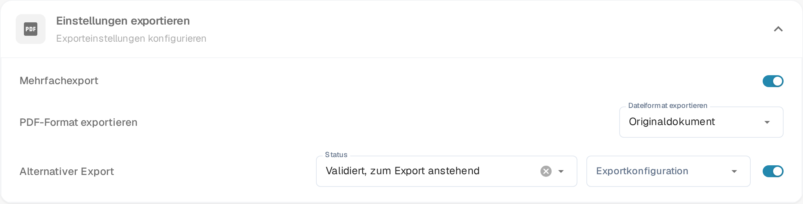

# Alternativer Export

## Übersicht

Sie können eine alternative Exportoption konfigurieren, die im Dropdown-Menü für den Export im Bestellabgleich angezeigt wird, wenn ein Dokument einen bestimmten Status hat.\
Diese Seite erklärt, wie Sie diese Option einrichten. Die Einstellung liegt im Bereich **Einstellungen exportieren**, also in den Exporteinstellungen des Dokumenttyps.

## Aktivierungsschritte

1. Gehen Sie zu **Einstellungen → Dokumenttypen**
2.  Finden Sie die Karte des Dokumenttyps und öffnen Sie über das Zahnrad (**Weitere Einstellungen**) dessen Einstellungen.

    <figure><figcaption>
Aktuelle deutsche Dokumenttypenübersicht. Über das Zahnrad des gewünschten Dokumenttyps öffnen Sie dessen Einstellungen; es wurde kein Schalter geändert.
</figcaption></figure>
3.  Öffnen Sie den Bereich **Einstellungen exportieren** und schalten Sie **Alternativer Export** ein. Die Bereichsüberschrift ist weiterhin fehlerhaft übersetzt; gemeint sind die Exporteinstellungen.

    <figure><figcaption>
Der Schalter <strong>Alternativer Export</strong> im Bereich <strong>Einstellungen exportieren</strong> (Exporteinstellungen). Ist er eingeschaltet, erscheinen daneben <strong>Status</strong> und <strong>Exportkonfiguration</strong>.
</figcaption></figure>

## So richten Sie es ein

Sobald die Einstellung aktiviert ist, können Sie einen Dokumentstatus auswählen und eine vordefinierte Exportkonfiguration zuweisen.

* **Status** - der Dokumentstatus, in dem die zusätzliche Exportoption angeboten wird.
* **Exportkonfiguration** - die Exportkonfiguration, die diese Option verwendet.

Weitere Informationen zur Einrichtung von Exportkonfigurationen finden Sie [hier](../../../../document-processing/export.md).

Sie können zwischen den folgenden Status wählen:

* Klassifiziert
* Bestätigung steht noch aus
* Genehmigung ausstehend
* Zweite Genehmigung ausstehend
* Validiert, zum Export anstehend
* Genehmigt und zur Ausfuhr vorgesehen
* Abgelehnt
* Abgeschlossen
* Exportiert
* In der Warteschleife
* Workflow
* Fehler
* In Überprüfung

Nach der Einrichtung wird eine zusätzliche Exportoption im Bestellabgleich angezeigt, die mit den Exportoptionen übereinstimmt. Diese Option verwendet die angegebene Exportkonfiguration, wenn das Dokument den definierten Status erfüllt.

<!-- Obsolete illustration retired: Unverified historical matching result is not current export-configuration evidence -->
