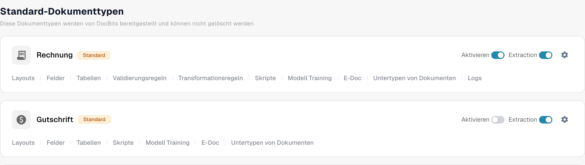
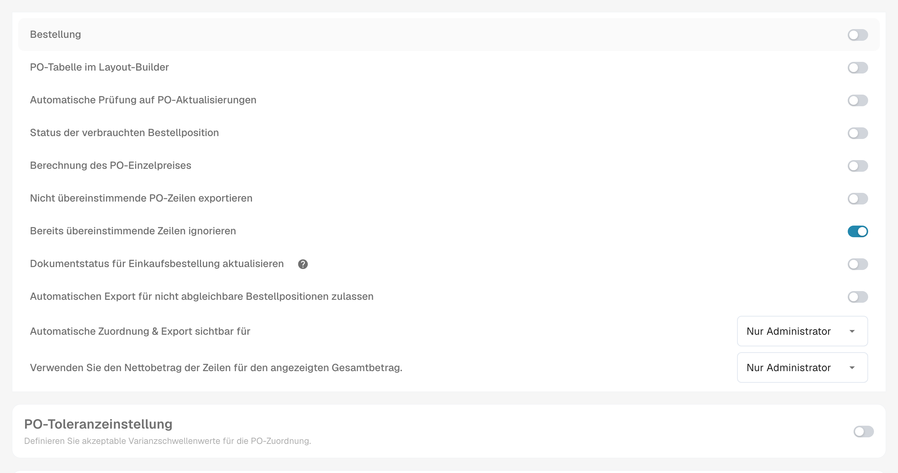

# Status verbrauchter Bestellpositionen

**Status der verbrauchten Bestellposition** färbt Bestellpositionen in der Abgleichsansicht danach ein, wie viel von jeder Position bereits abgeglichen wurde. Aktivieren Sie die Einstellung für den Rechnungs-Dokumenttyp, wenn Ihr Team unbenutzte, teilweise genutzte und vollständig genutzte PO-Positionen schnell erkennen soll. Die Farbe ist eine visuelle Hilfe; prüfen Sie die **abgeglichene Menge** und die Spalte mit der ausgewählten PO-Menge, bevor Sie entscheiden, ob eine Position erneut abgeglichen werden kann.

## Die Einstellung aktivieren

1. Öffnen Sie **Einstellungen → Dokumenttypen**. Suchen Sie den Dokumenttyp, den Sie für Ihre Rechnungen verwenden, und wählen Sie das Zahnrad auf der Karte, um **Weitere Einstellungen** zu öffnen. Der Screenshot zeigt die **Rechnung**-Karte. Lassen Sie die Schalter **Aktivieren** und **Extraktion** unverändert.

   <figure><figcaption>
Deutsche Dokumenttypenübersicht. Über das Zahnrad der Rechnung öffnen Sie die weiteren Einstellungen.
</figcaption></figure>

2. Klappen Sie **Bestellung** auf, falls der Bereich eingeklappt ist. Suchen Sie **Status der verbrauchten Bestellposition** und aktivieren Sie den zugehörigen Schalter. Dies ist eine eigene Einstellung und nicht dasselbe wie **Bestellstatus des Dokuments aktualisieren** weiter unten im selben Abschnitt.

   <figure><figcaption>
Deutsche Bestelleinstellungen mit Status der verbrauchten Bestellposition. Die Schalter zeigen den vorgefundenen Zustand.
</figcaption></figure>

3. Öffnen Sie eine Rechnung mit Bestellabgleich und prüfen Sie deren PO-Positionen. Die folgende Tabelle erklärt, wie die Zeilenfarben mit dem Abgleichsstatus zusammenhängen. Die Schritte zum Abgleich finden Sie unter [Bestellabgleich](../../../../../../end-user-and-partner-section/end-user-section/purchase-order-matching/README.md).

## Die PO-Zeilenfarben lesen

| Darstellung | Bedeutung | Was zu prüfen ist |
| --- | --- | --- |
| Einfarbig oder weiß | Für diese PO-Position wurde noch keine Menge abgeglichen. | Prüfen Sie vor dem Abgleich die PO-Menge und die Rechnungsposition. |
| Blaue Tönung | Sie haben die Position in der aktuellen Abgleichsansicht ausgewählt. | Die Auswahl ist vorübergehend; sie bedeutet nicht, dass die Position vollständig abgeglichen ist. |
| Hellorange | Es wurde bereits eine Menge abgeglichen, die abgeglichene Menge liegt aber unter der ausgewählten PO-Menge. | Prüfen Sie, wie viel Menge noch übrig ist. |
| Helles Violett | Die abgeglichene Menge entspricht mindestens der ausgewählten PO-Menge. | Gehen Sie nicht davon aus, dass noch weitere Menge verfügbar ist. |

Eine durchgestrichene Position hat eine andere Bedeutung: Ihr PO-Status kann durch [Deaktivierte Bestellstatus](purchase-order-disable-statuses.md) ausgeschlossen sein. Prüfen Sie diese Einstellung, wenn eine Position nicht ausgewählt werden kann.
