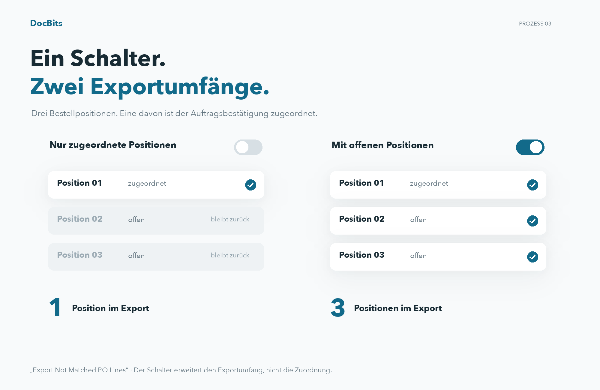

# Export nicht übereinstimmender PO-Zeilen

## Den Exportumfang an drei Positionen verstehen

<figure><figcaption>
Den Exportumfang an drei Positionen verstehen
</figcaption></figure>

Im Beispiel hat die Bestellung drei Positionen; nur eine ist einer Position der Auftragsbestätigung zugeordnet. Ist „Export Not Matched PO Lines“ ausgeschaltet, wird nur die zugeordnete Bestellposition exportiert. Ist die Option eingeschaltet, werden auch die beiden offenen Bestellpositionen mitgegeben. Das erzeugt keine zusätzliche Zuordnung.

## **Wo Sie es Finden**

Gehen Sie zu **Einstellungen → Allgemeine Einstellungen → Dokumenttypen → Weitere Einstellungen → Einkaufsbestellabschnitt → Export nicht übereinstimmender PO-Zeilen**. Schalten Sie den Schalter um, um diese Einstellung zu aktivieren.

### **Wie es Funktioniert**

* **Wenn deaktiviert**, exportiert das System nur Einkaufsbestellzeilen, die mit einer Auftragsbestätigungszeile übereinstimmen. Nicht übereinstimmende Einkaufsbestellzeilen werden nicht in den Export einbezogen.
* **Wenn aktiviert**, exportiert das System alle Einkaufsbestellzeilen, auch wenn sie nicht mit einer Auftragsbestätigungszeile übereinstimmen.

Zum Beispiel, wenn eine Einkaufsbestellung **drei Zeilen** hat, aber der Lieferant eine **Auftragsbestätigung mit nur einer Zeile** sendet, ordnen Sie diese Zeile einer Einkaufsbestellzeile zu. Die verbleibenden zwei nicht übereinstimmenden Einkaufsbestellzeilen werden:

* **Vom Export ausgeschlossen**, wenn die Einstellung deaktiviert ist.
* **Im Export enthalten**, wenn die Einstellung aktiviert ist.
