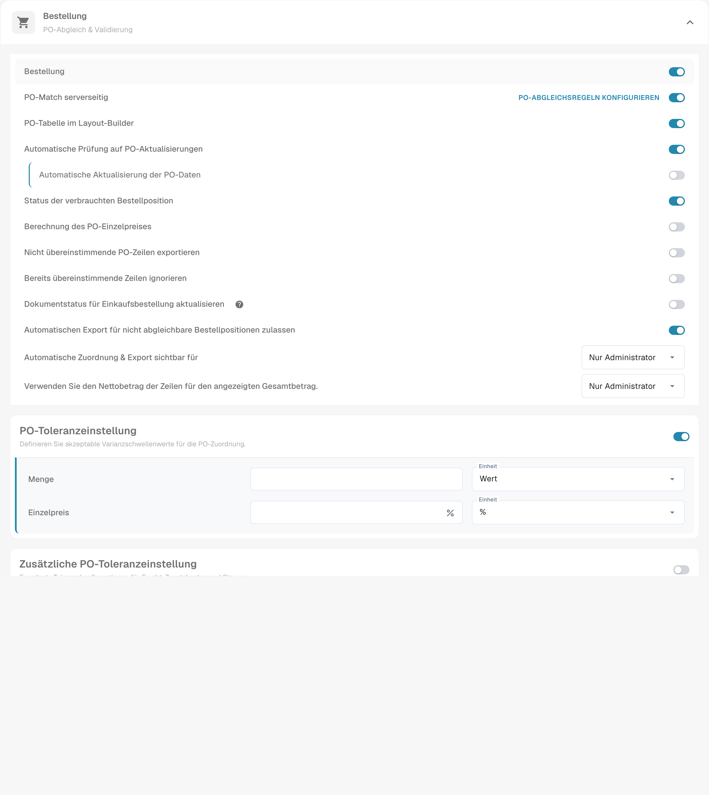
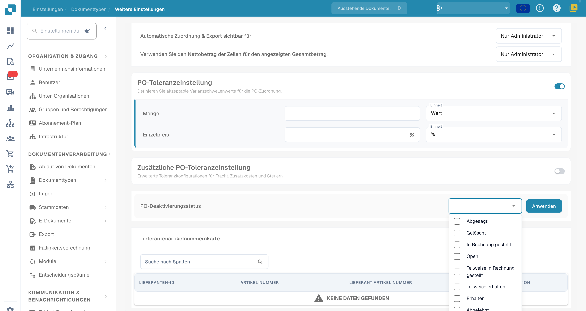

# PO-Deaktivierungsstatus

## **Übersicht**

Mit **PO-Deaktivierungsstatus** legen Sie fest, welche Bestellstatus eine Bestellung vom Rechnungsabgleich ausschließen. Prüfen Sie den Status der betroffenen Bestellung und die tatsächlich angewendeten Abgleichsregeln. Die Einstellung allein ist keine allgemeine Sperre für Rechnungsverarbeitung, Export oder Zahlung.

## **Aktivierungsschritte**

1.  Öffnen Sie **Einstellungen → Dokumenttypen**

    <figure><figcaption>
Aktuelle deutsche Dokumenttypenübersicht. Über das Zahnrad des gewünschten Dokumenttyps öffnen Sie dessen Einstellungen; es wurde kein Schalter geändert.
</figcaption></figure>
2.  Öffnen Sie über das Zahnrad des gewünschten Dokumenttyps dessen Einstellungen.

3.  Suchen Sie im Bereich **Bestellung** die Option **PO-Deaktivierungsstatus**.

    <figure><figcaption>
Oberer Bereich der aktuellen deutschen Bestelleinstellungen mit Abgleichsoptionen, Einzelpreisberechnung und Toleranzen. Die Schalter zeigen den vorgefundenen Zustand; kein Abgleich oder Export wurde ausgeführt.
</figcaption></figure>

### **Wie man eine deaktivierte Bestellung identifiziert**

Prüfen Sie im Bestellabgleich den Bestellstatus und Hinweise zur Verwendbarkeit. Eine durchgestrichene Darstellung kann je nach Ansicht einen ausgeschlossenen Eintrag kennzeichnen. Die Abbildungen dieser Anleitung zeigen nur die Einstellungen; sie belegen weder einen ausgeführten Abgleich noch eine Zahlungssperre.

### **Wie man es einrichtet**

1. In der **PO-Deaktivierungsstatus**-Einstellung öffnen Sie das Auswahlfeld neben der Beschriftung.
2.  Ein Klick auf dieses Feld öffnet eine Dropdown-Liste mit verfügbaren PO-Status.

    <figure><figcaption>
Geöffnete deutsche Auswahl für PO-Deaktivierungsstatus. Der Status „Open“ ist noch englisch; es wurde keine Auswahl geändert und „Anwenden“ nicht betätigt. Die Einstellung betrifft den Bestellabgleich.
</figcaption></figure>
3. Wählen Sie die gewünschten Status; ein erneuter Klick hebt die Auswahl auf. Prüfen Sie die betroffenen Bestellungen vor dem Anwenden.
4.  Mit **Anwenden** speichern Sie diese Konfiguration. Für die Abbildungen wurde diese Aktion nicht ausgeführt.

**Statusbezeichnungen**

Nutzen Sie die Status aus der aktuellen Auswahlliste Ihrer Umgebung. Die Abbildung zeigt beispielsweise **Abgesagt**, **Gelöscht**, **In Rechnung gestellt** und **Open**. Der noch englische Produkttext **Open** bedeutet hier **Offen**.
