# Regeln für die Übereinstimmung von Bestellungen

## Video: PO-Abgleichsregeln und Toleranzen einrichten

Der Administrator zeigt, wie er eine veröffentlichte Regelversion als Entwurf kopiert, die Vergleiche prüft, eine Änderung speichert und den gespeicherten Entwurf erneut lädt. Der Rundgang erklärt **Single Match**, **Multi Match** und **Match on Total**, Prioritäten innerhalb der Verarbeitungsstufen, automatische und manuelle Anwendung, Spaltenvergleiche, Aktivierungsbedingungen, Einheiten und Verpackungseinheiten.

Im zweiten Teil richtet er beim Dokumenttyp eine **Einzelpreistoleranz von fünf Prozent** ein und erklärt Prozentwerte, feste Beträge, artikelbezogene Vorgaben sowie getrennte Toleranzen für Fracht, Zusatzkosten und Steuern. Die Veröffentlichung und Aktivierung einer Regelversion erfolgen erst nach fachlichen Tests.



**Full Match ist ein Dokumentstatus, kein Regeltyp:** Alle relevanten Rechnungspositionen sind erfolgreich abgeglichen. Ein **Partial Match** lässt weitere Rechnungspositionen offen und bedeutet keine feste 50-Prozent-Grenze. Eine Regel vom Typ **Match on Total** kann zu einem vollständigen Abgleich beitragen, hat aber eine andere Bedeutung. Freigabe und Export bleiben eigene Prozessschritte. Den Ablauf für Anwender zeigt der [Rundgang zum Bestellabgleich](../../../../../../end-user-and-partner-section/end-user-section/purchase-order-matching/README.md).

## Einführung: Bestellungen und Verwaltung der PO-Regeln

Die PO-Abgleichsregeln bestimmen, welche Rechnungs- und Bestellpositionen zusammenpassen. DocBits verwendet sie beim automatischen Abgleich und, soweit für die Regel zugelassen, bei einer manuell gewählten Verbindung. Administratoren legen Vergleichsfelder, Regeltypen, Prioritäten und fachliche Ausnahmen fest.

Diese Konfigurationsseite dient dazu, die Regeln zu definieren und zu verwalten, die bestimmen, _wie_ PO-Positionen mit dem entsprechenden eingehenden Dokument (Rechnung, Auftragsbestätigung) abgeglichen werden.


**Voraussetzung:** Die Matching-Regeln werden nur verwendet, wenn **PO-Match serverseitig** für den Dokumenttyp aktiviert ist (Einstellungen → Dokumenttypen → Weitere Einstellungen → Bestellung). Ist der Schalter deaktiviert, führt DocBits den Abgleich mit seinem eingebauten Matcher durch (Menge, Stückpreis, Artikelnummer, Bestellnummer) und ignoriert das Regelwerk.


***

## Zugriff

1. Navigieren Sie zu **Einstellungen** → **Dokumenttypen**, wählen Sie den Dokumenttyp aus und klicken Sie auf **Weitere Einstellungen**.
2. Aktivieren Sie in der Karte **Bestellung** den Schalter **PO-Match serverseitig**.
3. Klicken Sie neben dem Schalter auf **PO-Abgleichsregeln konfigurieren**.

<figure>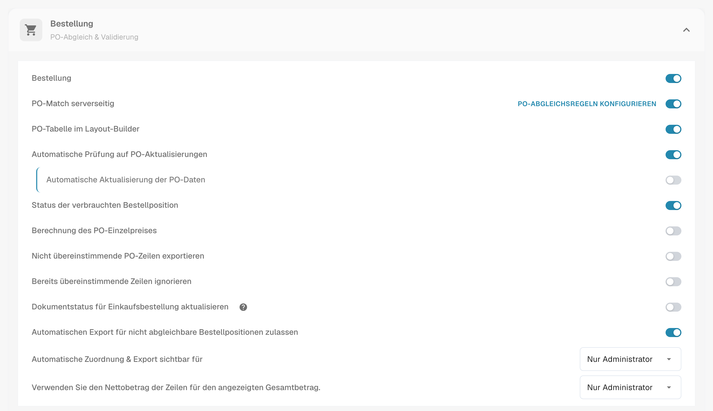<figcaption>
Die Karte Bestellung. <strong>PO-Abgleichsregeln konfigurieren</strong> steht neben <strong>PO-Match serverseitig</strong>.
</figcaption></figure>

## Die Seite im Überblick

<figure>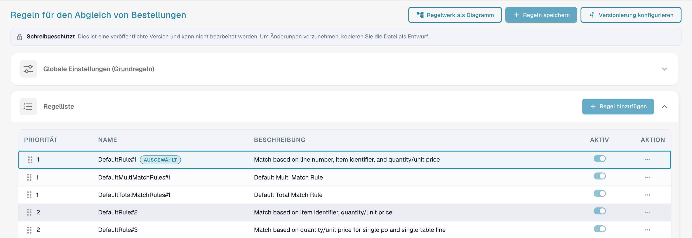<figcaption>
Die Seite PO-Abgleichsregeln.
</figcaption></figure>

Die Seite hat oben drei Schaltflächen:

* **Regelwerk als Diagramm** öffnet ein Flussdiagramm des aktiven Regelwerks. Siehe Abschnitt "Regelwerk als Diagramm".
* **Regeln speichern** speichert Ihre Änderungen im Entwurf, den Sie bearbeiten.
* **Versionierung konfigurieren** öffnet den Versionsverlauf. Siehe Abschnitt "Versionen und Entwürfe".

Unter den Schaltflächen erscheint ein Hinweis **Schreibgeschützt**, wenn Sie eine veröffentlichte Version ansehen: *Dies ist eine veröffentlichte Version und kann nicht bearbeitet werden. Um Änderungen vorzunehmen, kopieren Sie die Datei als Entwurf.* Darunter folgen die Karte **Globale Einstellungen (Basisregeln)** und die **Regelliste**. Wählen Sie eine Regel in der Liste aus, um sie im Bereich **Regelkonfiguration** unter der Liste zu konfigurieren.

***

## Globale Einstellungen (Basisregeln)

Diese Einstellungen legen den Rahmen fest, der für alle Matching-Regeln gilt:

<figure>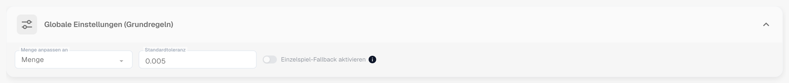<figcaption>
Die geöffnete Karte Globale Einstellungen (Basisregeln).
</figcaption></figure>

* **Einstellung:** Menge anpassen an
  * **Zweck:** Definiert, welche Menge der Bestellposition mit der Dokumentposition verglichen wird — zum Beispiel die bestellte Menge oder die **offene Rechnungsmenge** (bestellt minus bereits berechnet), was die übliche Wahl für Rechnungen ist.
  * **Gültige Werte:** Menge oder andere verfügbare Mengenfelder im System, abhängig von der Datenstruktur (z. B. ein alternatives normalisiertes Mengenfeld).
  * **Abhängigkeit:** Bestimmt die Grundlage für alle Matching-Regeln, die Menge in ihren Vergleichskriterien einschließen.
* **Einstellung:** Standardtoleranz
  * Die Anzeige, zum Beispiel `0.005`, ist keine Eingabe für fünf Prozent Einzelpreisabweichung. Richten Sie fachliche Mengen- und Einzelpreisgrenzen in den [PO-Toleranzeinstellungen des Dokumenttyps](purchase-order-tolerance-settings-additional-purchase-order-tolerance.md) ein. Dort besitzt jeder Wert eine eigene Auswahl für Prozent oder einen festen Wert.
  * Im numerischen Spaltenvergleich der Regel muss **Toleranz zulassen** aktiviert sein. Artikelbezogene Vorgaben können die allgemeinen Werte übersteuern; prüfen Sie das konkrete Ergebnis mit Testbelegen.

***

## Regelliste

Die Regelliste zeigt alle verfügbaren Matching-Regeln an und verwaltet deren Ausführungsreihenfolge.

<figure>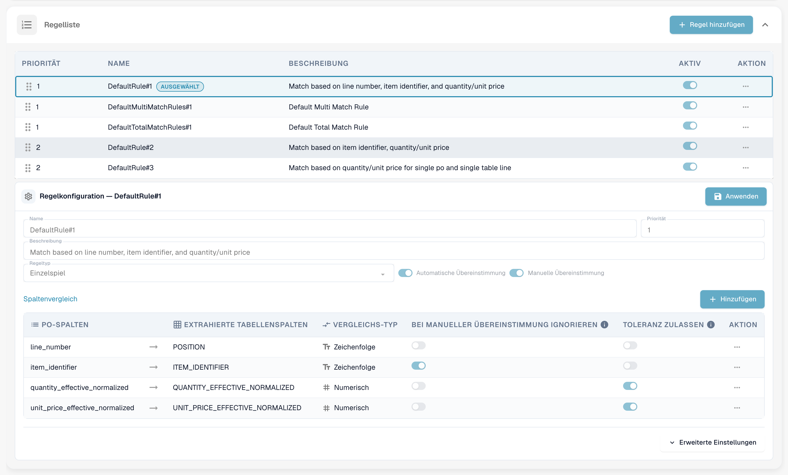<figcaption>
Die Regelliste. Die ausgewählte Regel ist mit <strong>Ausgewählt</strong> markiert. Eine Regel kann mit ihrem Schalter <strong>Aktiv</strong> ausgeschaltet werden.
</figcaption></figure>

#### Aufbau und Ausführung

* **Priorität:** Dieses numerische Feld (z. B. 1, 2, 3) bestimmt die Reihenfolge innerhalb der jeweiligen Verarbeitungsstufe. Regeln mit einer niedrigeren Prioritätsnummer werden dort zuerst versucht. Die Priorität einer Einzelregel ändert nicht die Reihenfolge der Regeltypen und Stufen. Dies ermöglicht Administratoren, eine Hierarchie zu strukturieren, typischerweise beginnend mit den spezifischsten und strengsten Regeln (z. B. Abgleich nach Zeilennummer und Artikelnummer) und als Rückfall auf breitere oder weniger restriktive Regeln.
* **Name & Beschreibung:** Bietet eine klare Identifikation und Kontext für die Regel, erklärt die primären Kriterien (z. B. „Standardregel Nr. 1: Abgleich basierend auf Zeilennummer, Artikel-ID und Menge“).
* **Aktiv:** Bestimmt, ob die Regel im gewählten Regelwerk verwendet wird. Bei der Bearbeitung eines Entwurfs ändern Sie zunächst diesen Entwurf; Speichern, Genehmigen und Aktivieren der Version sind getrennte Schritte.

**Ausführungsablauf:** Das System führt den Abgleich in Verarbeitungsstufen durch, unter anderem Einzel-, Mehrfach- und Summenabgleich sowie Rückfallstufen. Innerhalb einer Stufe werden die passenden aktiven Regeln nach ihrer Priorität versucht. Wenn eine Regel (z. B. Priorität 1) eine Position erfolgreich abgleicht, wird der Prozess für diese Position beendet. Wird keine Übereinstimmung gefunden, fährt das System mit der nächsten Regel in der Prioritätsreihenfolge fort (z. B. Priorität 2). Jeder Lauf wird im Dokument protokolliert; der **Matching-Verlauf** im Bildschirm zur Bestellabstimmung zeigt, welche Regel versucht wurde, welche übereinstimmte und welche übersprungen wurden und warum.

***

## Regelkonfiguration (Detail-Einstellungen)

Dieser detaillierte Konfigurationsbereich definiert die spezifische Logik und Kriterien für eine einzelne Regel.

<figure>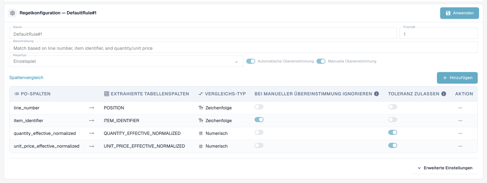<figcaption>
Der Bereich Regelkonfiguration für eine Single-Match-Regel. <strong>Anwenden</strong> behält Ihre Änderungen im Entwurf.
</figcaption></figure>

#### Basisparameter

* **Regeltyp:** Gibt die Matching-Kardinalität an.

| Regeltyp           | Was sie bewirkt                                                                                                                                                                                                                  | Typische Verwendung                                                                    |
| ------------------ | -------------------------------------------------------------------------------------------------------------------------------------------------------------------------------------------------------------------------------- | -------------------------------------------------------------------------------------- |
| **Einzelspiel**    | Eine Bestellposition zu einer Dokumentposition. Jede konfigurierte Spalte muss übereinstimmen (innerhalb der erlaubten Toleranz).                                                                                                | Der Standardfall.                                                                      |
| **Mehrfachspiel**  | Mehrere Bestellpositionen zu einer Dokumentposition oder mehrere Dokumentpositionen zu einer Bestellposition. Die konfigurierte Gruppierung und Vergleichsstrategie bestimmen, ob Werte gleich sein, innerhalb einer Toleranz liegen oder als Summe passen müssen. | Teillieferungen, eine Rechnungsposition, die mehrere Bestellpositionen abdeckt.        |
| **Spiel auf Gesamt** | Vergleicht einen **Betrag** — üblicherweise den Nettobetrag der Dokumentposition gegen die **Summe** der Bestellung — nach den konfigurierten Summenvergleichen und Aktivierungsbedingungen. Dieser Regeltyp ist etwas anderes als der Dokumentstatus **Full Match**.                                                         | Lieferanten, die pauschal abrechnen, Dienstleistungsrechnungen, einzeilige Rechnungen. |

<figure>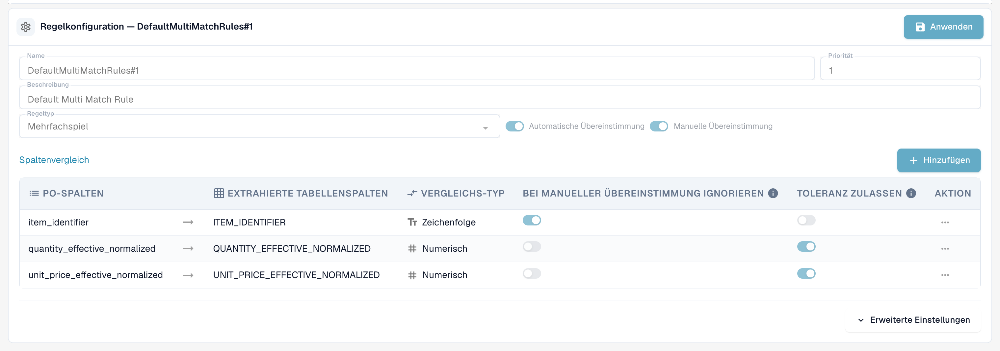<figcaption>
Eine Multi-Match-Regel vergleicht mehrere Positionen anhand ihrer Gruppierung und eingerichteten Vergleichsstrategien.
</figcaption></figure>

<figure>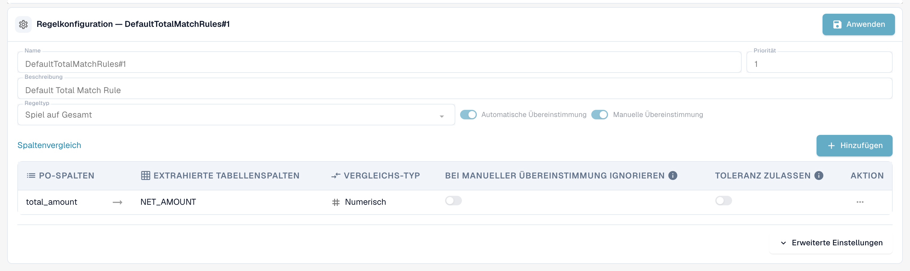<figcaption>
Eine Regel Spiel auf Gesamt vergleicht einen Betrag, hier den Nettobetrag mit der Bestellsumme.
</figcaption></figure>

* **Automatische Übereinstimmung:** Wenn aktiviert, versucht das System, diese Regel vollständig automatisch anzuwenden. Für die automatische Verarbeitung ist ein hohes Vertrauen in die Kriterien erforderlich.
* **Manuelle Übereinstimmung:** Wenn aktiviert, kann diese Regel einem Benutzer während des manuellen Abgleichs präsentiert oder angewendet werden und bietet ihm einen vordefinierten Satz von Vergleichskriterien zur Lösung von Ausnahmen.
* **Rückfall:** Eine als Fallback markierte Regel läuft in einer späteren Phase nur für die Positionspaare, die nach allen regulären Regeln noch nicht abgeglichen wurden. Verwenden Sie sie für die „lockerere“ Regel, die das auffangen soll, was die strengen Regeln verpasst haben.

#### Aktivierungsbedingungen

Eine Regel kann **Aktivierungsbedingungen** enthalten — Ausdrücke, die wahr sein müssen, bevor die Regel überhaupt ausgeführt wird. Ist eine Bedingung falsch, wird die Regel **für dieses Dokument übersprungen** (der Matching-Verlauf zeigt sie als „nicht ausgeführt“ mit dem Grund). Die Ausdrücke verwenden die Anzahl der Positionen, die abgeglichen werden:

| Ausdruck                 | Bedeutung                                                               |
| ------------------------ | ----------------------------------------------------------------------- |
| `[[count(po_lines)]]`    | Anzahl der für den Abgleich verfügbaren Bestellpositionen               |
| `[[count(table_lines)]]` | Anzahl der Positionen im Dokument, die für den Abgleich zugeordnet sind |

Vergleichen Sie sie mit `==`, `!=`, `>`, `>=`, `<`, `<=` und kombinieren Sie mehrere Bedingungen mit `&` (und). Beispiele:

* `([[count(po_lines)]] > 1) & ([[count(table_lines)]] > 1)` — nur für Dokumente mit mehreren Positionen auf beiden Seiten (typisch für eine Mehrfachspiel-Regel).
* `([[count(po_lines)]] == 1) & ([[count(table_lines)]] == 1)` — nur für einzeilige Dokumente gegen eine einzeilige Bestellung.
* `([[count(po_lines)]] >= 1) & ([[count(table_lines)]] >= 1)` — wann immer etwas abgeglichen werden soll.


Aktivierungsbedingungen sind der häufigste Grund, warum eine Regel „nichts tut“. Eine Regel Spiel auf Gesamt mit der Bedingung `[[count(table_lines)]] > 1` läuft nie für eine einzeilige Rechnung — und eine [Transformationsregel](../../transformation-rules.md), die die Rechnung in eine Gesamtposition zusammenfasst, erzeugt genau ein solches Dokument. Prüfen Sie die Zählwerte im Matching-Verlauf, bevor Sie die Regel selbst ändern.


#### Spaltenvergleich (Matching-Kriterien)

Dies ist die Kern-Definition der Logik der Regel, die angibt, welche Felder zwischen den Dokumenten übereinstimmen müssen.

1. Definition der zu vergleichenden Spalten:
   * **PO-Spalten:** Das Feld, das aus den Bestelldaten entnommen wird (z. B. Zeilennummer).
   * **Extrahierte Tabellenspalten:** Das entsprechende Feld, das aus dem eingehenden Dokument (Rechnung/Auftragsbestätigung) extrahiert oder geparst wurde (z. B. `POSITION`).
2. **Vergleichstyp:** Definiert die Art der erforderlichen Übereinstimmung (z. B. Tt für Text-/Stringvergleich, der eine genaue Zeichen-für-Zeichen-Übereinstimmung erfordert; # für numerischen Vergleich).
3. **Toleranz zulassen:** Erlaubt beim jeweiligen numerischen Vergleich die zutreffenden [Mengen- und Einzelpreistoleranzen](purchase-order-tolerance-settings-additional-purchase-order-tolerance.md). Ohne diese Option wird die fachliche Toleranz für diese Vergleichsspalte nicht angewendet. Prüfen Sie auch mögliche artikelbezogene Vorgaben.
4. **Bei manueller Übereinstimmung ignorieren:** Wenn aktiviert, wird dieses Kriterium bei manueller Intervention gelockert. Dies ist nützlich für Felder wie Beschreibungen oder interne Referenzen, die leicht variieren können, sodass der Benutzer kleinere, nicht kritische Abweichungen übergehen kann.

**Welche Spalten können verglichen werden**

| Spalte                               | Dokumentenseite                   | Bestellseite                      | Hinweis                                                                                                                                                                                                                                              |
| ------------------------------------ | --------------------------------- | --------------------------------- | ---------------------------------------------------------------------------------------------------------------------------------------------------------------------------------------------------------------------------------------------------- |
| Zeilennummer                         | `POSITION`                        | `line_number`                     | Text, exakt. Nur sinnvoll, wenn der Lieferant die Bestellpositionsnummern auf dem Dokument aufdruckt.                                                                                                                                                |
| Artikelkennzeichen                   | `ITEM_IDENTIFIER`                 | `item_identifier`                 | Text, exakt. Artikelnummer oder Lieferantenartikelnummer, auch über die [Lieferantenartikelnummernkarte](supplier-item-number-map-admin-documentation.md).                                                                                           |
| Effektive normalisierte Menge        | `QUANTITY_EFFECTIVE_NORMALIZED`   | `quantity_effective_normalized`   | Numerisch. Die Menge, die durch **Menge anpassen an** ausgewählt wurde, umgerechnet in dieselbe Einheit auf beiden Seiten (Einheitenumrechnung, „pro“-Mengen).                                                                                        |
| Effektiver normalisierter Stückpreis | `UNIT_PRICE_EFFECTIVE_NORMALIZED` | `unit_price_effective_normalized` | Numerisch. Der Stückpreis pro Einheit nach Rabatten und nach **Preiseinheit** — und, falls [Berechnung des PO-Einzelpreises](calculate-po-unit-price.md) aktiviert ist, der aus dem Bestellpositionsbetrag und der Menge berechnete Preis.            |
| Nettobetrag                          | `NET_AMOUNT`                      | `total_amount`                    | Numerisch. Wird von Regeln Spiel auf Gesamt verwendet.                                                                                                                                                                                               |

**Beispiel: Strenge PO-Matching-Regel (`DefaultRule#1`)**

Eine typische strenge Regel kombiniert obligatorische Identitätsprüfungen mit Wertprüfungen:

* **Obligatorische Identität:** Zeilennummer und Artikelkennzeichen müssen exakt übereinstimmen (Textvergleich, keine Toleranz).
* **Wertprüfungen:** Effektive normalisierte Menge und effektiver normalisierter Stückpreis müssen übereinstimmen (numerischer Vergleich, Toleranz erlaubt). Nur wenn alle vier Kriterien erfüllt sind (mit Toleranz für Werte), wird ein automatischer Abgleich durchgeführt.

***

#### Erweiterte Einstellungen

Klicken Sie unter der Spaltentabelle auf **Erweiterte Einstellungen**, um zwei weitere Optionen für die Regel zu öffnen.

<figure>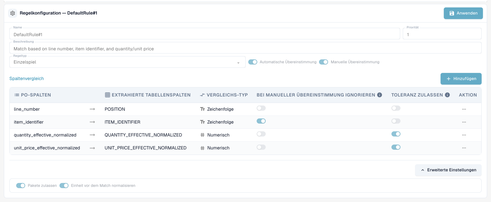<figcaption>
Erweiterte Einstellungen einer Regel.
</figcaption></figure>

* **Pakete zulassen:** Lässt die Regel Positionen abgleichen, bei denen sich Menge und Stückpreis um eine Packungsgröße unterscheiden. Die Standard-Packungsgrößen sind 10, 20, 100 und 1000. DocBits passt dann die Dokumentmenge und den Stückpreis um die Packungsgröße an, bevor es sie vergleicht. Dies ist der Schritt **Abgleich mit Gebindegrößen** jeder Stufe im Regeldiagramm (siehe Abschnitt "Regelwerk als Diagramm").
* **Einheit vor dem Match normalisieren:** Rechnet die Maßeinheit auf beiden Seiten in dieselbe Einheit um, bevor die Menge verglichen wird. Die Option ist standardmäßig aktiviert.

***

## Regelwerk als Diagramm

**Regelwerk als Diagramm** öffnet neben den Regeln ein Panel. Es zeigt die Regeln der aktiven Version als Flussdiagramm, sodass Sie sehen, in welcher Reihenfolge DocBits sie versucht und wo der Abgleich endet.

<figure>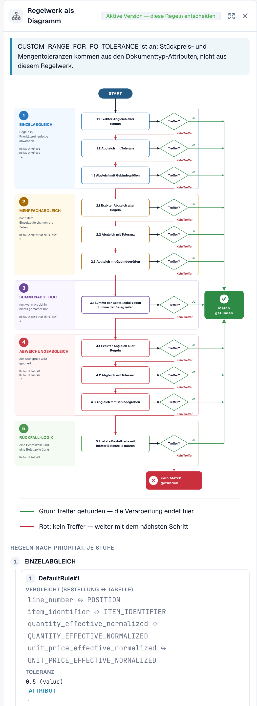<figcaption>
Das Regelwerk als Diagramm.
</figcaption></figure>

DocBits durchläuft fünf Stufen von oben nach unten. Jede Stufe hat bis zu drei Durchläufe: **Exakter Abgleich aller Regeln**, **Abgleich mit Toleranz** und **Abgleich mit Gebindegrößen**. Der erste Durchlauf, der eine Übereinstimmung findet, beendet den Prozess (grüner Pfeil). Findet ein Durchlauf keine Übereinstimmung, macht DocBits mit dem nächsten weiter (roter Pfeil).

| Stufe | Was sie bewirkt |
| ----- | --------------- |
| 1. Einzelabgleich | Wendet die Regeln des Einzelabgleichs in der Reihenfolge ihrer Priorität an. |
| 2. Mehrfachabgleich | Läuft nach dem Einzelabgleich, für mehrere Positionen auf einer Seite. |
| 3. Summenabgleich | Läuft nur, wenn überhaupt nichts abgeglichen wurde. Vergleicht die Bestellsumme mit der Summe der Tabellenpositionen. |
| 4. Abweichungsabgleich | Wendet die Regeln des Einzelabgleichs erneut an, wobei der Stückpreis ignoriert wird. |
| 5. Rückfall-Logik | Ordnet die letzte Bestellposition der letzten Tabellenposition zu, wenn auf jeder Seite genau eine Position übrig ist. |

Unter dem Diagramm listet das Panel die Regeln jeder Stufe nach Priorität auf, mit den Spalten, die jede Regel vergleicht. Ein Hinweis oben zeigt, woher die Toleranzen stammen: aus dem Regelwerk oder, wenn `CUSTOM_RANGE_FOR_PO_TOLERANCE` aktiviert ist, aus den [Dokumenttyp-Einstellungen](purchase-order-tolerance-settings-additional-purchase-order-tolerance.md).

<figure>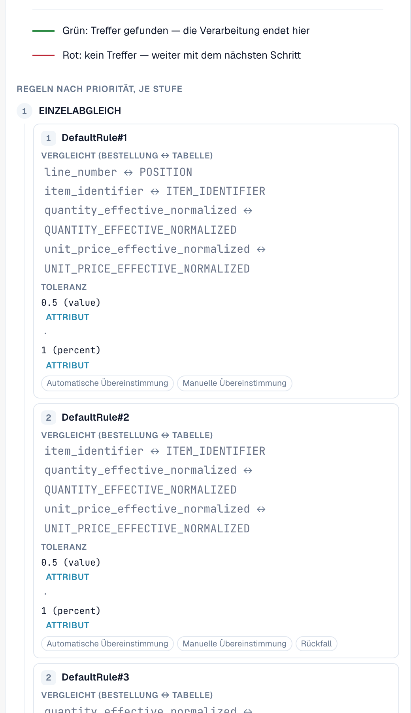<figcaption>
Unter dem Diagramm: die Regeln jeder Stufe mit den Spalten, die sie vergleichen, der Toleranz und den Optionen Automatische Übereinstimmung, Manuelle Übereinstimmung und Rückfall.
</figcaption></figure>

***

## Das Standardregelwerk

Jede Organisation startet mit demselben Standardregelwerk. Es ist eine gute Referenz, wenn Sie eigene Regeln erstellen:

| Regel                      | Typ / Priorität                     | Verglichene Spalten                                                       | Aktivierungsbedingung                                |
| -------------------------- | ----------------------------------- | ------------------------------------------------------------------------- | ---------------------------------------------------- |
| `DefaultRule#1`            | Einzelspiel, Priorität 1            | Zeilennummer, Artikelkennzeichen, Menge (Toleranz), Stückpreis (Toleranz) | immer                                                |
| `DefaultMultiMatchRules#1` | Mehrfachspiel, Priorität 1, Fallback | Artikelkennzeichen, Menge (Toleranz), Stückpreis (Toleranz)              | `count(po_lines) > 1` und `count(table_lines) > 1`   |
| `DefaultTotalMatchRules#1` | Spiel auf Gesamt, Priorität 1       | Nettobetrag ↔ Bestellsumme (keine Toleranz)                               | `count(po_lines) >= 1` und `count(table_lines) > 1`  |
| `DefaultRule#2`            | Einzelspiel, Priorität 2, Fallback  | Artikelkennzeichen, Menge (Toleranz), Stückpreis (Toleranz)               | immer                                                |
| `DefaultRule#3`            | Einzelspiel, Priorität 2, Fallback  | Menge (Toleranz), Stückpreis (Toleranz)                                   | `count(po_lines) == 1` und `count(table_lines) == 1` |

Von oben nach unten gelesen: zuerst die strenge Regel (Zeilennummer und Artikel müssen auf dem Dokument aufgedruckt sein), dann die Fallbacks ohne Zeilennummer, dann eine letzte Möglichkeit für einzeilige Dokumente, die nur Menge und Preis vergleicht.

***

## Auswirkungen auf den PO-Matching-Prozess

Das definierte Regelwerk steuert direkt die Effizienz und Integrität des PO-Matching-Workflows:

* **Priorisierung und Fallbacks:** Die definierte Priorität stellt sicher, dass das System zuerst die zuverlässigsten Matching-Methoden versucht. Wenn die strengen, hochprioritären Regeln fehlschlagen, greift das System auf breitere Regeln zurück, um die Anzahl der Ausnahmen, die an Benutzer weitergeleitet werden, zu minimieren.
* **Steuerung der Match-Qualität:** Strengere Regeln (die genauere Übereinstimmungen und weniger Toleranz erfordern) führen zu weniger, aber sehr zuverlässigen automatischen Übereinstimmungen. Lockerere Regeln erhöhen die Rate der automatischen Übereinstimmungen, erhöhen jedoch das Risiko von Fehlalarmen.
* **Ausnahmebehandlung (Manueller Abgleich):** Durch die Aktivierung von Regeln für den manuellen Abgleich bietet das System strukturierte Optionen für Benutzer. Wenn eine Transaktion die Kriterien für den automatischen Abgleich nicht erfüllt, wird sie zur Ausnahme. Der Benutzer kann dann versuchen, die Ausnahme durch Anwendung einer vordefinierten manuellen Regel zu lösen, die gelockerte Kriterien haben kann (z. B. Ignorieren einer kleinen Textabweichung gemäß der Einstellung „Bei manueller Übereinstimmung ignorieren“).

## Weitere Einflussfaktoren auf das Ergebnis

* **Wann der Abgleich läuft:** Während der Dokumentenverarbeitung, wenn ein Benutzer auf **Automatischer PO-Abgleich** klickt, und **bei jedem Speichern**, bei dem sich die Bestellnummer geändert hat oder zuvor nie abgefragt wurde (zum Beispiel wenn Stammdaten sie nachträglich gefüllt haben). Ein Speichern überschreibt niemals einen bereits bestehenden Abgleich.
* [**Transformationsregeln**](../../transformation-rules.md) laufen vor dem Abgleich und können die Positionen verändern — und damit die Zeilenzahlen, auf die sich die Aktivierungsbedingungen beziehen. Eine Tabellenregel, die die Positionen neu aufbaut, behält einen bestehenden Abgleich bei, solange die Positionen gleich bleiben; ersetzt sie abgeglichene Positionen, wird der Abgleich gelöscht und der Name der Regel als Grund angezeigt.
* [**Berechnung des PO-Einzelpreises**](calculate-po-unit-price.md) ändert, welchen Stückpreis die Regeln auf der Bestellseite vergleichen.
* [**Toleranzeinstellungen**](purchase-order-tolerance-settings-additional-purchase-order-tolerance.md) und [**deaktivierte Status**](purchase-order-disable-statuses.md) bestimmen, wie streng der Vergleich ist und welche Bestellpositionen überhaupt angeboten werden.

## Fehlerbehebung

| Symptom                                                   | Was zu prüfen ist                                                                                                                                                                                  |
| --------------------------------------------------------- | -------------------------------------------------------------------------------------------------------------------------------------------------------------------------------------------------- |
| „Keine Übereinstimmung“, obwohl alle Werte übereinstimmen | Öffnen Sie den Matching-Verlauf: Welche Regel lief, bei welcher Spalte schlug sie fehl (die Abweichung wird pro Spalte angezeigt), wurde die Regel durch eine Aktivierungsbedingung übersprungen? |
| Stückpreis weicht genau um den Steuersatz ab              | Die Bestellsumme enthält Steuer; aktivieren Sie [Berechnung des PO-Einzelpreises](calculate-po-unit-price.md) (zuerst Nettobetrag) oder vergleichen Sie den Zeilennettobetrag.                     |
| Eine Regel Spiel auf Gesamt läuft nie                     | Ihre Aktivierungsbedingung erfordert mehr als eine Dokumentposition. Setzen Sie `[[count(table_lines)]] >= 1` oder fassen Sie die Positionen nicht mit einer Transformationsregel zusammen.        |
| Das Regelwerk hat überhaupt keine Wirkung                 | **PO-Match serverseitig** ist für den Dokumenttyp deaktiviert oder das geänderte Regelwerk ist noch ein Entwurf — aktivieren Sie die Version.                                                      |

***

## Versionen und Entwürfe

Die Matching-Regeln sind versioniert. Sie können nur einen **Entwurf** bearbeiten; eine veröffentlichte Version kann nur angesehen werden. Klicken Sie auf **Versionierung konfigurieren**, um den **Versionsverlauf** zu öffnen.

<figure>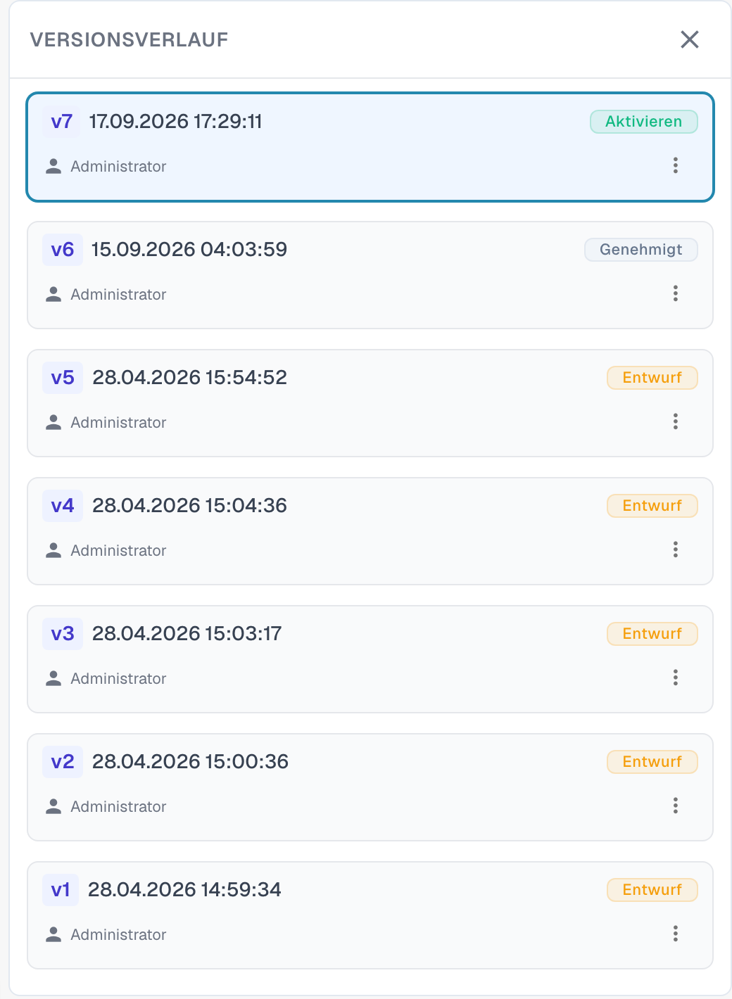<figcaption>
Der Versionsverlauf mit allen Versionen des Regelwerks.
</figcaption></figure>

Jede Version zeigt ihre Nummer, Datum und Uhrzeit sowie ihren Status, zum Beispiel **Entwurf** oder **Genehmigt**. Das Menü einer Version bietet die Aktionen dafür. Um das Standardregelwerk zu ändern, klonen Sie es zuerst: Öffnen Sie **Versionierung konfigurieren** und wählen Sie **Als Entwurf klonen** aus den Kartenoptionen der Version. Bearbeiten Sie den Entwurf, klicken Sie bei jeder geänderten Regel auf **Anwenden** und dann auf **Regeln speichern**. Die geänderten Regeln werden wirksam, sobald die Version aktiviert wird.
