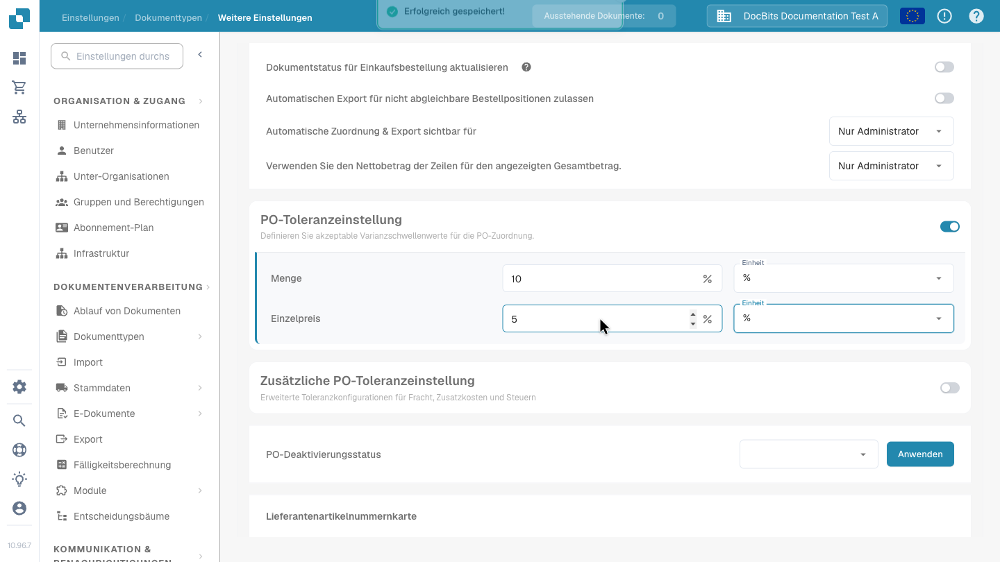
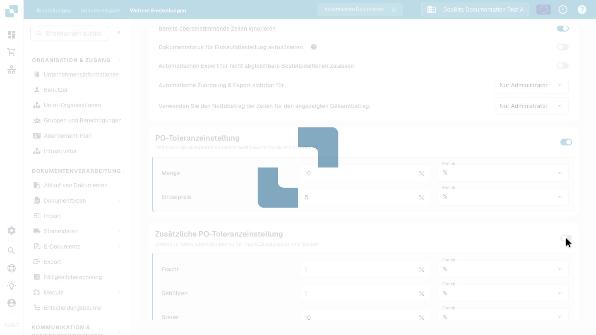

# Einstellungen zur Toleranz von Bestellungen / Zusätzliche Toleranz für Bestellungen

Mengen, Einzelpreise und zusätzliche Kosten dürfen nur innerhalb der fachlich festgelegten Grenzen vom Bestellwert abweichen. Administratoren richten diese Grenzen pro Dokumenttyp ein. Ein erfolgreicher Abgleich innerhalb der Toleranz ersetzt die Freigabe oder den Exportprozess nicht.

## Mengen- und Einzelpreistoleranzen einrichten

1. Öffnen Sie **Einstellungen → Dokumenttypen**, wählen Sie den Dokumenttyp, zum Beispiel **Rechnung**, und öffnen Sie **Weitere Einstellungen → Bestellung**.
2. Aktivieren Sie **PO-Toleranzeinstellung**. Für **Menge** und **Einzelpreis** erscheint jeweils ein Zahlenfeld mit einer eigenen Auswahl **Einheit**.
3. Wählen Sie **%** für einen Prozentsatz oder **Wert** für eine feste Abweichung und tragen Sie die fachlich erlaubte Grenze ein. Prüfen Sie beide Angaben getrennt.
4. Kontrollieren Sie den angezeigten Wert nach dem Ändern. Schalter und Einheitenauswahl werden direkt gespeichert; ein Zahlenwert wird beim Verlassen des Feldes gespeichert.
5. Lassen Sie im passenden numerischen Spaltenvergleich der [PO-Abgleichsregel](purchase-order-matching-rules.md) **Toleranz zulassen** zu. Testen Sie einen passenden Beleg sowie Werte innerhalb und außerhalb der Grenze, bevor Sie die Konfiguration im vorgesehenen Prozess verwenden.

<figure><figcaption>
Im Beispiel ist die Einzelpreistoleranz auf fünf Prozent eingestellt. Menge und Einzelpreis haben jeweils eine eigene Einheit.
</figcaption></figure>

## Prozent und fester Wert im Vergleich

Toleranzen gelten in beide Richtungen, bezogen auf den Bestellwert.

| Einstellung | Bestellpreis | Erlaubter Bereich |
| --- | --- | --- |
| Einzelpreis **5 %** | 10,00 Euro | 9,50 bis 10,50 Euro |
| Einzelpreis **5 %** | 20,00 Euro | 19,00 bis 21,00 Euro |
| Einzelpreis **Wert 0,50** | 10,00 Euro | 9,50 bis 10,50 Euro |
| Einzelpreis **Wert 0,50** | 20,00 Euro | 19,50 bis 20,50 Euro |

Ein Preis von 10,60 Euro liegt außerhalb einer Toleranz von fünf Prozent bei 10,00 Euro Bestellpreis. Prüfen Sie die Ursache der Differenz, statt einen Rechnungswert für eine erfolgreiche Markierung zu verändern. Bei einer Mengentoleranz bezeichnet ein fester Wert eine Mengenabweichung und keinen Geldbetrag.

Artikelbezogene Toleranzen können die allgemeinen Dokumenttyp-Werte übersteuern. Die Vorgabe für die eigene Artikelnummer hat dabei Vorrang vor einer Vorgabe über die Lieferantenartikelnummer. Prüfen Sie deshalb beim Bewerten eines Ergebnisses auch die zutreffenden Artikelvorgaben und die verwendete Abgleichregel.

## Zusätzliche Toleranzen für Fracht, Zusatzkosten und Steuern

Aktivieren Sie im selben Bereich **Zusätzliche PO-Toleranzeinstellung**. Für **Fracht**, **Gebühren** (Zusatzkosten) und **Steuer** werden getrennte Zahlenfelder und Einheiten angezeigt. Wählen Sie für jede Grenze Prozent oder einen festen Wert und prüfen Sie die gespeicherten Angaben. Auch diese Toleranzen gelten nach oben und unten.

<figure><figcaption>
Die zusätzlichen Toleranzen bilden einen eigenen Bereich und ersetzen keine Mengen- oder Einzelpreisregel.
</figcaption></figure>

Der [Adminfilm zu PO-Abgleichsregeln und Toleranzen](purchase-order-matching-rules.md#video-po-abgleichsregeln-und-toleranzen-einrichten) zeigt die Einrichtung. Der [Anwenderfilm](../../../../../../end-user-and-partner-section/end-user-section/purchase-order-matching/README.md#rechnungspositionen-prufen-und-mit-einer-bestellung-abgleichen) erläutert Full Match, Partial Match und die Bearbeitung von Ausnahmen.
