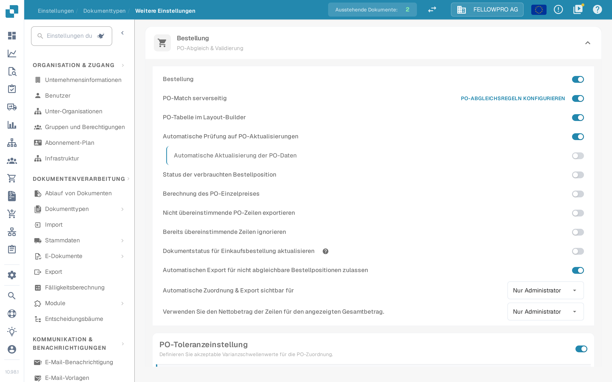

# Bestellung

## Übersicht

Diese Einstellung aktiviert den [**Purchase Order Matching**](../../../../../../end-user-and-partner-section/end-user-section/purchase-order-matching/README.md) Abschnitt, der nach der Dokumentvalidierung zugänglich wird.

<mark style="color:red;">**Hinweis**</mark>: Für den **Rechnung** Dokumenttyp müssen die folgenden zusätzlichen Anforderungen erfüllt sein:

* Die **Bestellung** Einstellung muss aktiviert sein (wie auf dieser Seite beschrieben)
* Die Rechnung muss vom Typ **Einkaufsrechnung** sein
* Eine **Extrahierte Tabelle** muss vorhanden sein

## Aktivierungsschritte 

1. Gehe zu **Einstellungen** -> **Globale Einstellungen** -> **Dokumenttypen**
2.  Finden Sie die Karte des Dokumenttyps und öffnen Sie über das Zahnrad (**Weitere Einstellungen**) dessen Einstellungen.
3.  Öffnen Sie den Abschnitt **Bestellung** und schalten Sie **Bestellung** ein.

<figure><figcaption>
Der Abschnitt <strong>Bestellung</strong> in den weiteren Einstellungen. Der erste Schalter aktiviert den Bestellabgleich für den Dokumenttyp, die Schalter darunter verfeinern ihn.
</figcaption></figure>

## **Funktionalität**

Sobald aktiviert, wird der [**Purchase Order Matching**](../../../../../../end-user-and-partner-section/end-user-section/purchase-order-matching/README.md) Abschnitt nach der Dokumentvalidierung verfügbar.

### Welche Menge abgeglichen wird

Welche Menge der Bestellung der Abgleich verwendet, hängt von **PO-Match serverseitig** ab:

* **PO-Match serverseitig aus** – neben dem Schalter **Bestellung** steht dann eine Auswahl mit **Menge**, **Empfangene Menge** und **Empfangene Lieferung Offene Menge**. DocBits gleicht mit dem eingebauten Abgleich ab und vergleicht die gewählte Menge.
* **PO-Match serverseitig ein** – der Abgleich läuft mit den Regeln des Dokumenttyps, und die Menge ist Teil dieser Regeln. Rechts in der Zeile **PO-Match serverseitig** steht dann der Link **PO-Abgleichsregeln konfigurieren**, der die Regeln öffnet.


Das Bild oben wurde mit eingeschaltetem **PO-Match serverseitig** aufgenommen. Die Auswahl der Menge ist dort deshalb nicht zu sehen - sie wird in den Abgleichsregeln festgelegt.

