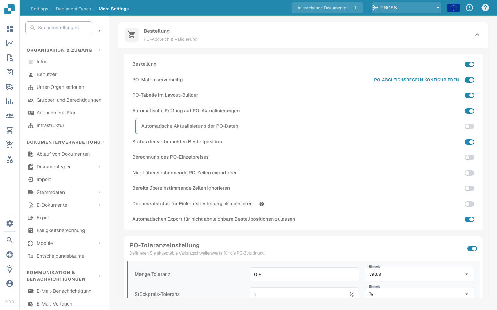

# Lieferantenartikelnummer-Zuordnung - Admin-Dokumentation



## **Übersicht**

Als Administrator haben Sie die Möglichkeit, die Zuordnungen (Mappings) zwischen internen Artikelnummern und Lieferantenartikelnummern einzusehen und zu verwalten. Diese Funktion stellt sicher, dass Unstimmigkeiten zwischen Ihrem System und den Systemen Ihrer Lieferanten effizient gehandhabt werden. Sie können fehlerhafte Zuordnungen überprüfen, bearbeiten und löschen, um die Datengenauigkeit aufrechtzuerhalten.

<figure><figcaption></figcaption></figure>

**Zugriff auf die Lieferantenartikelnummer-Zuordnung**

1. **Navigieren Sie zu den Einstellungen:**
   * Gehen Sie zum Abschnitt **Einstellungen** in Ihrem Admin-Dashboard.
2. **Belegtypen aufrufen:**
   * Wählen Sie unter **Einstellungen** die Option **Belegtypen**.
3. **Weitere Einstellungen:**
   * Klicken Sie auf **Weitere Einstellungen**, um auf zusätzliche Konfigurationsoptionen zuzugreifen.
4. **Lieferantenartikelnummer-Zuordnung:**
   * Im Abschnitt **Weitere Einstellungen** finden Sie die Tabelle **Lieferantenartikelnummer-Zuordnung**. Diese Tabelle listet alle aktuellen Zuordnungen zwischen Ihren internen Artikelnummern und den entsprechenden Lieferantenartikelnummern auf.

## **Verwalten von Artikelnummer-Zuordnungen**

1. **Anzeigen der Zuordnungen:**
   * Die Tabelle zeigt die folgenden Spalten an:
     * **Lieferanten-ID:** Die eindeutige Kennung für den Lieferanten.
     * **Artikelnummer:** Ihre interne Artikelnummer für das Produkt.
     * **Lieferantenartikelnummer:** Die vom Lieferanten verwendete entsprechende Artikelnummer.
     * **Aktion:** Optionen zur Verwaltung der Zuordnungen.
2. **Löschen fehlerhafter Zuordnungen:**
   * Wenn Sie eine fehlerhafte Zuordnung identifizieren, können Sie diese löschen, indem Sie auf das Mülleimer-Symbol (🗑) in der Spalte **Aktion** klicken.
   * Es erscheint eine Bestätigungsaufforderung, um sicherzustellen, dass Sie die Zuordnung löschen möchten.
3. **Bearbeiten von Zuordnungen:**
   * (Falls zutreffend) Möglicherweise haben Sie auch die Option, bestehende Zuordnungen zu bearbeiten, um Unstimmigkeiten zu korrigieren. Dies könnte durch Klicken auf die Artikel- oder Lieferantennummer erfolgen, um Änderungen vorzunehmen.

## **Beispiel-Workflow**

1. **Unstimmigkeiten identifizieren:**
   * Überprüfen Sie regelmäßig die **Lieferantenartikelnummer-Zuordnung**, um Unstimmigkeiten oder fehlerhafte Zuordnungen zu identifizieren.
2. **Fehlerhafte Zuordnungen löschen:**
   * Klicken Sie bei fehlerhaften Zuordnungen auf das Mülleimer-Symbol, um diese zu löschen.
3. **Korrekte Zuordnungen erneut eingeben:**
   * Stellen Sie sicher, dass korrekte Zuordnungen entweder manuell bei der nächsten Transaktion eingegeben werden oder indem Sie die vorhandenen Einträge bearbeiten, sofern das System dies unterstützt.