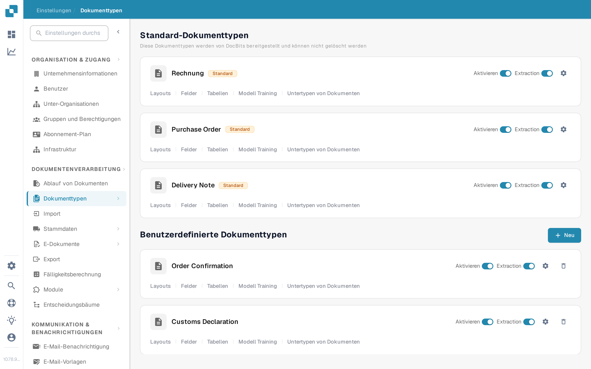
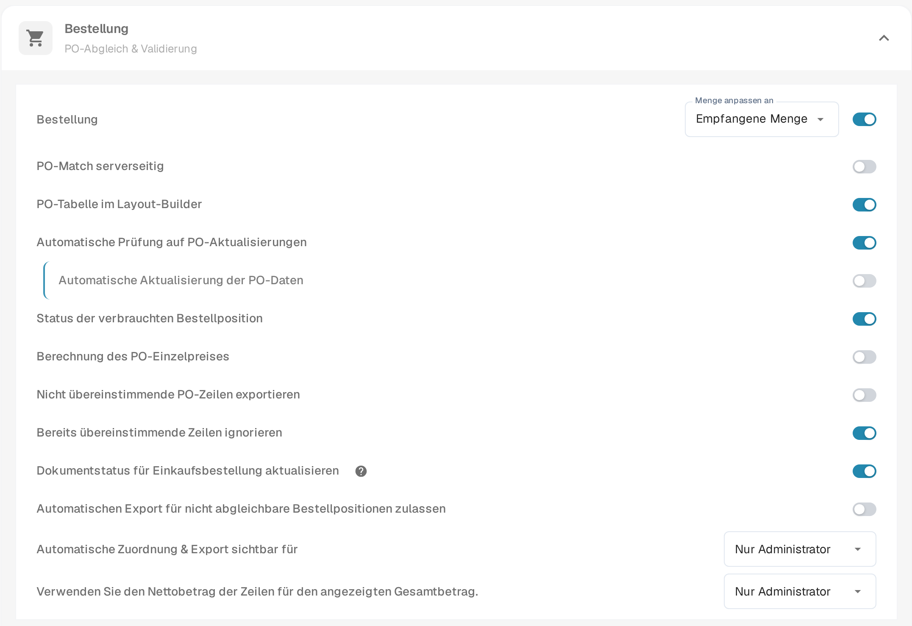
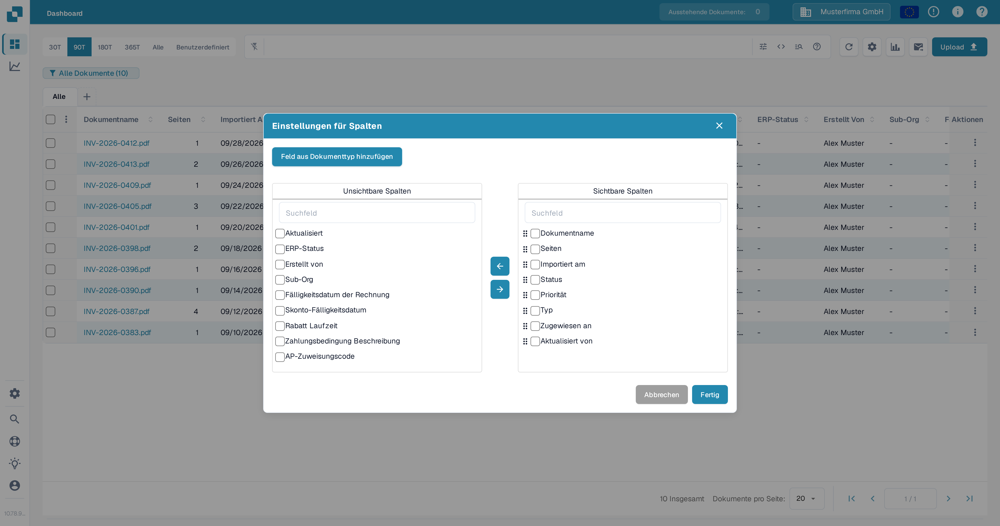
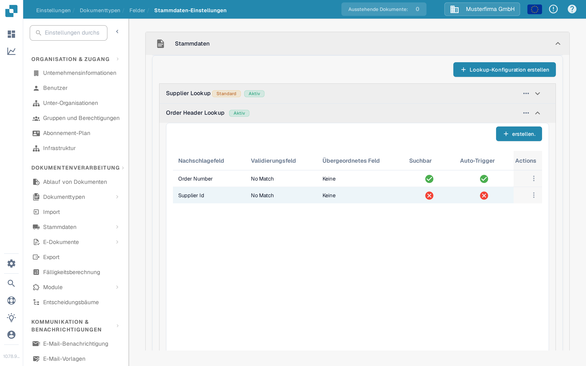

# Aktualisieren des Dokuments Bestellstatus

Diese Einstellung gilt für Dokumententypen, die Bestellungen (Purchase Orders) verwenden. Sie steuert, ob ein Dokument Statusaktualisierungen aus der verknüpften Bestellung erhalten kann. Der Schalter wird je Dokumententyp eingerichtet. Damit ein PO-Status im Dashboard sichtbar ist, muss das passende Feld außerdem als Spalte verfügbar und sichtbar sein.

Wählen Sie vor der Änderung die richtige Organisation und den richtigen Dokumententyp aus. Sie benötigen Administratorzugriff, um die Dokumententyp-Einstellungen zu bearbeiten. Eine Bestellung muss mit einem Dokument verknüpft sein, bevor eine Statusänderung geprüft werden kann.

## Einstellung einschalten

1. Öffnen Sie **Einstellungen → Dokumentenverarbeitung → Dokumenttypen**.
2. Suchen Sie den Dokumententyp der mit Bestellungen verknüpften Dokumente, zum Beispiel **Rechnung**, und wählen Sie das Zahnrad-Symbol auf seiner Karte, um **Weitere Einstellungen** zu öffnen.
3. Klappen Sie **Bestellung** auf. Finden Sie **Dokumentstatus für Einkaufsbestellung aktualisieren** und schalten Sie ihn ein. Das Hilfe-Symbol daneben erklärt die Option in der Anwendung. Das Umschalten dieses Schalters ändert nicht die anderen PO-Einstellungen im selben Abschnitt.

<figure><figcaption>Öffnen Sie die Einstellungen des Dokumenttyps, den Sie verwenden.</figcaption></figure>

<figure><figcaption>Der Statusaktualisierungs-Schalter in den Bestellung-Einstellungen.</figcaption></figure>

## PO-Status im Dashboard anzeigen

1. Kehren Sie zum Dashboard zurück und wählen Sie das Zahnrad-Symbol über der Dokumententabelle.
2. Öffnen Sie **Einstellungen für Spalten**.
3. Wählen Sie **Feld aus Dokumenttyp hinzufügen**, wählen Sie den Dokumententyp und suchen Sie nach dem PO-Status-Feld. Wenn das Feld verfügbar ist, wählen Sie es aus, wählen Sie **Zu sichtbaren Spalten hinzufügen** und danach **Fertig**.

Das Spaltendialog-Fenster enthält **Unsichtbare Spalten** und **Sichtbare Spalten**. Mit den Pfeilen verschieben Sie eine ausgewählte Spalte zwischen beiden Listen. Die vollständige Spaltenanleitung finden Sie unter [Dokumentspalten ändern](../../../../../../end-user-and-partner-section/end-user-section/dashboard/change-document-columns.md). Wenn das PO-Status-Feld für den gewählten Typ fehlt, bitten Sie eine Administratorperson, das Feld und die Lookup-Konfiguration zu prüfen; der Anzeige-Schalter allein erzeugt kein fehlendes Feld.

<figure><figcaption>Legen Sie fest, welche Spalten im Dashboard erscheinen.</figcaption></figure>

## Lookup für die Bestellung prüfen

Öffnen Sie **Einstellungen → Dokumentenverarbeitung → Dokumenttypen → Felder → Stammdaten-Einstellungen**, klappen Sie **Stammdaten** und dann **Order Header Lookup** auf. Prüfen Sie, dass die nötige PO-Feldzuordnung existiert und der relevante Lookup **Auto-Trigger** hat, wenn ein automatischer Lookup nötig ist. Das Bild unten zeigt die Konfigurationsliste; die roten Kreuze bedeuten, dass Auto-Trigger für diese Beispielzeilen ausgeschaltet ist. Es zeigt keine aktualisierte PO-Statusanzeige.

<figure><figcaption>Prüfen Sie die tatsächlichen Lookup-Zeilen des Dokumenttyps.</figcaption></figure>

Hilfe zum Einrichten eines Lookups finden Sie unter [Fuzzy Data Konfiguration mit Masterdaten](../../../../../setup/document-types/fuzzy-data-configuration-with-master-data.md).

## Mit einem bekannten Dokument prüfen

Verwenden Sie ein Dokument, das bereits mit einer Testbestellung verknüpft ist. Ändern Sie den Status dieser Bestellung über Ihren normalen Prozess, aktualisieren Sie das Dashboard und prüfen Sie das Dokument und das sichtbare PO-Status-Feld. Wenn der Status sich nicht aktualisiert, prüfen Sie die PO-Verknüpfung des Dokuments, die Lookup-Konfiguration und ob das passende Feld zum Dashboard hinzugefügt wurde. Schließen Sie eine erfolgreiche Aktualisierung nicht allein aus dem Schalter.
