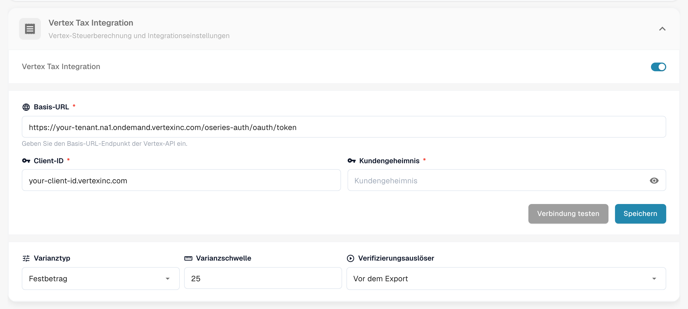
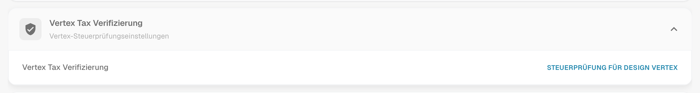
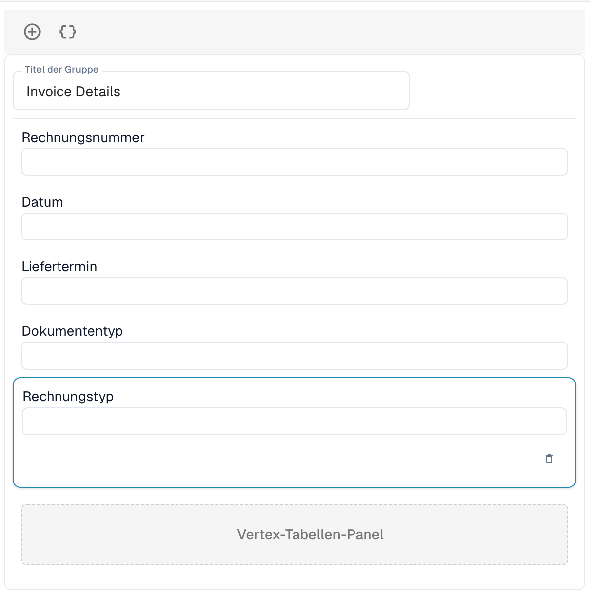

# Vertex Tax Verifizierung

Die Vertex Tax Verifizierung vergleicht die Steuer, die ein Lieferant auf einer Rechnung berechnet hat, mit der Steuer, die Vertex für dieselben Positionen berechnet. DocBits fordert die Berechnung bei Vertex an, zeigt dem Benutzer beide Beträge an und stoppt das Dokument, wenn die Steuer des Lieferanten zu hoch ist.

## So funktioniert es

1. Das Dokument erreicht den Auslösepunkt. Sie wählen ihn in den Moduleinstellungen: **Vor dem Export** (Standard) oder **Vor der Genehmigung**.
2. DocBits sendet die Rechnungspositionen an Vertex und erhält die berechnete Steuer.
3. DocBits schreibt das Ergebnis zurück ins Dokument: den **Vertex-Steuerbetrag** und den **Vertex-Steuersatz** pro Position sowie die Kopfsummen **Verkäufersteuer** (die auf der Rechnung berechnete Steuer), **Vertex Tax**, die Zwischensumme und die **Varianz**.
4. DocBits vergleicht die Verkäufersteuer mit der Vertex-Steuer:

| Situation | Ergebnis |
| --------- | -------- |
| Die Verkäufersteuer liegt um **mehr als die Varianzschwelle** über der Vertex-Steuer | Das Dokument wird abgelehnt. Sein Status wird **Vertex-Steuer abgelehnt**. |
| Die Verkäufersteuer ist höher, aber **innerhalb der Schwelle** | Das Dokument wird akzeptiert. |
| Die Verkäufersteuer entspricht der Vertex-Steuer | Das Dokument wird akzeptiert. |
| Die Verkäufersteuer ist **niedriger** als die Vertex-Steuer | Das Dokument wird akzeptiert und der fehlende Betrag wird abgegrenzt. |

Die Ergebnismeldung nennt die Beträge, zum Beispiel: *Rejected: vendor tax $380.00 exceeds Vertex calculated tax $140.00 by $240.00 (171.4%), above configured threshold of $25.00.*

Benutzer öffnen das Ergebnis über das Vertex-Symbol in der Dashboard-Zeile des Dokuments. Der Bildschirm **Vertex Tax Verifizierung** zeigt ein Banner (**Überprüfung fehlgeschlagen** mit der Meldung oder **Verifizierung erfolgreich**), die Felder des von Ihnen gestalteten Layouts und die Vertex-Tabellen mit der Steuer pro Position.


Die Verifizierung läuft nur für Dokumenttypen, die eine Exportkonfiguration vom Typ **Vertex** haben. Ohne eine solche läuft das Dokument ohne Verifizierung weiter.


## Die Integration einrichten

Öffnen Sie **Einstellungen** → **Module** → **Bestellung & Finanzen** und gehen Sie zur Karte **Vertex Tax Integration**. Die Seite enthält auch die Einstellungen für den PO-Abgleich und die automatische Kontierung.

<figure><figcaption>
Die Karte Vertex Tax Integration. Mandanten- und Client-Werte sind in diesem Screenshot durch Platzhalter ersetzt.
</figcaption></figure>

1. Schalten Sie **Vertex Tax Integration** ein. Die Funktion benötigt das Vertex-Steuer-Abonnement.
2. Geben Sie die **Basis-URL** Ihres Vertex-Token-Endpunkts, Ihre **Client-ID** und Ihr **Kundengeheimnis** ein.
3. Klicken Sie auf **Verbindung testen** und dann auf **Speichern**.
4. Legen Sie die Toleranz und den Auslöser fest:
   * **Varianztyp:** **Festbetrag** oder **Prozentsatz**.
   * **Varianzschwelle:** Die Abweichung, die noch akzeptiert wird. Der Standard ist ein Festbetrag von 25. Im Prozentmodus geben Sie den Wert als Dezimalzahl ein, zum Beispiel 0,05 für 5 %.
   * **Verifizierungsauslöser:** **Vor dem Export** oder **Vor der Genehmigung**. Bei **Vor der Genehmigung** läuft die Prüfung während der Verarbeitung des Dokuments, bevor es zur Genehmigung geht. Schlägt die Prüfung selbst fehl, erhält das Dokument den Status **Exportfehler**.

Fügen Sie dann für den Dokumenttyp eine Exportkonfiguration vom Typ **Vertex** hinzu (**Einstellungen** → **Exportieren**). Sie verwendet eine TOML-Mapping-Datei.

## Das Verifizierungsformular gestalten

Die Felder, die Benutzer im Verifizierungsbildschirm sehen, werden pro Dokumenttyp gestaltet.

1. Öffnen Sie **Einstellungen** → **Globale Einstellungen** → **Dokumenttypen**, wählen Sie den Dokumenttyp aus und klicken Sie auf **Weitere Einstellungen**.
2. Öffnen Sie die Karte **Vertex Tax Verifizierung** und klicken Sie auf **Steuerprüfung für Design Vertex**.

<figure><figcaption>
Die Karte Vertex Tax Verifizierung.
</figcaption></figure>

Der Layout Builder öffnet sich mit dem Layouttyp **Vertex Tax Verifizierung**. Ziehen Sie Gruppen und Felder in das Formular, zum Beispiel **Details der Rechnung** mit Rechnungsnummer, Datum und Lieferdatum. Das **Vertex-Tabellen-Panel** zeigt den Steuervergleich und die Positionen mit der Vertex-Steuer pro Position. Es ist Teil des Layouts.

<figure><figcaption>
Ein Layout Vertex Tax Verifizierung mit der Gruppe Rechnungsdetails und dem Vertex-Tabellen-Panel.
</figcaption></figure>

Wie der Layout Builder funktioniert, erfahren Sie im [Layout Manager](../layout-manager/README.md).
