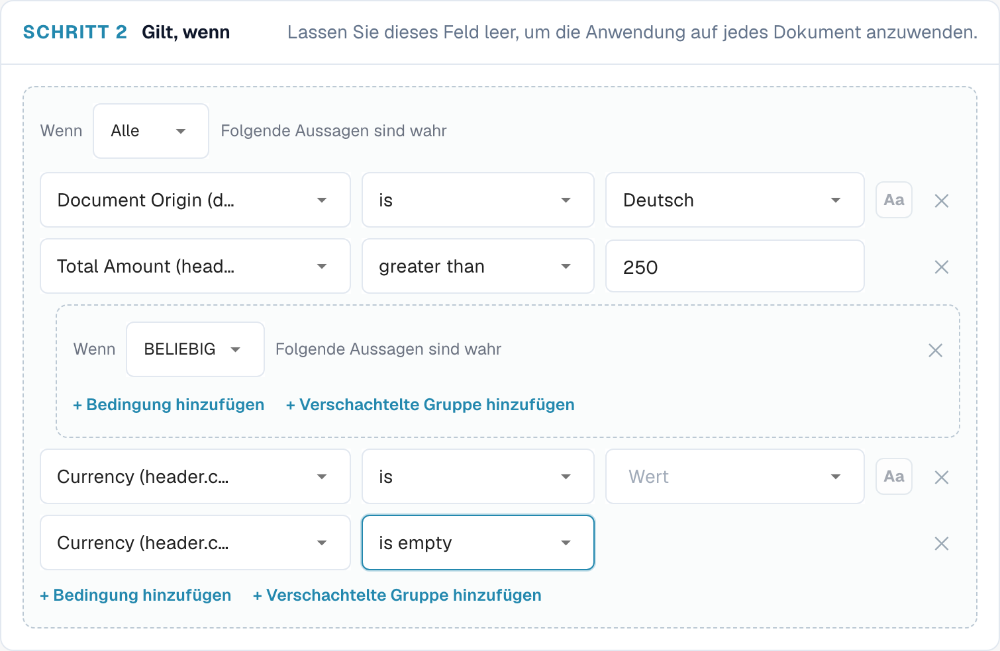
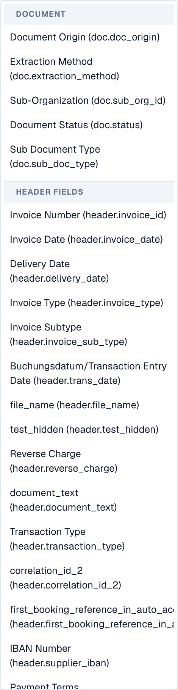
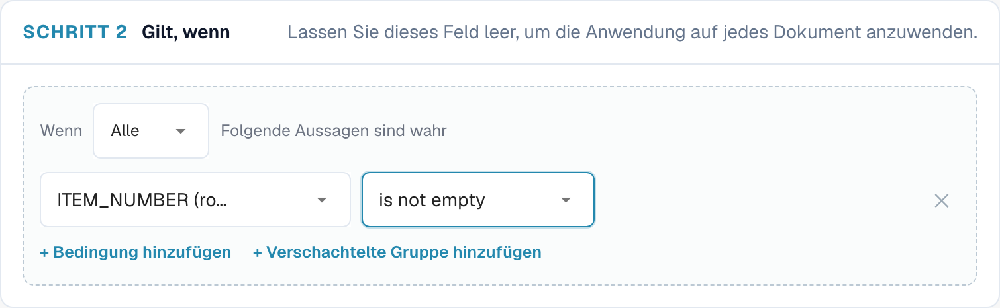
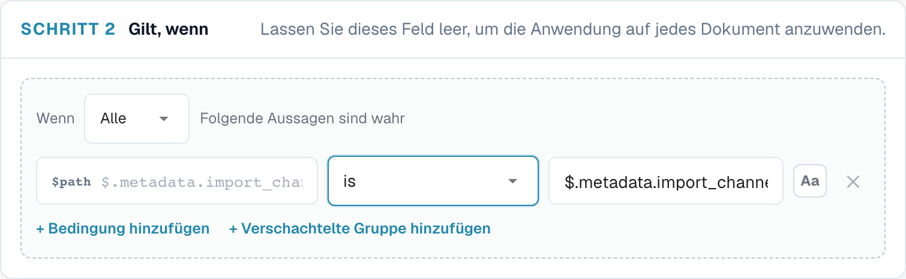
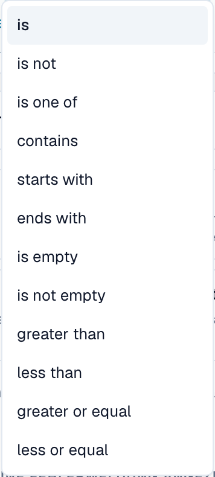

# Regelbedingungen (Applies when)

## Überblick

Jede Regel in den Regelfunktionen von DocBits hat einen Abschnitt **Applies when**. Er entscheidet, **für welche Dokumente (und bei Tabellenregeln für welche Zeilen) die Regel überhaupt etwas tut**. Die eigentliche Aufgabe der Regel – einen Validierungsfehler auslösen, einen Wert ändern, ein Layout auswählen – geschieht nur, wenn die Bedingung zutrifft.

Derselbe Bedingungseditor wird in allen drei Regelfunktionen verwendet:

| Funktion | Bezeichnung im Editor | Wenn die Bedingung zutrifft … | Wenn sie nicht zutrifft … | Wenn sie leer bleibt … |
| --- | --- | --- | --- | --- |
| [Benutzerdefinierte Validierungsregeln](custom-validation-rules.md) | Schritt 2 **Applies when** | wird die Prüfung aus Schritt 3 ausgeführt | wird die Regel übersprungen – kein Fehler, keine Warnung | wird die Prüfung für jedes Dokument ausgeführt |
| [Transformationsregeln](transformation-rules.md) | Schritt 2 **When it runs** → **Only when…** | ändert die Pipeline den Wert | bleibt der Wert unverändert | wählen Sie **Always**: Die Regel läuft für jedes Dokument |
| [Layout-Auswahlregeln](layout-manager/layout-selection-rules.md) | Schritt 2 **Applies when** | erhält das Dokument das Layout dieser Regel (die erste Übereinstimmung gewinnt) | probiert DocBits die nächste Regel | passt die Regel bei ihrer Priorität auf jedes Dokument |

Lernen Sie es einmal hier, dann können Sie es überall anwenden.


Eine Bedingung entscheidet nur, **ob** eine Regel gilt. Sie ändert niemals Daten und zeigt von sich aus keine Meldung an. „Die Steuernummer des Lieferanten muss ausgefüllt sein“ ist die **Prüfung** einer Validierungsregel; „nur für deutsche Rechnungen“ ist ihre **Bedingung**.


## Eine Bedingung lesen

Eine Bedingung liest sich wie ein Satz. Der folgende Editor besagt:

> **Wenn ALL** der folgenden Punkte zutreffen: Document Origin **is** Deutsch, Total Amount ist **greater than** 250, und (**ANY** von: Currency **is** EUR, Currency **is empty**).

<figure><figcaption>
Zwei mit ALL verknüpfte Bedingungen sowie eine verschachtelte Gruppe, die mit ANY verknüpft ist
</figcaption></figure>

Mit dieser Bedingung gilt die Regel für:

| Dokument | Herkunft | Gesamtbetrag | Währung | Gilt? | Begründung |
| --- | --- | --- | --- | --- | --- |
| A | DE | 469.18 | EUR | **ja** | alle drei Teile treffen zu |
| B | DE | 469.18 | *(leer)* | **ja** | die ANY-Gruppe trifft zu, weil die Währung leer ist |
| C | DE | 120.00 | EUR | nein | 120 ist nicht größer als 250 |
| D | DE | 469.18 | USD | nein | keine der beiden Zeilen der ANY-Gruppe trifft zu |
| E | AT | 469.18 | EUR | nein | die Herkunft ist nicht DE |

## Die Bausteine

### Bedingungszeilen

Jede Zeile besteht aus vier Teilen:

| Teil | Was es ist |
| --- | --- |
| **Field** | Der Wert, der geprüft wird: ein Dokumentattribut, ein Kopffeld, eine Tabellenspalte oder ein JSON-Pfad. Siehe [Verfügbare Felder](#verfugbare-felder). |
| **Operator** | Wie der Wert verglichen wird – *is*, *contains*, *greater than*, *is empty* … Siehe [Operatoren](#operatoren). |
| **Value** | Womit das Feld verglichen wird. Bei *is empty* / *is not empty* ausgeblendet. Bei Feldern mit fester Wertliste (Herkunft, Status, Währung …) wird der Wert aus einer Dropdown-Liste gewählt. |
| **Aa** | Groß-/Kleinschreibung ignorieren. Nur bei Textvergleichen verfügbar. Ist sie eingeschaltet, passt `gmbh` auf `GmbH`. |

Klicken Sie auf **✕**, um eine Zeile zu entfernen.

### ALL und ANY

Die Auswahl am Anfang einer Gruppe legt fest, wie ihre Zeilen verknüpft werden:

* **All** of the following are true – jede Zeile muss zutreffen (UND).
* **ANY** of the following are true – mindestens eine Zeile muss zutreffen (ODER).

### Verschachtelte Gruppen

Klicken Sie auf **+ Add nested group**, um eine Gruppe in eine Gruppe zu setzen. Eine verschachtelte Gruppe zählt als eine Zeile ihrer übergeordneten Gruppe, sodass Sie UND und ODER mischen können:

* *ALL of*: Herkunft ist DE, **ANY of** (Währung ist EUR, Währung ist leer)
* *ANY of*: Lieferant ist 10040, **ALL of** (Lieferant ist 20723, Gesamtbetrag größer als 1000)

Gruppen können beliebig tief verschachtelt werden. Halten Sie es lesbar: Zwei Ebenen genügen für nahezu jede Geschäftsregel.

### Eine leere Bedingung

Wenn Sie keine Zeilen hinzufügen, hat die Regel keine Bedingung und **gilt immer** (bei Layoutregeln: Sie passt bei ihrer Priorität auf jedes Dokument). Das ist die richtige Wahl für Regeln, die überall laufen müssen, etwa „Rechnungsnummer bereinigen“ oder „Menge muss positiv sein“.

## Verfügbare Felder

Öffnen Sie das Dropdown-Menü der Felder, um jedes Feld zu sehen, gruppiert nach seiner Herkunft. Geben Sie Text ein, um die Liste zu filtern.

<figure><figcaption>
Die Feldauswahl: zuerst die Dokumentattribute, dann die Kopffelder des Dokumenttyps
</figcaption></figure>

### Dokumentattribute (`doc.`)

Informationen, die DocBits über das Dokument selbst kennt, unabhängig von den extrahierten Feldern:

| Feld in der Auswahl | Schlüssel | Beispielwerte | Typische Verwendung |
| --- | --- | --- | --- |
| **Document Origin** | `doc.doc_origin` | `DE`, `AT`, `US` (angezeigt als Deutsch, Austria, United States) | länderspezifische Regeln und Layouts |
| **Extraction Method** | `doc.extraction_method` | `ELECTRONIC_DOCUMENT`, `FELLOW_KV2`, `MANUAL` | E-Rechnungen (XRechnung, ZUGFeRD) anders behandeln als gescannte PDFs |
| **Document Status** | `doc.status` | Ready for validation, Pending Approval, Pending second approval … | Layouts je Workflow-Stufe, Regeln, die nur vor der Genehmigung gelten |
| **Sub Document Type** | `doc.sub_doc_type` | Ihre Untertypen, z. B. Gutschrift | Regeln nur für einen Untertyp |

### Kopffelder (`header.`)

Jedes Feld des Dokumenttyps, zum Beispiel **Invoice Number** (`header.invoice_id`), **Supplier ID** (`header.supplier_id`), **Total Amount** (`header.total_amount`), **Currency** (`header.currency`), **Supplier Tax ID** (`header.supplier_tax_id`), **Purchase Order** (`header.purchase_order`). Die Auswahl zeigt die Bezeichnung und in Klammern den technischen Schlüssel. Verwendet wird der aktuelle Wert des Feldes – einschließlich der Korrekturen, die ein Benutzer vorgenommen hat.

### Tabellenspalten (`row.`)

Spalten der aktuellen Tabellenzeile, zum Beispiel `row.QUANTITY` oder `row.ITEM_NUMBER`. Sie erscheinen in der Auswahl als **Table columns** nur in Regeln, die **einmal pro Zeile** laufen:

* Validierungsregeln mit der Ebene **Table line**
* Transformationsregeln mit dem Geltungsbereich **Table column**

In diesen Regeln wird die Bedingung **für jede Zeile einzeln** geprüft. Eine Zeile, die nicht passt, wird übersprungen; die übrigen Zeilen werden weiterhin verarbeitet.

<figure><figcaption>
Eine Bedingung pro Zeile: Nur Zeilen mit einer Artikelnummer werden geprüft
</figcaption></figure>

Regeln, die einmal pro Dokument laufen (Kopfregeln, Regeln für die ganze Tabelle, Layoutregeln), können keine `row.`-Felder verwenden – es gibt keine einzelne Zeile, die sie betrachten könnten.

### Benutzerdefinierter JSON-Pfad (Advanced)

Am Ende der Auswahl verwandelt **Advanced → Custom JSON path…** das Feld in ein freies Textfeld mit der Markierung `$path`. Es liest einen Wert an beliebiger Stelle der extrahierten Daten des Dokuments, auch wenn er kein Feld des Dokumenttyps ist.

<figure><figcaption>
Eine JSON-Pfad-Bedingung auf den Importkanal des Dokuments
</figcaption></figure>

* Der Pfad beginnt mit `$` und verwendet `.name` für Schlüssel und `[0]` für Listenpositionen, zum Beispiel `$.metadata.import_channel` oder `$.shipping.addresses[0].country`.
* Er muss auf einem einzelnen Wert enden. Ein Pfad, der auf einer Liste oder einem Objekt endet, gilt als leer.
* Zeilen mit JSON-Pfad bieten die Operatoren *is*, *is not*, *matches*, *is empty* und *is not empty*.

Verwenden Sie JSON-Pfade sparsam. Sie hängen von der internen Struktur der extrahierten Daten ab; ein Feld des Dokumenttyps ist leichter zu verstehen und zu pflegen.

### Wo welche Art von Feld verwendet werden kann

| | Validierung: Kopffeld | Validierung: Tabellenzeile | Validierung: ganze Tabelle | Transformation: Kopf / Routing / Tabellenzeilen | Transformation: Tabellenspalte | Layoutauswahl |
| --- | --- | --- | --- | --- | --- | --- |
| `doc.` Dokumentattribute | ✓ | ✓ | ✓ | ✓ | ✓ | ✓ |
| `header.` Kopffelder | ✓ | ✓ | ✓ | ✓ | ✓ | ✓ |
| `row.` Tabellenspalten | – | ✓ | – | – | ✓ | – |
| `$` JSON-Pfad | ✓ | ✓ | ✓ | ✓ | ✓ | ✓ |

## Operatoren

<figure><figcaption>
Die für ein Textfeld angebotenen Operatoren
</figcaption></figure>

| Operator | Trifft zu, wenn … | Wert | Beispiel |
| --- | --- | --- | --- |
| **is** | das Feld dem Wert entspricht | ein Wert | Supplier ID **is** `20723` |
| **is not** | das Feld nicht dem Wert entspricht | ein Wert | Currency **is not** `EUR` |
| **is one of** | das Feld einem beliebigen Wert einer Liste entspricht | durch Kommas getrennte Werte | Supplier ID **is one of** `10040, 10041, 20723` |
| **contains** | der Wert an beliebiger Stelle im Feld vorkommt | Text | Supplier Name **contains** `GmbH` |
| **starts with** | das Feld mit dem Wert beginnt | Text | Invoice Number **starts with** `GS-` |
| **ends with** | das Feld mit dem Wert endet | Text | Purchase Order **ends with** `-IT` |
| **matches** | ein regulärer Ausdruck im Feld eine Übereinstimmung findet | regulärer Ausdruck | Invoice Number **matches** `^INV-\d{6}$` |
| **is empty** | das Feld keinen Wert hat (fehlt oder nur Leerzeichen enthält) | – | Purchase Order **is empty** |
| **is not empty** | das Feld einen Wert hat | – | Purchase Order **is not empty** |
| **greater than** / **less than** | das Feld eine Zahl über / unter dem Wert ist | Zahl | Total Amount **greater than** `10000` |
| **greater or equal** / **less or equal** | dasselbe, einschließlich des Wertes selbst | Zahl | Total Amount **less or equal** `250` |

### Welche Operatoren ein Feld anbietet

Die Liste passt sich dem Typ des Feldes an:

| Feldtyp | Operatoren |
| --- | --- |
| Text | alle Operatoren |
| Zahl und Betrag (Total Amount, Quantity …) | is, is not, greater than, less than, greater or equal, less or equal, is empty, is not empty |
| Felder mit fester Liste (Document Origin, Status, Currency …) | is, is not, is one of, is empty, is not empty |
| Datum (Invoice Date, Due Date …) | is, is not, is empty, is not empty |
| Ja/Nein | is, is not, is empty, is not empty |
| Benutzerdefinierter JSON-Pfad | is, is not, matches, is empty, is not empty |


**Datumsangaben können in einer Bedingung nicht mit *before* oder *after* verglichen werden.** „Fälligkeitsdatum nach Rechnungsdatum“ oder „Rechnungsdatum älter als 90 Tage“ gehört in die **Prüfung** einer Validierungsregel (**Compare fields**), nicht in *Applies when*.


## Wie Werte verglichen werden

Wenn Sie diese Regeln kennen, vermeiden Sie die meisten Überraschungen:

1. **Zahlen werden als Zahlen verglichen.** Sehen beide Seiten wie Zahlen aus, sind `250`, `250.00` und `250,00` gleich. Nach Locale formatierte Beträge wie `1.234,56` werden verstanden.
2. **Alles andere wird als Text verglichen, nachdem führende und nachfolgende Leerzeichen entfernt wurden.** `" EUR "` ist `EUR`.
3. **Groß- und Kleinschreibung zählen**, sofern **Aa** (Groß-/Kleinschreibung ignorieren) nicht eingeschaltet ist.
4. **Leer ist ein Sonderfall.** Ein Feld, das fehlt oder leer ist:
   * trifft zu für **is empty** und **is not**,
   * trifft nicht zu für **is**, **is one of**, **contains**, **starts with**, **ends with**, **matches** und alle Zahlenvergleiche.


Wegen Regel 4 trifft *Currency **is not** EUR* auch auf Dokumente **ohne** Währung zu. Wenn Sie das nicht möchten, fügen Sie eine zweite Zeile *Currency **is not empty*** hinzu.



Wegen Regel 1 werden Werte, die wie Zahlen aussehen, auch dann numerisch verglichen, wenn es sich um Codes handelt: `007` **is** `7` trifft zu. Verwenden Sie bei Codes, bei denen führende Nullen wichtig sind, **matches** mit einem Muster wie `^007$`.


## Beispiele

**Nur deutsche Dokumente** – `Document Origin` **is** `Deutsch`.

**Nur E-Rechnungen** – `Extraction Method` **is** `ELECTRONIC_DOCUMENT`. Verwenden Sie **is not**, um sie auszuschließen, zum Beispiel bei einer Regel, die OCR-Fehler korrigiert.

**Eine Gruppe von Lieferanten** – `Supplier ID` **is one of** `10040, 10041, 20723`.


Bei Feldern, deren Wert aus einer Dropdown-Liste gewählt wird (Herkunft, Status, Währung), lässt **is one of** nur die Auswahl eines Eintrags zu. Um mehrere zu akzeptieren, erstellen Sie eine **ANY**-Gruppe mit je einer **is**-Zeile pro Wert.


**Rechnungen mit hohem Wert eines Lieferanten** – **All of**: `Supplier ID` **is** `20723`, `Total Amount` **greater than** `10000`.

**Rechnungen ohne Bestellung** – `Purchase Order` **is empty**. Eine typische Bedingung für eine Regel „Kostenstelle erforderlich“.

**Alles außer Gutschriften** – `Invoice Type` **is not** `credit_note` (verwenden Sie die Werte, die Ihre Organisation im Feld speichert).

**Rechnungen, die per E-Mail eingegangen sind** – Benutzerdefinierter JSON-Pfad `$.metadata.import_channel` **is** `EMAIL`.

**Nur Artikelzeilen** (Regeln für Tabellenzeile / Tabellenspalte) – `row.ITEM_NUMBER` **is not empty**. Fracht- oder Rabattzeilen werden übersprungen.

**Zweite Genehmigungsstufe** (Layoutregeln auf dem Genehmigungsbildschirm) – `Document Status` **is** `Pending second approval`.

**EU oder fehlende Währung** – **All of**: `Document Origin` **is** `Deutsch`, **ANY of** (`Currency` **is** `EUR`, `Currency` **is empty**). Dies ist die Bedingung, die oben auf dieser Seite gezeigt wird.

## Eine Bedingung testen und debuggen

Jede Funktion bietet die Möglichkeit, eine Bedingung auszuprobieren, bevor Sie sich darauf verlassen:

* **Validierungsregeln** – **Test rule** führt die Regel für ein echtes Dokument aus. „*Rule skipped — scope not matched*“ bedeutet, dass die Bedingung für dieses Dokument falsch war. Siehe [Regel testen](custom-validation-rules.md#regel-testen).
* **Transformationsregeln** – die **Live preview** enthält **Condition values**: Geben Sie für jedes Feld der Bedingung einen Wert ein und sehen Sie „*Conditions match — rule runs*“ oder „*Conditions do not match — rule is skipped*“.
* **Layout-Auswahlregeln** – das Panel **Live preview · /resolve** zeigt, welche Regel für ein Beispieldokument zugetroffen hat.

### Die Bedingungsspur in den Protokollen lesen

Aktivieren Sie **Log execution** in einer Regel. Jede Auswertung wird dann unter **Document Types → (Dokumenttyp) → Logs** protokolliert. Öffnen Sie einen Eintrag: Unter **Log details** wird jede Bedingungszeile mit dem von der Regel erwarteten Wert, dem tatsächlichen Wert des Dokuments und dem Ergebnis der Prüfung aufgeführt.

<figure><figcaption>
Der Protokolleintrag erklärt, warum die Regel übersprungen wurde: Die Regel erwartete <code>abcd</code>, das Dokument hatte <code>911892112</code>
</figcaption></figure>

Die Protokolle lassen sich nach **Rule key**, **Rule ID** oder **Document** durchsuchen und nach Regeltyp, Ergebnis und Datum filtern. Schalten Sie **Log execution** wieder aus, wenn Sie fertig sind – es schreibt pro Auswertung einen Eintrag, und Regeln laufen bei jedem Speichern.

## Häufige Fehler

| Symptom | Ursache | Lösung |
| --- | --- | --- |
| Die Regel greift nie | Der Wert unterscheidet sich in Groß-/Kleinschreibung oder Schreibweise (`Gmbh` vs. `GmbH`) | Aktivieren Sie **Aa**, oder kopieren Sie den Wert exakt aus dem Dokument |
| Die Regel greift bei Dokumenten ohne das Feld | **is not** ist bei leeren Feldern wahr | Ergänzen Sie *Feld* **is not empty** |
| *greater than* trifft nie zu | Das Feld ist keine Zahl oder ein Datum | Verwenden Sie ein Zahlenfeld; vergleichen Sie Daten in einer Validierungsprüfung |
| Die Regel greift bei zu vielen Dokumenten | Die Zeilen wurden mit **ANY** statt **All** verknüpft | Prüfen Sie den Selektor jeder Gruppe |
| Tabellenspalten fehlen in der Auswahl | Die Regel läuft einmal pro Dokument | Verwenden Sie die Ebene **Table line** (Validierung) bzw. den Geltungsbereich **Table column** (Transformation) |
| Die Bedingung funktionierte in der Vorschau, aber nicht beim Dokument | Die Vorschau nutzte von Ihnen eingegebene Werte | Testen Sie mit **Test rule** an einem echten Dokument, oder prüfen Sie die Spur im Protokoll |
