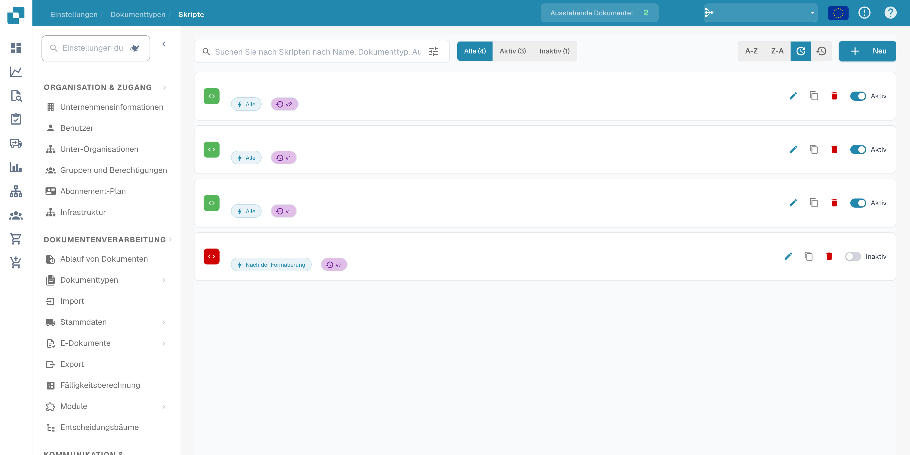
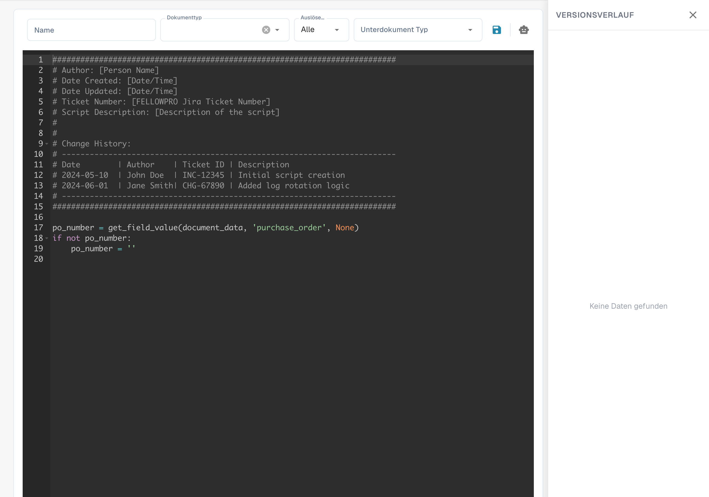

# Skripte

<figure><figcaption>
Skriptübersicht in deutscher Sprache; Namen und Datumsangaben sind ausgeblendet.
</figcaption></figure>


DocBits Document Scripts Explained: Automate Custom Logic in Your Document Workflow


#### Übersicht

Skripte in DocBits werden in der Regel in einer Skriptsprache geschrieben, die vom System Python unterstützt wird. Sie werden während des Dokumentenverarbeitungs-Workflows ausgelöst, um komplexe Geschäftslogik anzuwenden oder die Datenintegrität und -genauigkeit sicherzustellen, bevor die Daten weiterverarbeitet oder gespeichert werden.

#### Hauptfunktionen und Optionen

1. **Skriptverwaltung**:

* **Name**: Jedes Skript erhält einen eindeutigen Namen zur Identifizierung.
* **Dokumenttyp**: Ordnet das Skript einem bestimmten Dokumenttyp zu, der bestimmt, auf welche Dokumente das Skript angewendet wird.
* **Auslösen bei**: Definiert, wann das Skript ausgelöst wird (z. B. beim Hochladen von Dokumenten, vor dem Export von Daten, nach der Datenvalidierung).
* **Aktiver/Inaktiver Status**: Ermöglicht Administratoren, Skripte zu aktivieren oder zu deaktivieren, ohne sie zu löschen, was Flexibilität bei Tests und Bereitstellung bietet.

2. **Skript-Editor**:

* Bietet eine Benutzeroberfläche, in der Skripte geschrieben und bearbeitet werden können. Der Editor unterstützt in der Regel Syntaxhervorhebung, Fehlerhervorhebung und andere Funktionen zur Unterstützung bei der Skriptentwicklung.
* **Beispiel-Skript**: Skripte können Operationen wie das Durchlaufen von Rechnungszeilen zur Validierung von Summen oder zum Entfernen von Einträgen, die bestimmte Kriterien nicht erfüllen, enthalten.

<figure><figcaption>
Deutscher Skripteditor mit einem technischen Python-Beispiel.
</figcaption></figure>
