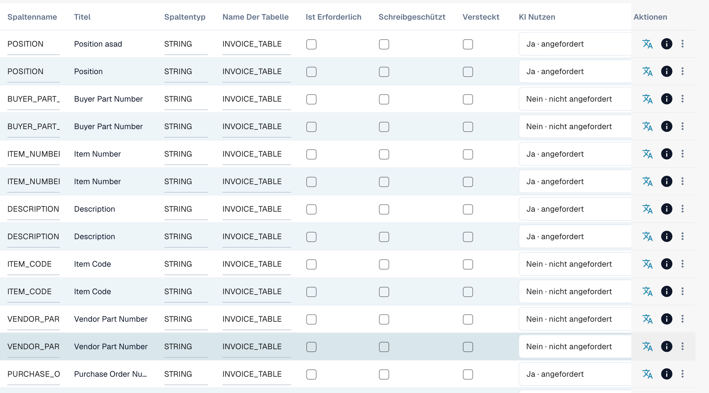

# Tabellenspalten

Tabellenspalten legen fest, welche Spalten die Positionstabelle eines Dokumenttyps hat: was DocBits in jede Spalte extrahiert, was der Benutzer in der Validierungsmaske sieht und was beim Export an das ERP gesendet wird.

**Wo:** Settings → Global Settings → Document Types → Table Columns

<figure><figcaption>
Table Columns: eine Zeile pro Spalte, die Flags werden direkt in der Liste umgeschaltet
</figcaption></figure>

## Was Sie sehen

Jede Zeile ist eine Spalte einer Tabelle. Die Liste zeigt:

| Spalte | Bedeutung |
|---|---|
| **Column name** | Technischer Name, aus dem Titel erzeugt (Großbuchstaben, Unterstriche). Wird in Skripten, Export-Mappings und der API verwendet. Kann später nicht geändert werden. |
| **Title** | Bezeichnung, die in der Validierungsmaske angezeigt wird. Ändern Sie sie mit dem Übersetzungs-Symbol in der Spalte *Actions* (*Update translation key*). |
| **Column Type** | `AMOUNT`, `STRING`, `DATE`, `NUMBER`, `BOOLEAN` oder `CURRENCY`. Bestimmt Validierung und Formatierung. |
| **Table name** | Die Tabelle, zu der die Spalte gehört, zum Beispiel `INVOICE_TABLE`. |
| **Is Required** | Das Dokument kann nicht freigegeben werden, solange diese Spalte in einer beliebigen Zeile leer ist. |
| **Read Only** | Benutzer sehen den Wert, können ihn aber nicht bearbeiten. |
| **Hidden** | Die Spalte wird weder angezeigt noch exportiert. Damit schalten Sie Standardspalten ab, die Sie nicht benötigen. |
| **Use AI** | Die KI-Tabellenextraktion füllt diese Spalte, auch wenn für einen Lieferanten trainierte Regeln vorhanden sind. |
| **Actions** | Übersetzungs-Symbol: Titel umbenennen. Info-Symbol: woher die angezeigte Bezeichnung stammt (Ihre Übersetzung, der Standard, der Schlüssel). Drei-Punkte-Menü: *Delete*, nur für Spalten, die Ihre Organisation angelegt hat; Standardspalten können nur ausgeblendet werden. |

Zwei Schaltflächen über der Liste:

* **Create new table**: eine zweite Positionstabelle für den Dokumenttyp (zum Beispiel eine Tabelle für Nebenkosten neben der Artikeltabelle).
* **Add new table column**: öffnet den Dialog, der unter [Neue Spalte hinzufügen](adding-a-new-column.md) beschrieben ist.

## Standardspalten und eigene Spalten

Jeder Dokumenttyp wird mit einer Reihe von Standardspalten ausgeliefert (für Rechnungen: Artikelnummer, Beschreibung, Menge, Einzelpreis, Gesamtbetrag, Steuer, …). Sie gehören zu DocBits und nicht zu Ihrer Organisation, daher können sie nicht gelöscht werden; blenden Sie sie stattdessen aus. Spalten, die Sie selbst hinzufügen, gehören zu Ihrer Organisation und können gelöscht werden.


**Änderungen gelten nur für neue Dokumente.** Eine Spalte, die Sie hinzufügen, ausblenden oder löschen, erscheint bei Dokumenten, die nach der Änderung hochgeladen oder neu gestartet werden. Dokumente, die sich bereits im Dashboard befinden, behalten ihre Tabelle so, wie sie extrahiert wurde. Starten Sie ein Dokument neu, um die neue Konfiguration zu übernehmen.


## Verwandte Seiten

* [Zweck und Verwendung](purpose-and-use.md): wo Tabellenspalten erscheinen
* [Neue Spalte hinzufügen](adding-a-new-column.md)
* [Spalten bearbeiten und löschen](editing-and-deleting-columns.md)
* [Best Practices](best-practices-2.md)
* [Fehlerbehebung](troubleshooting-1.md)
* [Training Line Fields / Table Training](../../../../setup/document-training/training-line-fields-table-training/README.md): DocBits beibringen, wo sich die Tabelle eines Lieferanten befindet
* [AI Table](../../../../../end-user-and-partner-section/end-user-section/ai-table/README.md): was der Benutzer in der Validierungsmaske sieht
