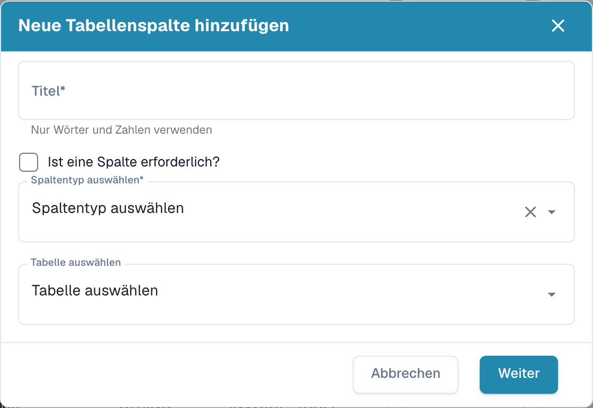

# Neue Spalte hinzufügen

Fügen Sie eine Spalte hinzu, wenn pro Position ein Wert erfasst werden muss, den die Standardspalten nicht abdecken, zum Beispiel eine Kostenstelle, eine Projektnummer oder eine interne Artikelnummer.

## Bevor Sie beginnen

* Entscheiden Sie, zu welcher **Tabelle** die Spalte gehört. Die meisten Dokumenttypen haben eine Tabelle (zum Beispiel `INVOICE_TABLE`). Ist die Liste leer, klicken Sie zuerst auf **Create new table**; der Dialog fragt nur nach einem Tabellennamen.
* Entscheiden Sie den **Typ**: `AMOUNT` für Geldbeträge, `NUMBER` für Mengen, `DATE`, `BOOLEAN` für Ja/Nein, `CURRENCY` für einen ISO-Währungscode, `STRING` für alles andere. Der Typ kann nach dem Speichern nicht mehr geändert werden.
* Prüfen Sie, ob bereits eine **Standardspalte** mit derselben Bedeutung existiert, aber ausgeblendet ist. Ausgeblendete Spalten stehen mit gesetztem Flag *Hidden* in der Liste; blenden Sie sie wieder ein, statt ein Duplikat anzulegen.

## Schritte

1. Öffnen Sie **Settings → Global Settings → Document Types → Table Columns**.
2. Klicken Sie auf **Add new table column**.

<figure><figcaption>
Dialog zum Hinzufügen einer neuen Tabellenspalte
</figcaption></figure>

3. Füllen Sie den Dialog aus:

| Feld | Was Sie eingeben |
|---|---|
| **Title** | Bezeichnung, die der Benutzer in der Validierungsmaske sieht, zum Beispiel `Cost Centre`. Nur Buchstaben und Zahlen. DocBits leitet daraus den technischen *Column name* ab (`COST_CENTRE`). |
| **Is column required?** | Aktivieren, wenn das Dokument nicht freigegeben werden darf, solange die Spalte in einer beliebigen Zeile leer ist. |
| **Select column type** | Siehe die Typenliste oben. |
| **Select Table** | Die Tabelle, die die Spalte erhält. |

4. Klicken Sie auf **Proceed**. Die Spalte erscheint in der Liste, wobei *Read Only*, *Hidden* und *Use AI* nicht gesetzt sind. Schalten Sie diese Flags bei Bedarf in der Liste um, siehe [Spalten bearbeiten und löschen](editing-and-deleting-columns.md).

## Nach dem Hinzufügen

* Die Spalte ist bei **bestehenden Dokumenten leer**. Sie wird bei Dokumenten gefüllt, die nach der Änderung hochgeladen oder neu gestartet werden.
* Bei Lieferanten mit **trainierten Regeln** öffnen Sie eines ihrer Dokumente im Tabellentraining und ordnen die neue Spalte zu, sonst bleibt die Spalte für diesen Lieferanten leer. Siehe [Tabellen und Spalten definieren](../../../../setup/document-training/training-line-fields-table-training/defining-tables-and-columns.md).
* Bei der **KI-Tabellenextraktion** füllt die KI die Spalte, wenn der Wert auf dem Dokument erkennbar ist. Markieren Sie die Spalte mit *Use AI*, wenn der Lieferant trainierte Regeln hat, diese Spalte aber trotzdem von der KI stammen soll.
* Fügen Sie die Spalte dem **Export-Mapping** hinzu, wenn das ERP sie erhalten soll, siehe [Export](../../../document-processing/export.md).

## Meldungen

| Meldung | Bedeutung |
|---|---|
| *Column name already exists* | Eine Spalte mit diesem technischen Namen ist bereits in der Tabelle vorhanden. Wählen Sie einen anderen Titel. |
| *Column name already exists – Please activate it in Table Column settings* | Eine ausgeblendete Standardspalte hat diesen Namen. Entfernen Sie deren Flag *Hidden*, statt eine neue Spalte anzulegen. |
| *No table exists. Please create table before creating columns.* | Der Dokumenttyp hat noch keine Tabelle: Klicken Sie zuerst auf **Create new table**. |
