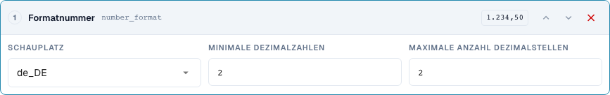
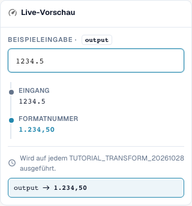

# Datum und Zahlen richtig formatieren

[Zurück zum vollständigen Praxisüberblick](praxisueberblick.md)

Textziel · date_format: %d.%m.%Y; number_format: de_DE, min. 2, max. 2 Nachkommastellen.

## Vorgehen im Editor

1. Für einen gut lesbaren ersten Versuch ein **Textziel** und den Schritt **Datum formatieren** verwenden. Ausgabemuster `%d.%m.%Y` und Eingabe `2026-10-28` einstellen; erwartet wird `28.10.2026`.
2. Die Varianten `%m/%d/%Y`, `%Y-%m-%d` und `%d %b %Y` jeweils mit derselben eindeutigen Eingabe vergleichen. Die Muster sind keine verlässliche Erkennung jedes beliebigen Datumsformats.
3. Mit `kein Datum` sowie einer mehrdeutigen Eingabe gegenprüfen. Beim echten DATE-Kopffeld zusätzlich den gespeicherten ISO-Wert und die sichtbare Darstellung getrennt kontrollieren.
4. In einer eigenen Regel **Zahl formatieren**, Gebietsschema `de_DE`, minimale und maximale Nachkommastellen jeweils 2 wählen. Die Servereingabe `1234.5` muss `1234,50` ergeben.
5. Mit `en_US` dieselbe Eingabe prüfen: Serverergebnis `1234.50`. Das Tausendertrennzeichen der geprüften Browservorschau wird serverseitig nicht geschrieben.
6. Null, einen negativen Betrag und zusätzliche Nachkommastellen prüfen. Anschließend Ausgabe erneut verarbeiten und den tatsächlich gespeicherten Wert kontrollieren.

<figure><figcaption>
Konfiguration der Schritte. Originalaufnahme der deutschen Oberfläche. Die Vorschau verändert keine gespeicherten Dokumente.
</figcaption></figure>

<figure><figcaption>
Live-Vorschau mit Schulungswert. Originalaufnahme der deutschen Oberfläche. Die Vorschau verändert keine gespeicherten Dokumente. Das sichtbare Tausendertrennzeichen gehört zur Browservorschau; der geprüfte Serverwert lautet 1234,50.
</figcaption></figure>

## 1. Datum und Datentyp

Datum neu formatieren schreibt ein Datum nach dem gewählten Muster. Ein eindeutiges ISO-Datum ist eine gute Testeingabe. Tag, Monat und Jahr lassen sich beispielsweise mit Punkten ausgeben. Bei einem echten Datumskopffeld kann der interne Wert im ISO-Format bleiben, während sich die Anzeige ändert. Ein Textfeld oder eine Tabellenzelle kann dagegen den formatierten Text enthalten. Deshalb vergleiche ich nicht nur das sichtbare Feld, sondern auch den gespeicherten Wert und die spätere Verwendung.

## 2. Unlesbare und mehrdeutige Daten

Ein unlesbares Datum wird nicht einfach erfunden. In meinem Servertest bleibt der Text unverändert, und das Ergebnis nennt den Grund. Mehrdeutige Angaben wie Tag und Monat mit kleinen Zahlen brauchen einen eindeutig vereinbarten Kontext. Ein formatiertes Datum darf beim nächsten Speichern nicht als ein anderer Tag gelesen werden. Ich prüfe deshalb einen zweiten Durchlauf. Aus einem beliebigen Text ohne gültiges Datum kann diese Transformation kein verlässliches Datum machen.

## 3. Zahlenformat

Zahlen formatieren verwendet ein Gebietsschema und eine minimale sowie maximale Zahl von Nachkommastellen. Das ändert Darstellung und gegebenenfalls Rundung, aber keinen Wechselkurs und keine Mengeneinheit. Für meine Eingabe tausendzweihundertvierunddreißig Komma fünf liefert der aktuelle Server mit zwei Nachkommastellen eine deutsche Kommaschreibweise oder eine englische Punktschreibweise. Ein Tausendertrennzeichen ist im geprüften Serverergebnis nicht enthalten. Ich übernehme deshalb keine schönere Browserdarstellung als Beweis für den Export. Null, negative Beträge, zusätzliche Nachkommastellen und der gespeicherte Ergebniswert brauchen eigene Tests.

## Geprüfte Beispiele und Gegenfälle

Diese Werte wurden serverseitig als trockener Test geprüft. Ein solcher Test verändert keine gespeicherten Dokumente.

| Fall | Eingabe | Serverergebnis |
| --- | --- | --- |
| date | `2026-10-28` | `28.10.2026` |
| date | `kein Datum` | `kein Datum` |
| number-de | `1234.5` | `1234,50` |
| number-us | `1234.5` | `1234.50` |

## Abnahme

Prüfen Sie einen passenden Fall, einen Gegenfall, einen leeren Wert und ein bereits verarbeitetes Ergebnis. Wiederholen Sie den Dokument-Speichervorgang. Prüfen Sie PO-Abgleich und ERP-Empfang zusätzlich, wenn sie zum fachlichen Ziel gehören.

Im geprüften Stand unterscheiden sich Zahlenvorschau und Server bei Tausendertrennzeichen. Die Tabelle nennt den tatsächlichen Serverwert.

## Videoanleitung


Datum und Zahlen richtig formatieren – Konfiguration, Beispiele und Gegenfälle.


[Video mit deutschen Untertiteln und Kapiteln öffnen](https://docbits-videos.fra1.cdn.digitaloceanspaces.com/settings-assistant/transformation-rules-06-dates-and-numbers-preview-admin/v1/de.html). Die fachliche und vollständige Hörprüfung dieser Reviewfassung steht noch aus.
