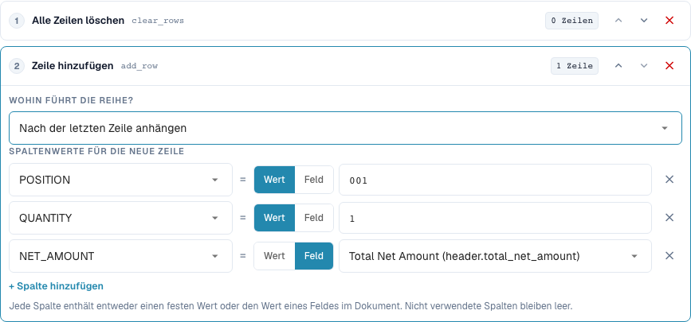
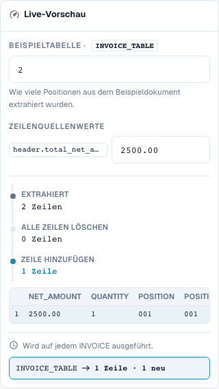

# Tabellenzeilen neu aufbauen

[Zurück zum vollständigen Praxisüberblick](praxisueberblick.md)

Tabelle INVOICE_TABLE · clear_rows → add_row am Ende · POSITION=001, QUANTITY=1, NET_AMOUNT aus header.total_net_amount.

## Vorgehen im Editor

1. Geltungsbereich **Tabellenzeilen** und die konkrete Tabelle `INVOICE_TABLE` wählen. Eine passende Lieferantenbedingung begrenzt den vollständigen Neuaufbau.
2. Zuerst **Alle Zeilen löschen**, danach **Zeile hinzufügen** konfigurieren. Für die neue Zeile Festwerte `POSITION=001`, `QUANTITY=1` und für `NET_AMOUNT` die Quelle `header.total_net_amount` einstellen.
3. Mit Kopfbetrag `2500.00` und zwei vorhandenen Zeilen testen: Es bleibt genau die neu definierte Gesamtzeile. Auch einen fehlenden Kopfbetrag prüfen, bevor die Regel aktiv wird.
4. Beim Hinzufügen die Position vor bzw. nach der ersten Zeile vergleichen. Für diese Positionsprobe das vorherige Löschen entfernen oder gesondert testen, sonst gibt es keine vorhandene Zeile als Bezug.
5. Die umgekehrte Schrittreihenfolge **Hinzufügen → Löschen** absichtlich als Gegenfall prüfen: Das Ergebnis ist leer. Danach wieder die beabsichtigte Reihenfolge herstellen.
6. Zweimaliges Speichern prüfen. Hinzufügen ohne vorheriges Löschen kann Zeilen vervielfachen; ein Neuaufbau kann Lieferantenpositionen fachlich unwiederbringlich aus dem Arbeitsergebnis entfernen. Den Bestellabgleich separat abnehmen.

<figure><figcaption>
Konfiguration der Schritte. Originalaufnahme der deutschen Oberfläche. Die Vorschau verändert keine gespeicherten Dokumente.
</figcaption></figure>

<figure><figcaption>
Live-Vorschau mit Schulungswert. Originalaufnahme der deutschen Oberfläche. Die Vorschau verändert keine gespeicherten Dokumente.
</figcaption></figure>

## 1. Zeilen aufbauen

Alle Zeilen löschen entfernt die vorhandenen Zeilen der ausgewählten Tabelle. Zeile hinzufügen baut anschließend eine neue Zeile auf. Für jede Spalte wähle ich entweder einen festen Wert oder den Wert eines Kopffelds. In meinem Beispiel entsteht eine Gesamtposition mit Menge eins und einem Nettobetrag aus dem Rechnungskopf. Nicht befüllte Spalten bleiben leer. Die neue Zeile kann am Anfang oder am Ende stehen. Das ist keine automatische Gruppierung oder Summierung ausgewählter vorhandener Positionen.

## 2. Schrittreihenfolge

Die Reihenfolge ist entscheidend. Löschen und danach hinzufügen ergibt die gewünschte neue Zeile. Hinzufügen und danach löschen entfernt auch die gerade erzeugte Zeile. Ohne vorausgehendes Löschen würde ein weiterer Durchlauf noch eine Zeile anhängen. Dafür verlangt die Regel eine passende Einmalausführung. Eine Vorschau mit einer Zeilenzahl prüft die Struktur, ersetzt aber noch keinen Test mit einer echten extrahierten Tabelle. Ich kontrolliere die Spaltenwerte und die Zeilenzahl nach dem Speichern.

## 3. Bestellabgleich getrennt prüfen

Eine Tabellenregel läuft vor den Spaltenregeln. Eine nachgelagerte Spaltenregel kann deshalb auch neu hinzugefügte Zeilen bereinigen. Das Neuaufbauen von Positionen kann bestehende Zeilenkennungen und Bestellzuordnungen verändern. Für eine Rechnung, die bewusst auf den Gesamtbetrag abgeglichen wird, brauche ich zusätzlich die passende Bestellabgleichsregel. Die Transformation allein bestätigt keinen vollständigen Abgleich. Ich teste das nur mit einem isolierten Beleg und prüfe nach erneutem Speichern die Zeilenzahl und den Abgleichsstatus getrennt.

## Abnahme

Prüfen Sie einen passenden Fall, einen Gegenfall, einen leeren Wert und ein bereits verarbeitetes Ergebnis. Wiederholen Sie den Dokument-Speichervorgang. Prüfen Sie PO-Abgleich und ERP-Empfang zusätzlich, wenn sie zum fachlichen Ziel gehören.

## Videoanleitung


Tabellenzeilen neu aufbauen – Konfiguration, Beispiele und Gegenfälle.


[Video mit deutschen Untertiteln und Kapiteln öffnen](https://docbits-videos.fra1.cdn.digitaloceanspaces.com/settings-assistant/transformation-rules-08-table-rows-preview-admin/v1/de.html). Die fachliche und vollständige Hörprüfung dieser Reviewfassung steht noch aus.
