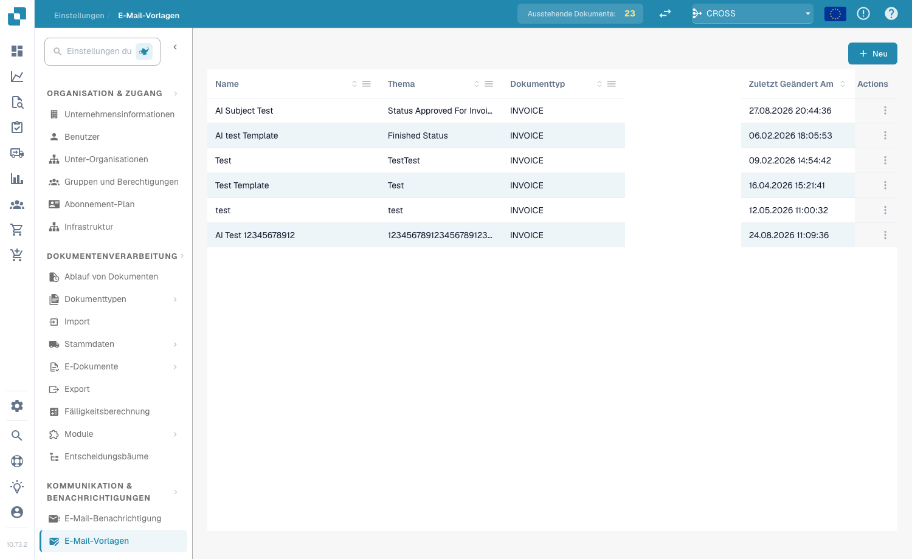
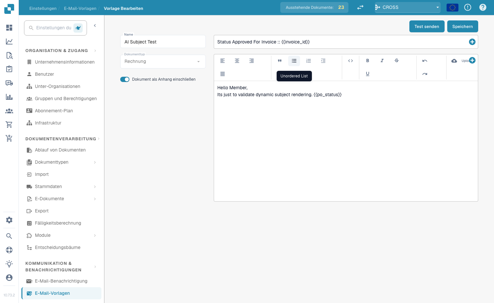
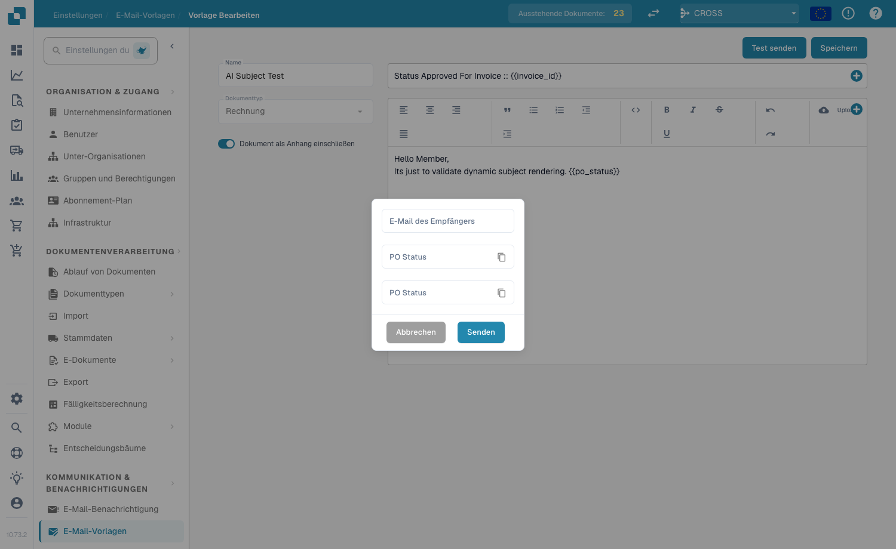

# E-Mail-Vorlagen

## **Überblick**

Mit E-Mail-Vorlagen passen Sie die automatisierten E-Mails an, die DocBits versendet — zum Beispiel Genehmigungserinnerungen oder Fehlerbenachrichtigungen. Eine Vorlage definiert Betreffzeile und Inhalt und kann dynamische Felder (z. B. `{{InvoiceNumber}}`), Bilder und Rich-Text-Formatierungen enthalten.

## **Zugriff auf E-Mail-Vorlagen**

Navigieren Sie zu **Einstellungen → Communication & Notifications → Email Templates**. Die Liste zeigt jede Vorlage mit **Name**, **Betreff**, **Dokumenttyp**, Datum der **letzten Änderung** und **Aktionen** (Bearbeiten oder Löschen).

<figure><figcaption>
Die Liste der E-Mail-Vorlagen
</figcaption></figure>

## **Eine Vorlage erstellen**

1. Klicken Sie oben rechts auf **+ New**.
2. Füllen Sie die Felder aus:
   * **Name** — eine aussagekräftige Bezeichnung (z. B. „Document Error Notification“).
   * **Document Type** — der Dokumenttyp, für den die Vorlage gilt (z. B. `INVOICE`).
   * **Include Document As Attachment** — aktivieren Sie diesen Schalter, um das Quelldokument an die E-Mail anzuhängen.
   * **Subject** — die Betreffzeile der E-Mail. Klicken Sie auf die Schaltfläche **+** neben dem Feld, um ein dynamisches Feld einzufügen, oder geben Sie `{{FieldID}}` direkt ein.
3. Gestalten Sie den Inhalt im Rich-Text-Editor — formatieren Sie Text (fett, kursiv, Listen, Ausrichtung), fügen Sie Bilder mit **Upload** ein, bearbeiten Sie den rohen HTML-Code mit der Schaltfläche `<>` und fügen Sie mit der Schaltfläche **+** dynamische Felder ein.
4. Klicken Sie auf **Save**.

<figure><figcaption>
Der Vorlagen-Editor — Name, Dokumenttyp, Anhang-Schalter, Betreff und Rich-Text-Inhalt
</figcaption></figure>

## **Dynamische Felder**

Dynamische Felder werden beim Versand der E-Mail durch Dokumentdaten ersetzt. Fügen Sie sie mit der Schaltfläche **+** ein oder geben Sie sie manuell in doppelten geschweiften Klammern ein:

* `{{invoice_id}}` — die Rechnungsnummer
* `{{supplier_name}}` — der Name des Lieferanten
* `{{total_amount}}` — der Gesamtbetrag
* `{{status}}` — der aktuelle Dokumentstatus

## **Eine Test-E-Mail senden**

Klicken Sie im Editor auf **Send Test**, geben Sie eine **Receiver Email**-Adresse ein und klicken Sie auf **Send**. DocBits sendet eine Vorschau der Vorlage, sodass Sie vor dem Speichern das Layout prüfen und kontrollieren können, ob die dynamischen Felder korrekt aufgelöst werden.

<figure><figcaption>
Der Dialog Send Test
</figcaption></figure>

## **Vorlagen in Benachrichtigungen verwenden**

Gespeicherte Vorlagen können mit [**E-Mail-Benachrichtigungs**](email-notification/)-Workflows verknüpft werden — zum Beispiel Genehmigungserinnerungen oder Statusänderungs-Updates.
