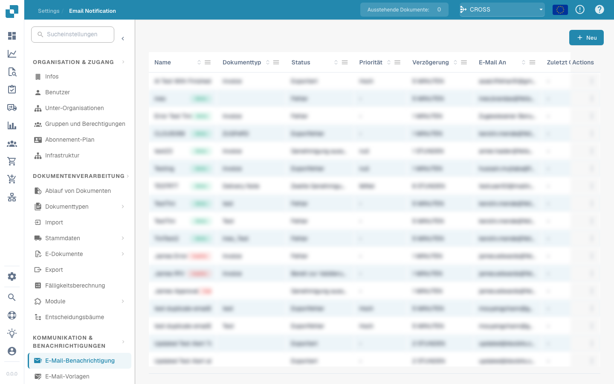

# E-Mail-Benachrichtigungen


DocBits-Anleitung zu Aufgaben und Benachrichtigungen: Arbeit zuweisen, Status verfolgen und Workflow-Aufgaben bearbeiten


<figure><figcaption></figcaption></figure>

E-Mail-Benachrichtigungen in DocBits informieren Benutzer über dokumentbezogene Ereignisse, beispielsweise abgeschlossene Verarbeitung, Import- oder Exportfehler und erforderliche Benutzereingriffe. Eine passende Konfiguration unterstützt die Kommunikation und den kontinuierlichen Betrieb der Dokumentenverarbeitung.

**Kommunikation in Echtzeit:**

* E-Mail-Hinweise informieren die beteiligten Benutzer unmittelbar über wichtige Ereignisse und Änderungen im Dokumentenmanagement.

**Transparenz und Nachvollziehbarkeit:**

* Benachrichtigungen helfen, den Status von Verarbeitungsvorgängen zu verfolgen und zu überwachen.

**Rechtzeitige Reaktionen:**

* Automatische Hinweise auf Dokumentfreigaben, Kommentare oder Genehmigungen ermöglichen eine schnelle Reaktion auf Anfragen und Aktualisierungen. Das erhöht Effizienz und Produktivität.

**Automatisierte Workflows:**

* E-Mail-Benachrichtigungen lassen sich in Workflows einbinden, um bei bestimmten Aktionen automatisch die zuständigen Benutzer zu informieren.

**Erinnerungen und Fristen:**

* Die Konfiguration kann Benutzer an bevorstehende Fristen oder offene Aufgaben erinnern und so deren rechtzeitige Erledigung unterstützen.

Automatische Benachrichtigungen verbessern die Kommunikation und helfen, Dokumentvorgänge rechtzeitig zu bearbeiten. Wichtige Informationen erreichen die zuständigen Personen und unterstützen schnelle Entscheidungen sowie eine effiziente Verwaltung der Dokumenten-Workflows.
