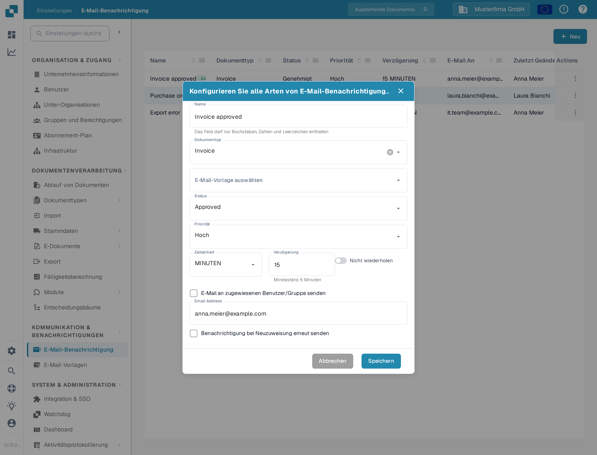
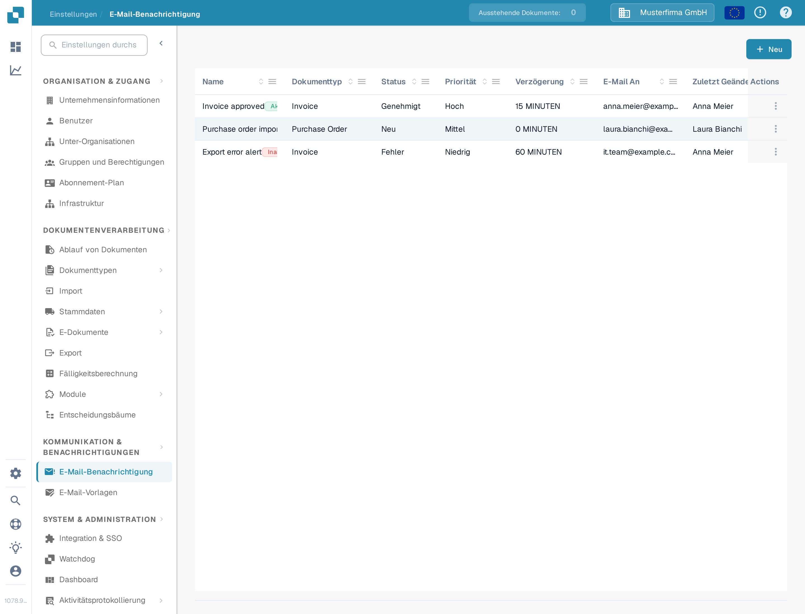
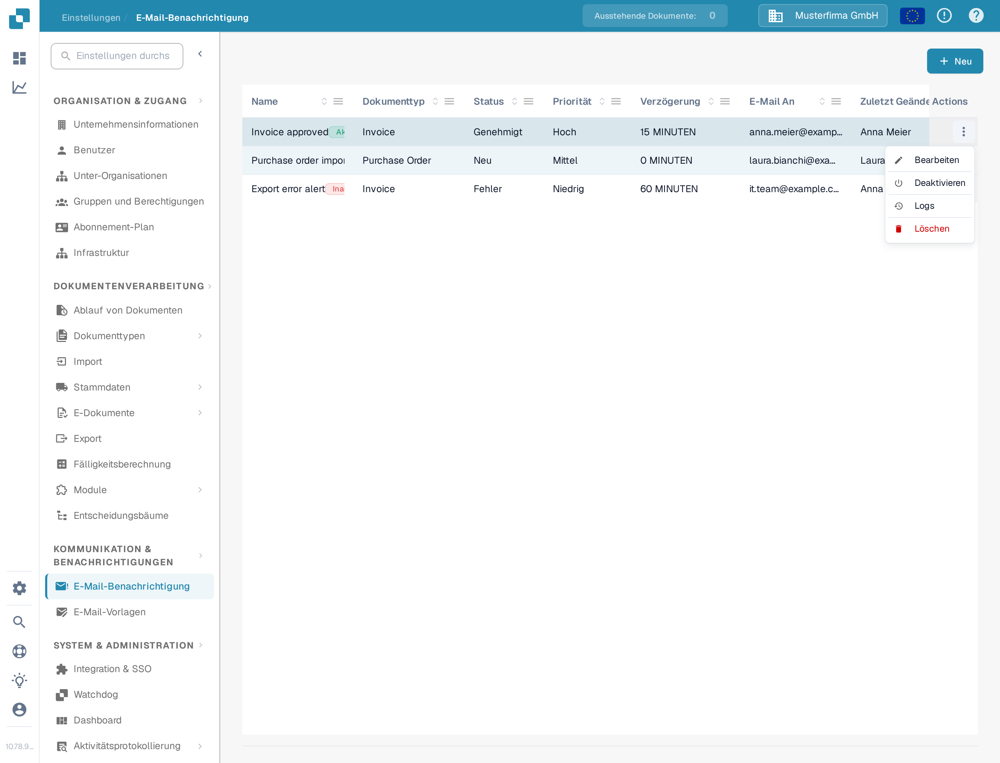

# Benachrichtigungen verwalten

Öffnen Sie **Einstellungen → E-Mail-Benachrichtigung**, um die Regeln für Ihre Organisation zu sehen. Eine Regel verknüpft einen Dokumentstatus mit einer E-Mail-Vorlage und einem Empfänger. Das folgende Beispiel verwendet eine Demonstrationsregel für Rechnungen und bleibt in der DocBits-Sandbox **inaktiv**.

## Beispiel: Eine Rechnung ist bereit zur Validierung

Bevor Sie eine Regel erstellen, bereiten Sie eine E-Mail-Vorlage für **Invoice** unter **Einstellungen → E-Mail-Vorlagen** vor. In diesem Beispiel heißt die Vorlage **Docs Demo Invoice Notification**. Die Vorlage liefert den E-Mail-Betreff und die Nachricht.

1. Wählen Sie auf der Seite **E-Mail-Benachrichtigung** **+ Neu** aus.
2. Geben Sie **Docs Demo Invoice Validation** als Namen ein, wählen Sie **Invoice** als Dokumenttyp und wählen Sie die vorbereitete E-Mail-Vorlage aus.
3. Wählen Sie **Ready for validation** als Status und **Medium** als Priorität. Setzen Sie **Zeiteinheit** auf **MINUTEN** und **Verzögerung** auf **10**. Die Mindestverzögerung für Minuten beträgt fünf.
4. Wählen Sie **E-Mail an zugewiesenen Benutzer/Gruppe senden**. Aktivieren Sie **Nicht wiederholen**, wenn die Nachricht nur einmal gesendet werden soll. Prüfen Sie Empfänger und Timing und wählen Sie dann **Speichern**.

<figure><figcaption>
Die gespeicherte Beispielregel im Bearbeitungsdialog. Ihre Werte zeigen, wann und an wen die Benachrichtigung gesendet würde.
</figcaption></figure>

Die Regel erscheint nun in der Liste. Das Dokumentationsbeispiel wurde danach deaktiviert, daher bietet sein **Actions**-Menü **Aktivieren** an. Prüfen Sie Name, Dokumenttyp, Status, Verzögerung und Empfänger in Ihrer eigenen Liste, bevor Sie eine Regel aktivieren.

<figure><figcaption>
Die Liste zeigt die gespeicherten Regeln, die Sie finden und verwalten können.
</figcaption></figure>

## Regel bearbeiten, aktivieren oder löschen

Öffnen Sie das **Actions**-Menü der Zeile. **Bearbeiten** öffnet die Regel mit ihren aktuellen Werten. **Aktivieren** schaltet dieses inaktive Beispiel ein; eine aktive Regel bietet stattdessen **Deaktivieren** an. **Logs** öffnet den Benachrichtigungsverlauf der Regel. **Löschen** entfernt die Regel nach einer Bestätigung. Prüfen Sie Empfänger und Timing, bevor Sie eine Regel aktivieren oder ändern.

<figure><figcaption>
Die verfügbaren Aktionen hängen davon ab, ob die Regel aktiv ist.
</figcaption></figure>

Wenn die Liste **No Record Found!** anzeigt, erstellen Sie zuerst eine Regel. Wenn die Liste **Dokumenttyp** oder die E-Mail-Vorlagen leer ist, konfigurieren Sie einen aktiven Dokumenttyp und eine passende Vorlage, bevor Sie zu diesem Formular zurückkehren.

Weitere Informationen zur Ersteinrichtung finden Sie unter [Benachrichtigungen konfigurieren](configuring-notifications.md). Wenn E-Mails nicht wie erwartet ankommen, lesen Sie [Fehlerbehebung](troubleshooting.md).
