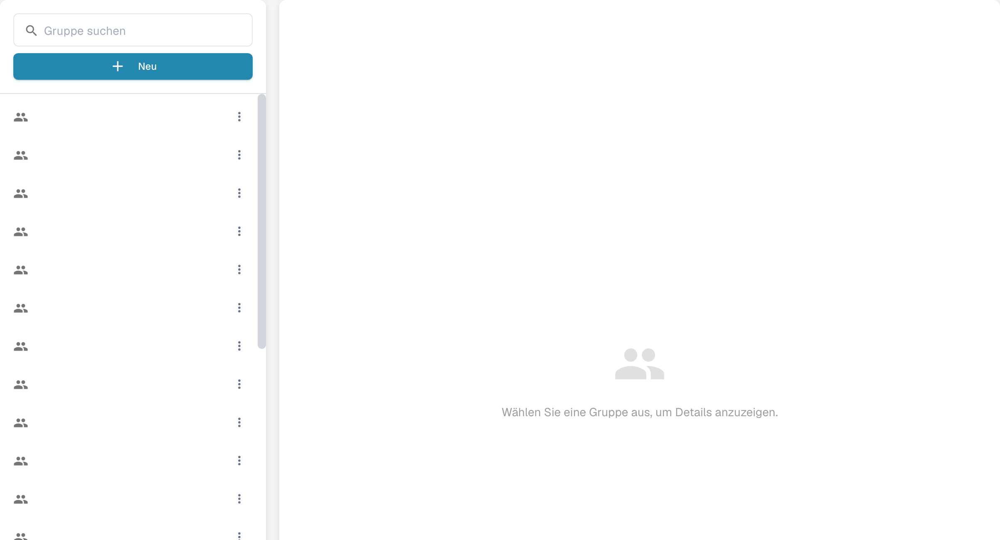

# Gruppen, Benutzer und Berechtigungen

## Gruppe anlegen und Dokumentzugriff testen

Bei bereits aktivierten Gruppenberechtigungen legen Sie eine eigene Prüfergruppe an und fügen ein Testkonto ohne Administratorrechte hinzu. Erlauben Sie das Auflisten, Anzeigen und Bearbeiten zugewiesener Rechnungen; Löschen, Massenänderungen und Genehmigungen bleiben gesperrt. Speichern Sie, öffnen Sie die Einstellungen erneut und melden Sie sich als normaler Benutzer an: Die zugewiesene Rechnung ist sichtbar, ein nicht zugewiesenes Kontrolldokument nicht.



[Mit Untertiteln ansehen](https://docbits-videos.fra1.cdn.digitaloceanspaces.com/settings-assistant/groups-permissions-admin/v1/de.html)

Diese Einstellungen beantworten drei verschiedene Fragen: Wer kann sich anmelden, in welcher Unterorganisation arbeitet er, und was darf seine Gruppe tun.

| Wenn Sie … möchten | Öffnen Sie … |
| --- | --- |
| das Konto einer Person hinzufügen oder bearbeiten | **Einstellungen** → **Benutzer**; lesen Sie dann [Benutzer](users/README.md). |
| den Zugriff über Unternehmenseinheiten hinweg organisieren | **Einstellungen** → **Unter-Organisationen**; lesen Sie dann [Unter-Organisationen](sub-organizations/README.md). |
| den Zugriff über Gruppen steuern | **Einstellungen** → **Gruppen und Berechtigungen**; lesen Sie dann [Gruppen und Berechtigungen](groups-and-permissions/README.md). |

<figure><figcaption>Deutsche Gruppenübersicht. Wählen Sie links eine Gruppe aus, um rechts ihre Details zu sehen. Gruppennamen sind ausgeblendet.</figcaption></figure>

Wenn ein Benutzer ein Dokument oder eine Aktion nicht sehen kann, prüfen Sie zuerst sein Konto und seine Organisation. Prüfen Sie danach die Berechtigungen der zugehörigen Gruppe. Verwenden Sie ein Testkonto ohne Administratorrechte, um zu bestätigen, welchen Zugriff ein normaler Benutzer tatsächlich hat, bevor Sie eine produktive Organisation ändern.
